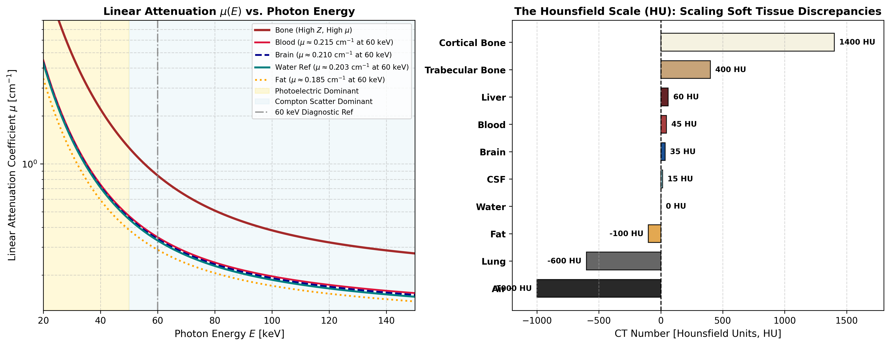
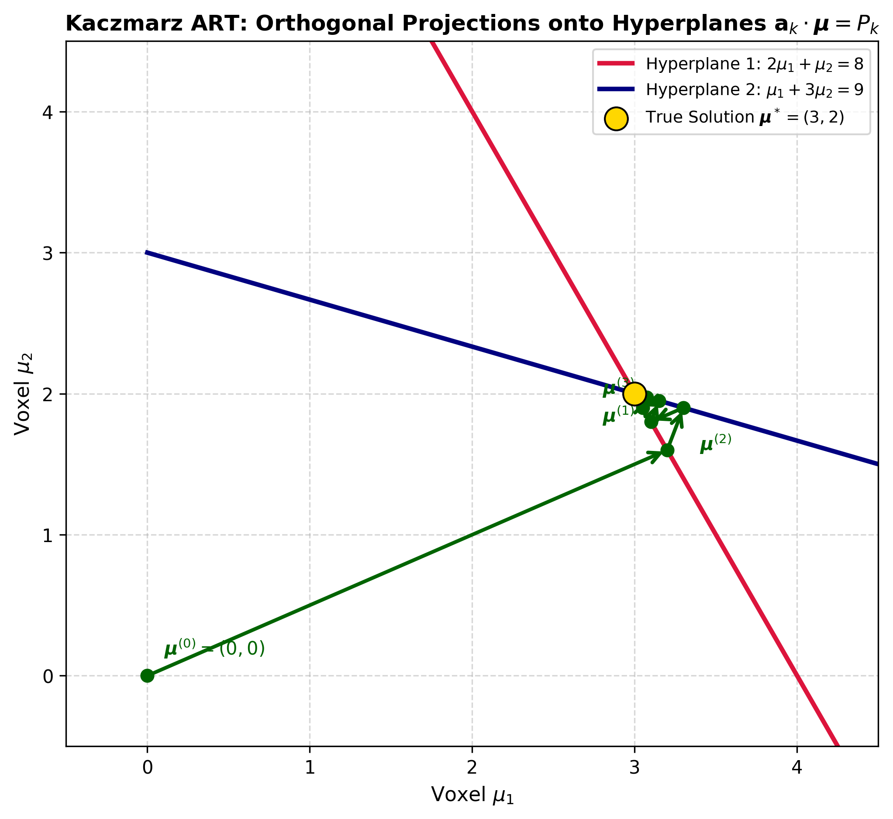
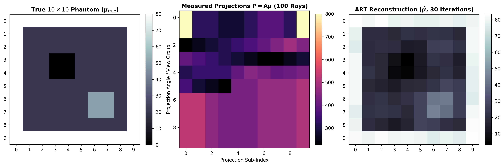

# Computed Tomography I: Lectures 1 & 2 Master Study Notes
**Course:** Computed Tomography I – Methods on CT (OVGU Magdeburg, WiSe 2026/27)  
**Lecturers:** Prof. Dr. Georg Rose & Dr. rer. medic. Martin Volk (Institute of Medical Engineering / LMT)  
**Modules Covered:** Introduction to CT, Physical Basics of X-rays, Instrumentation, Extinction & Lambert-Beer, The Hounsfield Scale & Windowing, Discrete Inverse Problem, Algebraic Reconstruction Technique (ART / Kaczmarz), and Mathematical Bridge to Tutorial 1.  
**Sources:** `Introduction.pdf` (Handwritten Notes), `Lecture 2.pdf` (Handwritten Notes), `CT-1-Einführung_Englisch.pdf` (Lecture Slides), `Tutorial 1.pdf`, Hansen et al. (SIAM 2021), Kak & Slaney (SIAM 1988).

---

## 1. The Tomographic Mindset: Why Computed Tomography?

### 1.1 The Clinical Imperative: Non-Destructive Inspection
> *"We are curious how we, other people, animals, etc. look inside... but we don’t like to (be) hurt! Traditionally, the inspection of the inside of objects causes destruction."*  
> — Prof. Georg Rose (Lecture 1, Slide 6)

The historical challenge of medicine was that looking inside living human anatomy required physical dissection or surgical trauma. Medical imaging exists to resolve this fundamental paradox: **to obtain spatially resolved maps of internal morphology, pathology, and tissue composition completely non-invasively**, while strictly minimizing ionizing radiation detriment under the **ALARA** (*As Low As Reasonably Achievable*) principle.

### 1.2 Projection Radiography vs. Computed Tomography: The Superposition Dilemma
Conventional planar X-ray radiography (Röntgen, 1895) operates by passing an X-ray beam through the patient onto a planar detector, forming a 2D shadowgram. It suffers from two fatal physical limitations:

```
[ Conventional Planar Radiography: Depth Collapse & Shadowing ]
X-ray Source ───► [ High-Density Rib ] ───► [ Subtle Tumor ] ───► Detector Screen
                  (Linear Attenuation μ_1)  (Attenuation μ_2)
                  └─────────────────────────┴─────────────────► Superimposed 1D Line
                                                                Tumor completely obscured!

[ Computed Tomography: Multi-Angular Angular Sampling & Slice Reconstruction ]
Rotational Gantry: Angular perspectives θ ∈ [0, π)
   θ = 0°   ──► [ Cross-Sectional Slice f(x,y) ] ──► Extinction Profile p(0°, s)
   θ = 45°  ──► [ Cross-Sectional Slice f(x,y) ] ──► Extinction Profile p(45°, s)
   θ = 90°  ──► [ Cross-Sectional Slice f(x,y) ] ──► Extinction Profile p(90°, s)
Reconstruction Algorithm (ART / FBP) ═══════════════► Pure 2D Axial Slice μ(x,y)
                                                      (No anatomical superposition!)
```

1. **Information Loss (Depth Collapse):**
   A 3D patient volume $f(x,y,z)$ is collapsed onto a 2D detector. The depth coordinate $z$ along each ray trajectory is integrated away:
   $$I(u, v) = I_0(u, v) \exp\left( -\int_{\text{ray}} \mu(x, y, z) \, dz \right)$$
   A thin layer of dense cortical bone and a thick section of soft adipose tissue can produce identical detector attenuation.
2. **The Superposition (Masking) Problem:**
   Radiodense structures (e.g., ribs, spine, sternum) cast dense radiographic shadows that completely mask underlying low-contrast soft-tissue pathology (e.g., small pulmonary nodules, early-stage hepatic metastases, or intracranial aneurysms). Radiography reveals only the dominant absorbing structure along the path.

### 1.3 The Tomographic Paradigm Shift
Computed Tomography resolves the superposition problem by acquiring projection profiles from many rotational angles $\theta$ around the patient's longitudinal ($z$) axis:
* **True Cross-Sectional (Axial) Slices:** Each reconstructed voxel represents the true, isolated local linear attenuation coefficient $\mu(x, y)$ of a discrete anatomical volume element. Structures in front of or behind the slice plane are eliminated.
* **3D Volumetric Imaging & Advanced Post-Processing:** Slices can be stacked into a continuous 3D scalar volume $V(x,y,z)$, enabling Multiplanar Reformation (MPR: sagittal, coronal, oblique), Maximum Intensity Projection (MIP for angiography), and 3D Volume Rendering (VRT).
* **Demonstrated Clinical Case Studies (Lecture 1):**
  * *Intracranial Aneurysm Detection:* Visualizing cerebral arterial aneurysms using iodinated contrast agent and digital bone subtraction to prevent fatal hemorrhagic stroke.
  * *Virtual Colonoscopy / Endoscopy:* Navigating a "virtual journey through the colon" to identify endoluminal adenomatous polyps without invasive optical colonoscopy.
* **Resolution vs. Radiation Dose Trade-Off:**
  * From 1974 ($80 \times 80$ matrix, $\sim 5\text{ min/slice}$) to modern multi-slice spiral CT ($512 \times 512$ or $1024 \times 1024$, sub-millimeter isotropic voxels, $<0.25\text{ s}$ gantry rotation).
  * *The Physical Cost:* Radiation dose scales inversely with the fourth power of spatial resolution:
    $$\text{Dose} \propto \frac{\text{SNR}^2}{\Delta x^3 \cdot \Delta z}$$
    Halving the voxel size in all dimensions requires an $8\times$ to $16\times$ radiation dose increase to maintain constant image noise.

---

## 2. Physical Foundations of X-rays & Interaction Mechanisms (Lecture 1)

### 2.1 Wave-Particle Duality & Medical Energy Window
X-rays are high-frequency electromagnetic radiation exhibiting wave-particle duality:

```
                  The Electromagnetic Spectrum & Diagnostic CT
◄─────────────────────────────────────────────────────────────────────────────►
  Radio / Microwave     Infrared      Visible       UV        X-rays       Gamma
  λ ~ 1 m - 1 mm      λ ~ 700 nm    λ ~ 400 nm   λ ~ 10 nm   λ ~ 10 pm    λ < 1 pm
─────────────────────────────────────────────────────────────────────────────►
                                                    │ Diagnostic CT │
                                                    │  20 - 150 keV │
                                                    └───────────────┘
```

1. **Wave Nature:** Described by Maxwell's equations:
   $$c = \lambda \cdot f \implies \lambda = \frac{c}{f}$$
   * Speed of light: $c \approx 3 \times 10^8 \text{ m/s}$
   * Wavelength range: $\lambda \approx 3 \times 10^{-8} \text{ m} - 3 \times 10^{-11} \text{ m}$ ($30\text{ nm} - 0.03\text{ nm}$)
   * Frequency range: $f \approx 10^5\text{ GHz} - 10^{10}\text{ GHz}$ ($10^{14}\text{ Hz} - 10^{19}\text{ Hz}$)
2. **Particle Nature (Photons):** Transports discrete energy quanta:
   $$E = h \cdot f = \frac{h \cdot c}{\lambda}$$
   * Planck constant: $h \approx 6.626 \times 10^{-34} \text{ J}\cdot\text{s} = 4.136 \times 10^{-21} \text{ MeV}\cdot\text{s}$
   * Energy unit conversion: $1\text{ eV} = 1.602 \times 10^{-19} \text{ J}$
   * Total X-ray spectrum: $42\text{ eV} \le E \le 500\text{ keV}$
   * **Diagnostic Medical Imaging Range:** $20\text{ keV} \le E \le 150\text{ keV}$

> [!IMPORTANT]
> **Ionizing Radiation Risk:** Photon energies in diagnostic CT ($20 - 150\text{ keV}$) vastly exceed molecular binding energies (e.g., $13.6\text{ eV}$ for hydrogen ionization). X-rays liberate orbital electrons, create free radicals, and break chemical bonds in DNA, mandating strict legal dose thresholds and justification for every scan.

### 2.2 Soft vs. Hard X-rays: Clinical Specialization

| Property | Soft X-rays | Hard X-rays |
| :--- | :--- | :--- |
| **Photon Energy ($E$)** | $15\text{ keV} - 60\text{ keV}$ | $60\text{ keV} - 150\text{ keV}$ |
| **Wavelength ($\lambda$)** | $0.08\text{ nm} - 0.02\text{ nm}$ (Longer) | $0.02\text{ nm} - 0.008\text{ nm}$ (Shorter) |
| **Attenuation ($\mu$)** | Very high (absorbed quickly) | Moderate to low (deep penetration) |
| **Dominant Interaction** | Photoelectric absorption ($\propto Z^3/E^3$) | Compton scattering ($\propto \rho_e$) |
| **Primary Clinical Application** | **Mammography** ($25 - 35\text{ kVp}$), soft specimen radiography | **Computed Tomography** ($80 - 140\text{ kVp}$), chest & body imaging |
| **Clinical Role in Body CT** | **Harmful:** Causes surface skin dose without penetrating to the detector | **Essential:** Provides sufficient transmission through the torso to form diagnostic images |

### 2.3 The Source Spectrum: Polychromatic Reality & Pre-Filtration
* **The Theoretical Assumption:** Reconstruction mathematics assumes a single monochromatic photon energy $E_0$.
* **The Physical Reality:** X-ray tubes emit a broad **polychromatic spectrum** consisting of:
  1. *Bremsstrahlung (Deceleration Radiation):* Continuous spectrum from $E=0$ up to $E_{\max} = e \cdot U_a$ (tube potential in $\text{kVp}$).
  2. *Characteristic Radiation:* Discrete spectral lines from tungsten target electron shell transitions (e.g., $K_\alpha \approx 59\text{ keV}$, $K_\beta \approx 67\text{ keV}$).
* **Pre-Patient Filtration (Hardening at Source):** Soft photons under $30\text{ keV}$ have near-zero chance of penetrating a $30\text{ cm}$ patient torso. They contribute $0\%$ to image formation but $100\%$ to skin dose. Metal filters ($2.5 - 7\text{ mm}$ Aluminum equivalent, Copper, and Bowtie filters) absorb these low-energy photons at the tube output, shifting the mean energy upwards (e.g., from $40\text{ keV}$ to $\sim 70\text{ keV}$ for a $120\text{ kVp}$ tube).

---

## 3. Attenuation Physics & The Compton Scatter Crisis

### 3.1 Total Linear Attenuation Coefficient ($\mu$)
As photons pass through matter, the total linear attenuation coefficient $\mu$ is the sum of independent quantum cross-sections:
$$\mu = \tau_{\text{photo}} + \sigma_{\text{compton}} + \sigma_{\text{rayleigh}} + \kappa_{\text{pair}}$$

```
Attenuation Cross-Sections for Biological Soft Tissue (Water) vs. Energy
  μ [cm⁻¹]
    ▲
10.0┼── Photoelectric Effect (τ ∝ Z³/E³)
    │  \
 1.0┼───\──────┐
    │    \     └──────── Compton Scattering (σ ∝ ρ_e) ───┐
 0.1┼─────\───────────────────────────────────────────────┴────
    │      \
0.01┼───────\─────────────────────────────── Pair Production (κ: E > 1.022 MeV)
    └────────┴──────────────┴───────────────┴───────────────► E [keV]
            10              60             150            1000
                     [ Diagnostic CT Range ]
```

1. **Photoelectric Absorption ($\tau$):**
   * Photon is completely absorbed, ejecting an inner-shell photoelectron.
   * Cross-section: $\tau \propto \rho \cdot \frac{Z^3 \text{ to } Z^4}{E^3}$.
   * Extremely sensitive to atomic number $Z$: Excellent for differentiating bone ($Z_{\text{eff}} \approx 13.8$) and iodine ($Z=53$) from tissue ($Z_{\text{eff}} \approx 7.4$).
   * Drops rapidly with increasing energy ($1/E^3$): at $20\text{ keV}$, water absorbs photons $20\times$ more strongly than at $60\text{ keV}$.
2. **Compton Scattering ($\sigma$):**
   * Photon inelastically collides with an outer-shell quasifree electron, deflecting at an angle $\theta$ with reduced energy $E'$.
   * Cross-section: $\sigma \propto \rho \cdot \frac{Z}{A} \approx \rho \cdot \rho_e$ (proportional to electron density and mass density; independent of $Z$).
   * **Dominance in CT:** In soft tissue, Compton scattering surpasses photoelectric absorption above **$26\text{ keV}$**. In diagnostic body CT ($80 - 140\text{ kVp}$, effective energy $\sim 60 - 75\text{ keV}$), **Compton scattering accounts for $>90\%$ of all interactions!**
3. **Rayleigh (Coherent) Scattering:** Elastic deflection without ionization ($<5-10\%$ in CT).
4. **Pair Production ($\kappa$):** Conversion of photon into an electron-positron pair in nuclear Coulomb field. Requires kinematic threshold $E \ge 2 m_e c^2 = 1.022\text{ MeV}$. **Completely impossible in diagnostic CT ($E_{\max} \le 150\text{ keV}$).**

### 3.2 The Compton Scatter Crisis in CT Instrumentation
Detectors in clinical CT are **energy-integrating detectors (EIDs)**. They record total deposited energy and cannot distinguish a primary ballistic photon from an obliquely scattered Compton photon:
$$I_{\text{measured}}(\theta, s) = I_{\text{primary}}(\theta, s) + I_{\text{scatter}}(\theta, s)$$

```
Focal Spot (Source S)
      │ \
      │  \ Primary Ray (Ballistic straight line)
      │   \
      │   [ Patient Slice ]
      │         \
      │          * Compton Scatter Event (Deflected ray)
      │           \
      ▼            ▼
Detector Pixel A   Detector Pixel B (Corrupted by scattered photon from Pixel A's ray!)
```

**Consequences of Unmitigated Scatter:**
1. **Severe Contrast Loss (Fogging):** Scatter adds an approximately uniform DC background pedestal across the detector array, drastically reducing contrast:
   $$C = \frac{\Delta I_{\text{primary}}}{I_{\text{primary}} + I_{\text{scatter}}} = \frac{C_{\text{ideal}}}{1 + \text{SPR}}$$
   where $\text{SPR} = I_{\text{scatter}}/I_{\text{primary}}$ is the Scatter-to-Primary Ratio. In wide-beam CT, $\text{SPR}$ can reach $1.0 - 3.0$, cutting contrast by more than $50-75\%$.
2. **Reconstruction Artifacts (Cupping & Streaks):** The reconstruction algorithm assumes $I = I_0 e^{-\epsilon}$. When false scatter intensity is added, the calculated extinction $\epsilon = -\ln(I/I_0)$ is underestimated. Along thick body paths (where primary intensity is low), scatter makes the center of the patient appear artificially less dense, causing **cupping artifacts** and dark streaks between dense bones.
3. **Occupational Dose Hazard:** Side-scattered photons exiting the patient and gantry bore represent the primary source of ionizing radiation exposure to interventional staff in the CT room.

---

## 4. Anti-Scatter Grids (ASG) & Gantry Instrumentation

To intercept Compton-scattered photons before they reach the detector elements, mechanical **Anti-Scatter Grids (ASG)** are mounted directly above the detector scintillator array.

```
                           Focused Anti-Scatter Grid (ASG)
                              Focal Spot (Point Source)
                                    /   |   \
                                   /    |    \
                                  /     |     \  Primary Ballistic Rays
                                 /      |      \
                             ┌───┴──────┴──────┴───┐
                             │    Patient Slice    │
                             │          *          │ ◄── Compton Scatter Deflection
                             └───┬──────┬──────┬───┘
                                 │      │     / (Oblique path)
    Focused Lead Lamellae:       │      │    /
           / / / / / / / / / / / ││││││ ││││ \ \ \ \ \ \ \ \ \ \
          |/|/|/|/|/|/|/|/|/|/|/|/|/|/|/|/|/|/|/|/|/|/|/|/|/|/|/| ◄── ASG (Lead Septa)
          ███████████████████████████████████████████████████████ ◄── Detector Array
              [Primary Passes]            [Scatter Absorbed by Lead Septum]
```

### 4.1 Mechanical Construction & Focusing
* **Construction:** Precision alternating strips of radiopaque lead ($\mu_{\text{Pb}} \approx 200\text{ cm}^{-1}$ at diagnostic energies, $Z=82$) and radiolucent interspaces (carbon fiber, aluminum, or polymer).
* **Geometric Focusing:** Because primary rays diverge from a point source at Focus-to-Detector Distance ($FDD$), the lead lamellae cannot be parallel. Each lamella is tilted at an angle $\theta(x) = \arctan(x / FDD)$ to point directly at the focal spot. Oblique scattered photons strike the lead walls and are absorbed.

### 4.2 1D vs. 2D Anti-Scatter Grids
* **1D Linear ASG:** Lamellae run parallel to the patient longitudinal ($z$) axis. Blocks in-plane fan scatter. Standard in single-slice and moderate multi-slice CT ($<64$ slices).
* **2D Cellular (Egg-Crate) ASG:** Honeycomb or grid matrix of lead septa. Absorbs scatter along both transverse ($x-y$) and longitudinal ($z$) directions. **Mandatory in wide-area detector CT ($16\text{ cm}$ coverage, 320 detector rows) and Cone-Beam CT (CBCT)**.

### 4.3 Engineering Trade-Offs & High-Speed Gantry Dynamics
1. **Scatter Rejection vs. Primary Absorption:**
   * A focused ASG removes **$70\% - 80\%$ of Compton scatter**.
   * *The Cost:* Lead lamellae have finite thickness ($20 - 50 \, \mu\text{m}$), blocking **$15\% - 25\%$ of primary ballistic photons (septal shadowing)**.
   * *Bucky Factor ($B$):* Tube output ($\text{mAs}$) must be increased by $B = I_{\text{total, without grid}} / I_{\text{total, with grid}} \approx 1.5 - 2.5$ to maintain equivalent image SNR.
2. **Gantry Centrifugal Stress at High Rotational Speeds:**
   * Modern clinical CT gantries rotate at **up to 4 revolutions per second ($250\text{ ms}/360^\circ$)**.
   * Peripherally mounted components experience centrifugal accelerations exceeding **$20\text{g} - 32\text{g}$** ($a_c = \omega^2 r$).
   * If lamellae are made too tall (high grid ratio $r = h/D$), centrifugal torque causes micro-bending and structural flexure.
   * A deflection of **just a few micrometers** misaligns the lamellae with the focal spot, causing catastrophic **primary beam cut-off** (severe shading and ring artifacts across the reconstructed slice). ASGs are precision-engineered from rigid carbon-fiber composite matrix structures.

---

## 5. The Lambert-Beer Law & Mathematical Linearization

### 5.1 Continuous vs. Discrete Formulations
The attenuation of an X-ray beam along a straight line path $L$ is governed by the Beer-Lambert law:

1. **Homogeneous Slab (Monochromatic):**
   $$-\frac{dI}{dx} = \mu \cdot I \implies I = I_0 e^{-\mu D}$$
2. **Discrete Multi-Material Stack:**
   $$I = I_0 \prod_{i=1}^N \exp(-\mu_i \Delta x_i) = I_0 \exp\left( -\sum_{i=1}^N \mu_i \Delta x_i \right)$$
3. **Continuous Inhomogeneous Object (The Patient):**
   $$I = I_0 \exp\left( -\int_0^D \mu(x) \, dx \right)$$
4. **General Polychromatic Formulation:**
   $$I_{\text{poly}} = \int_0^{E_{\max}} I_0(E) \exp\left( -\int_L \mu(\mathbf{x}, E) \, dl \right) dE$$

### 5.2 Key Physical Metrics

| Metric | Formula | Physical Meaning | Range |
| :--- | :--- | :--- | :--- |
| **Transmission ($\tau$)** | $\tau(E) = \frac{I(E)}{I_0(E)} = \exp\left(-\int_L \mu(x, E) dx\right)$ | Fraction of incident photons that penetrate without interacting | $\tau \in [0, 1]$ |
| **Absorptance ($\alpha$)** | $\alpha(E) = 1 - \tau(E)$ | Fraction of photons absorbed or scattered away | $\alpha \in [0, 1]$ |
| **Extinction ($\epsilon$)** | $\epsilon = -\ln\left(\frac{I}{I_0}\right) = -\ln \tau = \int_L \mu(\mathbf{x}) \, dl$ | Integrated linear attenuation along the ray path (ray sum) | $\epsilon \in [0, \infty)$ |

### 5.3 Why Extinction is Essential for Reconstruction
* Raw detector measurements are **exponential and non-linear**: $I = I_0 e^{-\int \mu dl}$.
* All fundamental reconstruction algorithms (Radon inversion, FBP, Kaczmarz ART) require a **linear system of line integrals**:
  $$\mathcal{A}[f] = p \quad \text{or} \quad \mathbf{A}\boldsymbol{\mu} = \boldsymbol{\epsilon}$$
* Taking the negative logarithm linearizes the measurement:
  $$\epsilon = -\ln\left(\frac{I}{I_0}\right) = \int_L \mu(\mathbf{x}) \, dl$$
  Extinction $\epsilon$ converts multiplicative exponential decay into an **additive line integral**, producing the sinogram projection data.

---

## 6. The Soft-Tissue Contrast Dilemma, Hounsfield Scale, & Windowing

### 6.1 The Soft-Tissue Contrast Dilemma
At diagnostic photon energy (**$60\text{ keV}$**), the linear attenuation coefficients $\mu$ of biological tissues are:

| Tissue Type | Attenuation $\mu$ [$\text{cm}^{-1}$] | Relative Contrast vs. Water ($\Delta \mu / \mu_w$) |
| :--- | :--- | :--- |
| **Cortical Bone** | $0.4000$ | $+97.0\%$ |
| **Blood** | $0.2150$ | $+5.9\%$ |
| **Brain Tissue** | $0.2100$ | $+3.4\%$ |
| **Water (Reference)** | $0.2030$ | $0.0\%$ (Anchor) |
| **Fat (Adipose)** | $0.1850$ | $-8.9\%$ |
| **Air** | $0.0002$ | $-99.9\%$ |

> [!WARNING]
> **The Clinical Problem:** All parenchymal soft tissues (brain, blood, liver, muscle) differ in attenuation by **only 1% to 6%** ($\Delta \mu \approx 0.01 - 0.03\text{ cm}^{-1}$). In conventional radiography, these subtle differences are undetectable. Absolute $\mu$ also drifts with tube voltage and patient size.

### 6.2 The Hounsfield Scale (CT Numbers)
Sir Godfrey Hounsfield solved this by normalizing all attenuation values against pure water:
$$\text{HU} = 1000 \times \frac{\mu - \mu_{\text{water}}}{\mu_{\text{water}}}$$

* **Factor 1000:** Each Hounsfield Unit represents a **$0.1\%$ ($1/1000$) variation in linear attenuation relative to water**.
* **Fixed Calibration Anchors:**
  $$\mu = \mu_{\text{water}} \implies \text{HU}_{\text{water}} = 0 \text{ HU}$$
  $$\mu = \mu_{\text{air}} \approx 0 \implies \text{HU}_{\text{air}} = -1000 \text{ HU}$$
  $$\text{Cortical Bone} \implies +1000 \text{ to } +3000 \text{ HU}$$



### 6.3 Windowing: Window Width (WW) and Window Level (WL)
The dynamic range of CT spans over **$4000\text{ HU}$** ($-1000$ to $+3000\text{ HU}$).
* **The Display Problem:** Standard medical monitors display 8-bit grayscale (**256 shades of gray**), and the human eye can distinguish only $\sim 40 - 60$ gray shades simultaneously.
* If all $4000\text{ HU}$ were mapped linearly across 256 gray levels, each shade would span $\approx 15.6\text{ HU}$. The difference between cerebral gray matter ($+40\text{ HU}$) and white matter ($+30\text{ HU}$) is only $10\text{ HU}$, meaning **acute stroke would be completely invisible!**

```
                                 The Windowing Function
   Display Luminance (Gray Level)
        ▲
  255 ┼─                          ┌────────────────────────────────────── (White: High Saturation)
      │                          /
      │                         /   Slope = 255 / WW  (Contrast Gain)
      │                        /
      │                       /
    0 ┼─────────────────────┘ (Black: Low Saturation)
      └─────────┬───────────┴─────────────┬───────────────────────────► CT Number [HU]
             HU_min                     HU_max
               │◄─────── Window Width ───►│
                           (WW)
                        Center = Window Level (WL)
```

**Piecewise Linear Transfer Function:**
$$\text{HU}_{\min} = WL - \frac{WW}{2}, \quad \text{HU}_{\max} = WL + \frac{WW}{2}$$

$$G(\text{HU}) = \begin{cases} 
0 & \text{if } \text{HU} \le \text{HU}_{\min} \quad (\text{Black}) \\
255 \times \left( \frac{\text{HU} - \text{HU}_{\min}}{WW} \right) & \text{if } \text{HU}_{\min} < \text{HU} < \text{HU}_{\max} \quad (\text{Linear Grayscale}) \\
255 & \text{if } \text{HU} \ge \text{HU}_{\max} \quad (\text{White})
\end{cases}$$

**Standard Clinical Window Presets:**
* **Brain Window:** $WL = +40\text{ HU}, WW = 80\text{ HU}$ (Range: $[0, +80\text{ HU}]$; $\sim 0.3\text{ HU}$ per gray level; highlights stroke & edema).
* **Bone Window:** $WL = +500\text{ HU}, WW = 2000\text{ HU}$ (Range: $[-500, +1500\text{ HU}]$; resolves trabecular micro-fractures).
* **Soft Tissue / Abdomen:** $WL = +40\text{ HU}, WW = 400\text{ HU}$ (Range: $[-160, +240\text{ HU}]$; balances liver, kidneys, mesenteric fat).
* **Lung Window:** $WL = -600\text{ HU}, WW = 1500\text{ HU}$ (Range: $[-1350, +150\text{ HU}]$; resolves delicate alveolar parenchymal markings).

---

## 7. Discrete Algebraic Reconstruction: Matrix Formulation (Lecture 2)

### 7.1 Voxel Discretization & The Linear System
In Lecture 2, Dr. Martin Volk shifts from continuous line integrals to discrete computer representation. The patient slice (thickness $s$) is discretized into a 2D matrix of $N = N_x \times N_y$ volume elements (**voxels**), each having a constant attenuation value $\mu_j$ ($j = 1, \dots, N$).

The continuous line integral for ray $k$ collapses to a weighted discrete sum:
$$\epsilon_k = \sum_{j=1}^N a_{kj} \mu_j \quad (k = 1, \dots, M)$$
where $a_{kj}$ (denoted $d_{kj}$ in lecture) is the **geometric weighting factor**—the intersection chord length of ray $k$ through voxel $j$.

In vector-matrix form:
$$\mathbf{A} \boldsymbol{\mu} = \boldsymbol{\epsilon}$$
* $\boldsymbol{\mu} = [\mu_1, \mu_2, \dots, \mu_N]^T \in \mathbb{R}^N$: Unknown voxel attenuation values.
* $\boldsymbol{\epsilon} = [\epsilon_1, \epsilon_2, \dots, \epsilon_M]^T \in \mathbb{R}^M$: Calibrated extinction measurements (sinogram entries).
* $\mathbf{A} \in \mathbb{R}^{M \times N}$: **Projection / Geometry Matrix**, where row $k$ describes the path of ray $k$.

```
Ray Path Geometry & Discrete Voxel Chord Lengths:
      Horizontal Ray (Length d):                Diagonal Ray (Length √2 d):
       ┌───────────┐                             ┌───────────┐
  I_0  │           │ I_A                    I_0  │╲          │
 ─────►│    μ_j    ├─────►                 ──────┼─╲─────────┼─────► I_D
       │  (width d)│                             │  ╲  μ_j   │
       └───────────┘                             └───────────┘
       Chord length = d                          Chord length = √2 d (longer!)
       I_A = I_0 · exp(-μ_j · d)                 I_D = I_0 · exp(-μ_j · √2 d)
```

---

### 7.2 The Failure of Direct Matrix Inversion ($\boldsymbol{\mu} = \mathbf{A}^{-1} \boldsymbol{\epsilon}$)
A naive linear algebra approach suggests inverting $\mathbf{A}$ directly: $\boldsymbol{\mu} = \mathbf{A}^{-1} \boldsymbol{\epsilon}$. Dr. Volk proves why this is mathematically and computationally impossible in clinical CT:

#### 1. The Memory Explosion Bottleneck
For a standard clinical slice of resolution $512 \times 512$:
* Unknown voxels: $N = 512^2 = 262,144 \approx \frac{1}{4} \text{ million unknowns}$.
* If $M = N = 512^2$, matrix $\mathbf{A}$ contains:
  $$\text{Elements} = 512^2 \times 512^2 = 512^4 = (2^9)^4 = 2^{36} \approx \mathbf{6.87 \times 10^{10} \text{ elements}}$$
* Double-precision floating-point storage ($8\text{ bytes} = 2^3\text{ bytes}$ per element):
  $$\text{Memory Required} = 2^{36} \times 2^3 = 2^{39} \text{ Bytes} = \frac{2^{39}}{2^{30}} \text{ GB} = 2^9 \text{ GB} = \mathbf{512 \text{ GB of RAM!}}$$
  *(Even single-precision float32 requires $256\text{ GB}$ of RAM per slice).*

#### 2. Computational Inversion Complexity ($\mathcal{O}(N^3)$)
Inverting a dense matrix via Gaussian elimination or SVD scales cubically:
$$\text{FLOPs} \approx N^3 = (512^2)^3 = 512^6 = (2^9)^6 = 2^{54} \approx \mathbf{1.80 \times 10^{16} \text{ FLOPs}}$$
On a $100\text{ GFLOP}$ processor, computing $\mathbf{A}^{-1}$ once would take **over 50 hours per slice**.

#### 3. Numerical Instability, Determinant Underflow, & Noise Blowup
* **Floating-Point Underflow:** Adjacent projection rays have nearly identical paths, making rows of $\mathbf{A}$ almost linearly dependent ($\det(\mathbf{A}) \to 0$), causing underflow in CPU registers.
* **Ill-Conditioning:** The condition number $\kappa(\mathbf{A}) = \sigma_{\max} / \sigma_{\min} \gg 10^6 - 10^8$. In the presence of noise $\Delta \boldsymbol{\epsilon}$:
  $$\frac{\|\Delta \boldsymbol{\mu}\|}{\|\boldsymbol{\mu}\|} \le \kappa(\mathbf{A}) \frac{\|\Delta \boldsymbol{\epsilon}\|}{\|\boldsymbol{\epsilon}\|}$$
  Small measurement noise is amplified by a factor of millions, completely obliterating the image.

#### 4. Matrix Sparsity: The Path Forward
While $\mathbf{A}$ has $512^4$ entries, it is **overwhelmingly sparse**:
* An individual X-ray pencil beam traverses at most $\sqrt{2} \times 512 \approx 724$ voxels.
* More than **$99.7\%$ of entries in every row of $\mathbf{A}$ are identically zero**:
  $$\text{Non-Zero Fraction} \le \frac{724}{262,144} \approx 0.276\%$$
* Modern algorithms exploit sparsity: they never form $\mathbf{A}$ in memory, using **matrix-free on-the-fly ray tracing** (Siddon's algorithm).

#### 5. Overdetermined System & Optimization Formulation
In real CT, the number of ray measurements $M$ exceeds voxels $N$ ($M > N$; e.g., 1000 angles $\times$ 900 detector channels $= 900,000$ rays for $262,144$ voxels).
Because of photon noise $\boldsymbol{\eta}$, the measurement $\boldsymbol{\epsilon} = \mathbf{A}\boldsymbol{\mu}_{\text{true}} + \boldsymbol{\eta}$ does not lie in the column space of $\mathbf{A}$. **There is no exact solution $\mathbf{A}\boldsymbol{\mu} = \boldsymbol{\epsilon}$.**

Instead, reconstruction is solved as a **constrained least-squares optimization problem**:
$$\min_{\boldsymbol{\mu} \ge \mathbf{0}} \|\mathbf{A}\boldsymbol{\mu} - \boldsymbol{\epsilon}\|_2^2 + \lambda \mathcal{R}(\boldsymbol{\mu})$$

---

## 8. Algebraic Reconstruction Technique (ART / Kaczmarz Method)

To solve large-scale sparse systems without inverting $\mathbf{A}$, Stefan Kaczmarz (1937) developed an iterative projection method, adapted to CT as the **Algebraic Reconstruction Technique (ART)**.

### 8.1 Geometric Concept: Orthogonal Projections on Hyperplanes
Each ray equation $k$ defines an $(N-1)$-dimensional affine hyperplane $H_k \subset \mathbb{R}^N$:
$$H_k = \left\{ \boldsymbol{\mu} \in \mathbb{R}^N \;\middle|\; \mathbf{d}_k^T \boldsymbol{\mu} = P_k \right\}$$
where $\mathbf{d}_k$ is the row vector of chord lengths (normal vector to the hyperplane), and $P_k$ is the measured projection.

ART sequentially projects the current estimate $\boldsymbol{\mu}^j$ orthogonally onto each hyperplane $H_k$:



---

### 8.2 Step-by-Step Walkthrough: Dr. Volk's $2 \times 2$ Phantom

#### Ground Truth Phantom & Measured Projections
$$\boldsymbol{\mu}_{\text{true}} = \begin{pmatrix} \mu_{11} & \mu_{12} \\ \mu_{21} & \mu_{22} \end{pmatrix} = \begin{pmatrix} 5 & 7 \\ 6 & 2 \end{pmatrix}$$

* **Horizontal Ray Sums:**
  * Row 1: $P_{H1} = \mu_{11} + \mu_{12} = 5 + 7 = \mathbf{12}$
  * Row 2: $P_{H2} = \mu_{21} + \mu_{22} = 6 + 2 = \mathbf{8}$
* **Vertical Ray Sums:**
  * Col 1: $P_{V1} = \mu_{11} + \mu_{21} = 5 + 6 = \mathbf{11}$
  * Col 2: $P_{V2} = \mu_{12} + \mu_{22} = 7 + 2 = \mathbf{9}$
* **Diagonal Ray Sums:**
  * Anti-diagonal (SW $\to$ NE): $P_{D1} = \mu_{21} + \mu_{12} = 6 + 7 = \mathbf{13}$
  * Main diagonal (NW $\to$ SE): $P_{D2} = \mu_{11} + \mu_{22} = 5 + 2 = \mathbf{7}$

---

#### Iterative Execution Walkthrough

##### Step 0: Initialization via Vertical Backprojection
Distribute vertical sums uniformly down each column ($2$ voxels per column):
* Col 1: $\mu_{11}^{(0)} = \mu_{21}^{(0)} = \frac{11}{2} = \mathbf{5.5}$
* Col 2: $\mu_{12}^{(0)} = \mu_{22}^{(0)} = \frac{9}{2} = \mathbf{4.5}$

$$\boldsymbol{\mu}^{(0)} = \begin{pmatrix} 5.5 & 4.5 \\ 5.5 & 4.5 \end{pmatrix}$$

##### Step 1: Horizontal Projection Residual & Row Update
Forward project current estimate $\boldsymbol{\mu}^{(0)}$ horizontally:
* Row 1 forward sum: $p_{H1}^{(0)} = 5.5 + 4.5 = 10 \implies \delta_{H1} = P_{H1} - p_{H1}^{(0)} = 12 - 10 = \mathbf{+2}$
* Row 2 forward sum: $p_{H2}^{(0)} = 5.5 + 4.5 = 10 \implies \delta_{H2} = P_{H2} - p_{H2}^{(0)} = 8 - 10 = \mathbf{-2}$

Distribute corrections equally across row voxels ($\frac{\delta}{2}$):
* Row 1 correction: $+2/2 = \mathbf{+1} \implies \mu_{11}^{(1)} = 5.5 + 1 = \mathbf{6.5}, \; \mu_{12}^{(1)} = 4.5 + 1 = \mathbf{5.5}$
* Row 2 correction: $-2/2 = \mathbf{-1} \implies \mu_{21}^{(1)} = 5.5 - 1 = \mathbf{4.5}, \; \mu_{22}^{(1)} = 4.5 - 1 = \mathbf{3.5}$

$$\boldsymbol{\mu}^{(1)} = \begin{pmatrix} 6.5 & 5.5 \\ 4.5 & 3.5 \end{pmatrix}$$

##### Step 2: Diagonal Projection Residual & Diagonal Update
Forward project current estimate $\boldsymbol{\mu}^{(1)}$ along diagonals:
* Anti-diagonal: $p_{D1}^{(1)} = \mu_{21} + \mu_{12} = 4.5 + 5.5 = 10 \implies \delta_{D1} = 13 - 10 = \mathbf{+3}$
* Main diagonal: $p_{D2}^{(1)} = \mu_{11} + \mu_{22} = 6.5 + 3.5 = 10 \implies \delta_{D2} = 7 - 10 = \mathbf{-3}$

Distribute corrections equally along diagonals ($\frac{\delta}{2}$):
* Anti-diagonal correction: $+3/2 = \mathbf{+1.5} \implies \mu_{21}^{(2)} = 4.5 + 1.5 = \mathbf{6.0}, \; \mu_{12}^{(2)} = 5.5 + 1.5 = \mathbf{7.0}$
* Main diagonal correction: $-3/2 = \mathbf{-1.5} \implies \mu_{11}^{(2)} = 6.5 - 1.5 = \mathbf{5.0}, \; \mu_{22}^{(2)} = 3.5 - 1.5 = \mathbf{2.0}$

$$\boldsymbol{\mu}^{(2)} = \begin{pmatrix} 5 & 7 \\ 6 & 2 \end{pmatrix} \equiv \boldsymbol{\mu}_{\text{true}}$$

In two projection sweeps, the consistent noise-free system recovers the exact ground truth.

---

### 8.3 Rigorous Proof: Why the Update is Normalized by $\sum d_{ki}^2$ (Not $\sum d_{ki}$)

When rays traverse pixels at arbitrary angles, the chord lengths $d_{ki}$ differ (e.g., $d_{ki} = \sqrt{2} d$).

#### The Constraint Equation
We want the updated vector $\boldsymbol{\mu}^{j+1} = \boldsymbol{\mu}^j + \boldsymbol{\delta}_k$ to satisfy the measured projection:
$$\mathbf{d}_k^T \boldsymbol{\mu}^{j+1} = P_k \iff \sum_{i=1}^N d_{ki} (\mu_i^j + \delta_{ki}) = P_k$$
$$\sum_{i=1}^N d_{ki} \mu_i^j + \sum_{i=1}^N d_{ki} \delta_{ki} = P_k$$
Recognizing that $p_k^j = \sum d_{ki} \mu_i^j$ is the current forward projection, let residual $\delta_k = P_k - p_k^j$:
$$\sum_{i=1}^N d_{ki} \delta_{ki} = \delta_k \quad \text{--- [Constraint Condition]}$$

#### Why Naive Normalization by $\sum d_{km}$ Fails
A naive guess distributes the scalar residual $\delta_k$ proportional to chord length, normalized by the sum of lengths:
$$\delta_{ki}^{\text{naive}} = \frac{\delta_k}{\sum_{m} d_{km}} d_{ki}$$
Substitute this into the left-hand side of the Constraint Condition:
$$\sum_{i=1}^N d_{ki} \delta_{ki}^{\text{naive}} = \sum_{i=1}^N d_{ki} \left( \frac{\delta_k}{\sum_m d_{km}} d_{ki} \right) = \frac{\delta_k}{\sum_m d_{km}} \sum_{i=1}^N d_{ki}^2$$
For this to equal $\delta_k$, we would need:
$$\sum_{i=1}^N d_{ki}^2 \stackrel{?}{=} \sum_{m=1}^N d_{km}$$
This holds **only if all $d_{ki} = 1$**. In any general geometry where chord lengths vary (or $d \neq 1$), Cauchy-Schwarz guarantees $\sum d_{ki}^2 \neq \sum d_{ki}$.
**Conclusion:** Naive chord-sum normalization fails to satisfy the projection equation!

#### The Proof: Orthogonal Minimum-Norm Projection
To find the update that satisfies the constraint while minimizing the change to the image in the $L^2$ norm ($\min \|\boldsymbol{\mu}^{j+1} - \boldsymbol{\mu}^j\|_2$), the displacement vector $\boldsymbol{\delta}_k$ must be strictly parallel to the hyperplane normal $\mathbf{d}_k$:
$$\boldsymbol{\delta}_k = \alpha \mathbf{d}_k \iff \delta_{ki} = \alpha d_{ki}$$
Substitute into the Constraint Condition:
$$\sum_{i=1}^N d_{ki} (\alpha d_{ki}) = \delta_k \implies \alpha \sum_{i=1}^N d_{ki}^2 = \delta_k \implies \alpha = \frac{\delta_k}{\sum_{i=1}^N d_{ki}^2} = \frac{P_k - \mathbf{d}_k^T \boldsymbol{\mu}^j}{\|\mathbf{d}_k\|_2^2}$$

Therefore, the exact voxel update is:
$$\delta_{ki} = \frac{P_k - \sum_{m} d_{km} \mu_m^j}{\sum_m d_{km}^2} d_{ki}$$

In vector notation, this is the **Generalized Kaczmarz Update Rule**:
$$\mathbf{\mu}^{j+1} = \mathbf{\mu}^j + \frac{P_k - \mathbf{d}_k^T \mathbf{\mu}^j}{\|\mathbf{d}_k\|_2^2} \mathbf{d}_k$$

> [!TIP]
> **Relaxed ART Update:** In the presence of noise, standard ART enters a limit cycle. Introducing a relaxation parameter $\lambda_j \in (0, 1]$ guarantees convergence to the least-squares solution:
> $$\boldsymbol{\mu}^{j+1} = \boldsymbol{\mu}^j + \lambda_j \frac{P_k - \mathbf{d}_k^T \boldsymbol{\mu}^j}{\|\mathbf{d}_k\|_2^2} \mathbf{d}_k$$

---

## 9. Conceptual Bridge: Linking Lecture Theory to Tutorial 1

```
      Physical CT Reality (Lecture 1 & 2)         Mathematical Foundations (Tutorial 1)
 ┌─────────────────────────────────────────┐     ┌─────────────────────────────────────────┐
 │ Continuous Attenuation μ(x, y)          │ ──► │ Image Function f ∈ L²(ℝ²)               │
 │ Extinction Profile ε = -ln(I/I_0)       │ ──► │ Radon Transform p = ℛ[f]                │
 │ Superposition Principle                 │ ──► │ Linear Operator 𝒜[αf_1 + βf_2]          │
 │ Backprojection Smearing                 │ ──► │ Adjoint Operator ℛ* (ℛ* ≠ ℛ⁻¹)          │
 │ Smeared Ray Overlap (1/r Blur)          │ ──► │ Convolved State ℛ*ℛf = f * (1/‖x‖)      │
 │ Frequency Ramp Filter |ν|               │ ──► │ Convolution Theorem & Ram-Lak Kernel h  │
 │ Discrete Grid Reconstruction            │ ──► │ Algebraic System Aμ = ε (Kaczmarz ART)  │
 └─────────────────────────────────────────┘     └─────────────────────────────────────────┘
```

### 9.1 From Physical Extinction to the Radon Transform ($\mathcal{R}$)
Parametrizing any 2D ray line by its angle $\theta \in [0, \pi)$ and signed distance from the origin $s \in \mathbb{R}$:
$$L(\theta, s) = \left\{ (x, y) \in \mathbb{R}^2 \;\middle|\; x \cos\theta + y \sin\theta = s \right\}$$
The forward projection is the continuous **Radon Transform ($\mathcal{R}$)**:
$$p(\theta, s) = \mathcal{R}[f](\theta, s) = \iint_{\mathbb{R}^2} f(x, y) \, \delta(x \cos\theta + y \sin\theta - s) \, dx \, dy$$

### 9.2 The Adjoint Operator ($\mathcal{R}^*$) vs. The Inverse Operator ($\mathcal{R}^{-1}$)
In Tutorial 1, the adjoint operator $\mathcal{A}^*$ of $\mathcal{A}$ in Hilbert space $L^2$ is defined by:
$$\langle \mathcal{A}f, g \rangle = \langle f, \mathcal{A}^* g \rangle$$
For the Radon transform $\mathcal{A} = \mathcal{R}$, its adjoint $\mathcal{R}^*$ is **Unfiltered Backprojection**:
$$\mathcal{R}^*[p](\mathbf{x}) = \int_0^\pi p(\theta, \mathbf{x} \cdot \boldsymbol{\theta}) \, d\theta = \int_0^\pi p(\theta, x\cos\theta + y\sin\theta) \, d\theta$$

> [!CAUTION]
> **The Backprojection Trap:** The adjoint operator is NOT the inverse: $\mathcal{R}^* \neq \mathcal{R}^{-1}$.  
> Applying unfiltered backprojection produces:
> $$\mathcal{R}^* \mathcal{R} f = f * \frac{1}{\|\mathbf{x}\|}$$
> The image is blurred by a point-spread function of $1/r$ because backprojected lines accumulate heavily at the center.

### 9.3 Inversion via Fourier Transform & Convolution Theorem (Tutorial 1.2 & 1.3)
1. **Fourier Slice Theorem:** The 1D Fourier transform of a projection at angle $\theta$ is a 1D radial slice of the 2D Fourier transform of the object:
   $$\mathcal{F}_{1D}\{\mathcal{R}[f](\theta, \cdot)\}(\nu) = \mathcal{F}_{2D}\{f\}(\nu \cos\theta, \nu \sin\theta)$$
2. **The Ramp Filter:** In 2D frequency space, the blur $1/r$ has spectrum $\mathcal{F}_{2D}\{1/r\} = 1/|\boldsymbol{\nu}|$. To cancel this blur, projections must be multiplied in frequency space by $|\nu|$:
   $$\tilde{p}_{\text{filtered}}(\theta, \nu) = \tilde{p}(\theta, \nu) \cdot |\nu|$$
3. **The Convolution Theorem:** Frequency multiplication corresponds to spatial convolution:
   $$p_{\text{filtered}}(\theta, s) = (p * h)(s)$$
   where $h(s) = \mathcal{F}^{-1}[|\nu|]$ is the spatial Ram-Lak filter kernel.
4. **Filtered Backprojection (FBP) Formula:**
   $$\hat{f}(x, y) = \mathcal{R}^{-1}[p] = \mathcal{R}^* [p * h] = \int_0^\pi \left( \int_{-\infty}^\infty p(\theta, s') h(x\cos\theta + y\sin\theta - s') \, ds' \right) d\theta$$

---

### 9.4 Comprehensive Comparison: ART vs. Filtered Backprojection (FBP)

| Dimension | Filtered Backprojection (FBP) | Algebraic Reconstruction Technique (ART) |
| :--- | :--- | :--- |
| **Mathematical Basis** | Fourier Slice Theorem ($\mathcal{F}_{1D}\mathcal{R} = \mathcal{F}_{2D}$) | Kaczmarz projection on hyperplanes ($\mathbf{A}\boldsymbol{\mu} = \boldsymbol{\epsilon}$) |
| **Algorithm Class** | **Analytical / Direct Inversion** | **Iterative Numerical Solver** |
| **Complexity** | $\mathcal{O}(M \cdot N) = \mathcal{O}(N^{1.5})$ operations | $\mathcal{O}(K \cdot M \cdot N)$ where $K = 10 - 50$ iterations |
| **Reconstruction Speed** | **Baseline ($\sim 0.05\text{ s}$, Real-time)** | **$\sim 100\times$ slower** (Historically $\sim 1\text{ hour}$) |
| **Beam Geometry** | Strict; requires uniform parallel or equiangular fan | **Completely flexible; arbitrary beam geometry** |
| **Noise & Artifact Handling** | Sensitive to noise and streaks on low dose | **Superior; easily enforces $\boldsymbol{\mu} \ge 0$ & low-dose priors** |

> [!NOTE]
> **Why Modern CT Returned to Iterative Reconstruction (MBIR):**  
> While FBP dominated for 30 years due to speed, modern scanners have returned to iterative algorithms (Model-Based Iterative Reconstruction, MBIR). Iterative methods model physical optics, detector response, and Poisson statistics, enabling **$70\% - 80\%$ radiation dose reduction** while eliminating streak artifacts.

---

## 10. Lecture 2 Homework Solution: $10 \times 10$ Phantom & 100 Projections

At the conclusion of Lecture 2, Dr. Martin Volk assigns:
> *"Exercise: 10 × 10 Phantom by defining gray level. Write forward projector. Ask AI to define the 100 projections."*

### 10.1 Mathematical Design of 100 Independent Projections
For a $10 \times 10$ grid ($N = 100$ unknowns), we construct $M = 100$ linearly independent rays:
* **Horizontal Rays (10 rays):** $\theta = 0^\circ$, rows $r = 0, \dots, 9 \implies P_{H, r} = \sum_{c=0}^9 \mu_{r, c}$.
* **Vertical Rays (10 rays):** $\theta = 90^\circ$, cols $c = 0, \dots, 9 \implies P_{V, c} = \sum_{r=0}^9 \mu_{r, c}$.
* **Main Diagonals (17 rays):** Chords along $c - r = \text{offset}$, with chord length $\sqrt{2}$.
* **Anti-Diagonals (17 rays):** Chords along $r + c = k$, with chord length $\sqrt{2}$.
* **Skew Angular Chords (46 rays):** Chords at slopes $\pm 0.5$ and $\pm 2$ to reach exactly 100 projections.



### 10.2 Complete Tested Python Implementation

```python
#!/usr/bin/env python3
"""
Computed Tomography I - Lecture 2 Homework Solution
10x10 Phantom Definition, Forward Projector, and Kaczmarz ART Reconstruction
"""
import numpy as np
import matplotlib.pyplot as plt

def run_homework_demo():
    # 1. Define 10x10 Anatomical Phantom
    phantom = np.zeros((10, 10), dtype=np.float64)
    phantom[1:9, 1:9] = 20.0  # Brain parenchyma
    phantom[0, :], phantom[9, :], phantom[:, 0], phantom[:, 9] = 80.0, 80.0, 80.0, 80.0 # Skull
    phantom[3:5, 3:5] = 0.0   # Hypodense fluid (Ventricle)
    phantom[6:8, 6:8] = 50.0  # Hyperdense hematoma / contrast lesion

    x_true = phantom.flatten()
    N = 100 # 10x10 = 100 unknowns

    # 2. Build 100-Projection Geometry Matrix A (100 x 100)
    rays = []
    # (a) 10 Horizontal rays
    for r in range(10):
        v = np.zeros((10, 10)); v[r, :] = 1.0; rays.append(v.flatten())
    # (b) 10 Vertical rays
    for c in range(10):
        v = np.zeros((10, 10)); v[:, c] = 1.0; rays.append(v.flatten())
    # (c) 17 Diagonals (chord = sqrt(2))
    for offset in range(-8, 9):
        v = np.zeros((10, 10))
        for r in range(10):
            c = r - offset
            if 0 <= c < 10: v[r, c] = np.sqrt(2)
        rays.append(v.flatten())
    # (d) 17 Anti-diagonals (chord = sqrt(2))
    for k in range(1, 18):
        v = np.zeros((10, 10))
        for r in range(10):
            c = k - r
            if 0 <= c < 10: v[r, c] = np.sqrt(2)
        rays.append(v.flatten())
    # (e) 46 Skew Chords (reach 100 total projections)
    k = 0
    while len(rays) < 100:
        v = np.zeros((10, 10))
        for r in range(10):
            c = int(2*r - k) % 10
            v[r, c] = np.sqrt(1 + 0.5**2)
        rays.append(v.flatten())
        k += 1

    A = np.ascontiguousarray(rays[:100], dtype=np.float64)

    # 3. Forward Project (Beer-Lambert Line Integrals)
    P = np.dot(A, x_true)

    # 4. Kaczmarz ART Reconstruction Loop
    mu_est = np.zeros(N, dtype=np.float64)
    n_epochs = 30
    relaxation = 0.6

    for epoch in range(n_epochs):
        for k in range(100):
            d_k = A[k]
            norm_sq = np.dot(d_k, d_k)
            if norm_sq > 1e-8:
                residual = P[k] - np.dot(d_k, mu_est)
                # Kaczmarz update normalized strictly by squared chord norm
                mu_est += relaxation * (residual / norm_sq) * d_k
        mu_est = np.maximum(mu_est, 0.0) # Physical non-negativity

    recon = mu_est.reshape((10, 10))
    print(f"Reconstruction completed! Final RMSE: {np.sqrt(np.mean((phantom - recon)**2)):.4f}")
    return phantom, P, recon

if __name__ == '__main__':
    run_homework_demo()
```

---

## 11. Exam Quick-Recall & Formula Sheet (K60 Exam Prep)

| Question / Concept | Core Formula / Key Rule | Critical Takeaway |
| :--- | :--- | :--- |
| **Beer-Lambert Law** | $I = I_0 \exp\left(-\int \mu(x) dx\right)$ | Exponential photon decay in continuous media |
| **Extinction (Linearization)** | $\epsilon = -\ln(I/I_0) = \int \mu(x) dx$ | Converts exponential decay into linear line integrals |
| **Hounsfield Scale** | $\text{HU} = 1000 \times \frac{\mu - \mu_w}{\mu_w}$ | Water $= 0\text{ HU}$, Air $= -1000\text{ HU}$, $1\text{ HU} = 0.1\%$ difference |
| **Windowing Center/Width** | $[\text{WL} - \frac{\text{WW}}{2}, \; \text{WL} + \frac{\text{WW}}{2}]$ | Brain ($40/80$), Bone ($500/2000$), Lung ($-600/1500$) |
| **Direct Inversion Failure** | $\text{RAM} = 512^4 \times 8\text{ B} = 512\text{ GB}$ | $\mathcal{O}(N^3) \approx 1.8\times 10^{16}$ FLOPs; determinant underflow |
| **Matrix Sparsity** | Non-zero entries $\le \frac{\sqrt{2} \cdot 512}{512^2} \approx 0.28\%$ | Rays intersect few pixels; never store full matrix |
| **Kaczmarz ART Update** | $\boldsymbol{\mu}^{j+1} = \boldsymbol{\mu}^j + \frac{P_k - \mathbf{d}_k^T \boldsymbol{\mu}^j}{\|\mathbf{d}_k\|_2^2} \mathbf{d}_k$ | **Normalized by $\|\mathbf{d}_k\|^2 = \sum d_{ki}^2$** (orthogonal projection) |
| **Radon Adjoint $\mathcal{R}^*$** | $\mathcal{R}^*[p](\mathbf{x}) = \int_0^\pi p(\theta, \mathbf{x}\cdot\boldsymbol{\theta}) d\theta$ | Unfiltered backprojection; causes $1/r$ spatial blur |
| **Ramp Filter (Ram-Lak)** | $H(\nu) = |\nu|$ | Multiplies projections in Fourier space to cancel $1/r$ blur |
| **FBP Inversion** | $\hat{f} = \mathcal{R}^* [p * h]$ | $\sim 100\times$ faster than ART; exact analytical solution |
