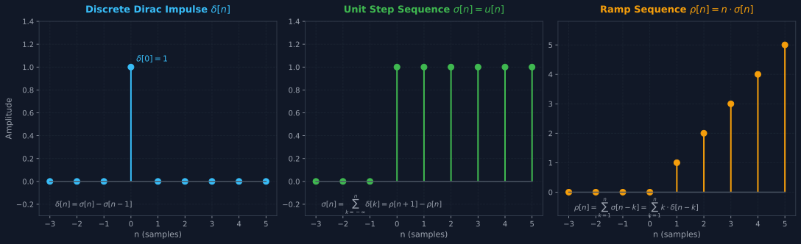
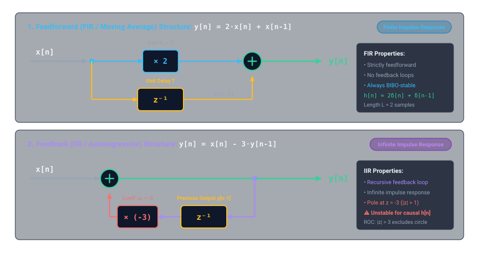
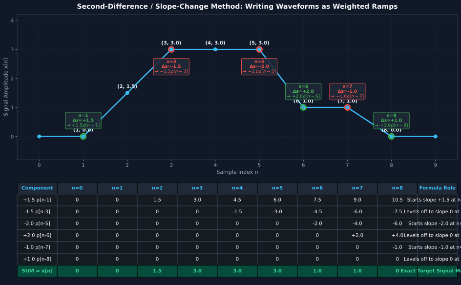
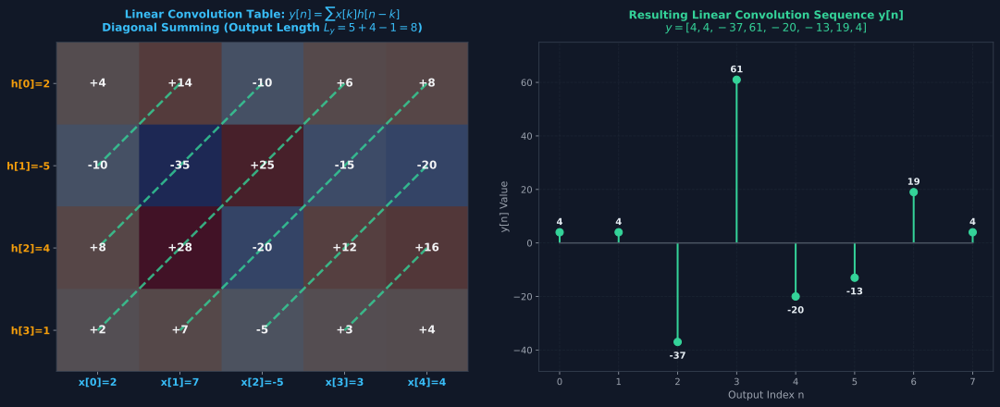
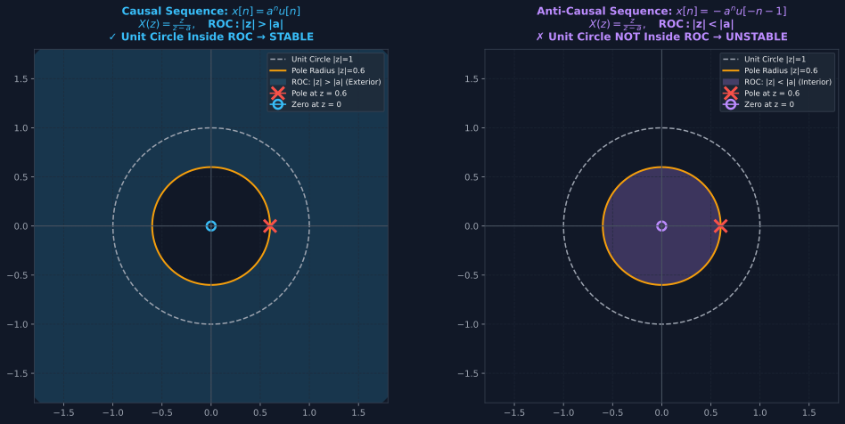

# Digital Information Processing (DIP) — Exam-Mastery Notes (Lessons 1 & 2)

**Chair / Institute:** Chair of Cognitive Systems (KS / FEIT), Otto-von-Guericke-Universität Magdeburg  
**Lecturer:** Prof. Dr. rer. nat. Andreas Wendemuth  
**Target Degree:** M.Sc. Medical Systems Engineering (Semester 2 — WiSe)  
**Assessment:** Written Exam (K120) — Pillars 1 & 2 Focus  
**Primary Course Reference:**
* **Textbook:** Andreas Wendemuth: *Grundlagen der digitalen Signalverarbeitung — Ein mathematischer Zugang*, Springer-Verlag, 2004 (ISBN 978-3-540-21885-2).
  * *Kapitel 1: Zeitdiskrete Signale und Signalparameter* (pp. 1–18)
  * *Kapitel 2: Analoge zeitkontinuierliche Systeme* (pp. 19–36)
  * *Kapitel 3: Zeitdiskrete LTI-Systeme* (pp. 37–84)
* **Lecture Slides:** `DIP-2026-10-12.pdf` (L1), `DIP-2026-10-19.pdf` (L2)
* **Tutorial Exercises:** `ueb01_engl.pdf` (Exercise 1), `ueb02_engl.pdf` (Exercise 2)
* **FEIT Exam Archive:** Historical exams 2006–2020 (FEIT Cloud, Klausuren 2009, 2010, 2013, 2014, 2016, 2017, 2018, 2020)

---

> [!IMPORTANT]
> **Prof. Wendemuth Exam Directives (Zero-Tolerance Rules)**:
> 1. **Never write standard formulas without derivation**: Writing the geometric series sum $S = \frac{1}{1-q}$ directly without stating partial sums $S_N = \sum_{n=0}^N q^n$ and showing $S_N(1-q) = 1 - q^{N+1}$ forfeits 50% of the task points.
> 2. **Every Z-Transform MUST have a Region of Convergence (ROC)**: An algebraic expression $X(z)$ without an explicit ROC receives **zero points** in FEIT exams, because $\mathcal{Z}^{-1}\{X(z)\}$ is mathematically ambiguous without the ROC.
> 3. **Avoid $m$-th Order Residue Derivatives via Parameter Differentiation**: When computing $\mathcal{Z}^{-1}\{(z-a)^{-2}\}$, never compute higher-order Cauchy derivatives. Differentiate $\frac{1}{z-a}$ with respect to the parameter $a$ ($\frac{\partial}{\partial a}$) and exploit operator linearity. Solutions using $m$-th order derivatives are disqualified or heavily penalized.
> 4. **Linearity Requires $S\{0\} = 0$**: An affine system $y(t) = x(t) + b$ with $b \neq 0$ is **non-linear**. Always execute the zero-input test first.

---

## 1. Textbook Foundations & Mathematical Framework (Wendemuth Kap. 1–3)

### 1.1 The Discrete-Time Abstraction: Why $x[n]$?
In technical and biomedical instrumentation (e.g., EEG, ECG, CT detector readout arrays, ultrasound beamforming), physical processes are continuous-time signals $x_a(t)$. To process them digitally, uniform sampling is performed with period $T_a$ (sampling period, Wendemuth Kap. 1.2.1, p. 4):

$$t = n \cdot T_a \quad (n \in \mathbb{Z})$$

$$x[n] = x_a(n T_a) \quad \text{or simply} \quad x_n$$

Where:
* $T_a = \frac{1}{f_a}$ is the sampling period (seconds), $f_a$ is sampling frequency (Hz),
* $n \in \mathbb{Z}$ is the **dimensionless integer sample index**,
* Nyquist-Shannon sampling criterion requires $f_a > 2 f_{\max}$ to prevent spectral aliasing.

```
Continuous Analog x(t) ───[ Time Sampling Ta ]───> Discrete-Time x[n] ───[ Amplitude Quantization Q ]───> Digital Signal x_d[n]
```

---

### 1.2 Signal Classification Matrix (The 10 Dichotomies — Wendemuth Kap. 1.1 & 1.2)

| Classification | Meaning & Mathematical Criterion | Biomedical Engineering Example |
| :--- | :--- | :--- |
| **Deterministic $\Leftrightarrow$ Stochastic** | Deterministic: exactly predictable by math equation. Stochastic: governed by probability distributions. | Deterministic: Calibration chirp. Stochastic: EEG background noise, ECG arrhythmia. |
| **Continuous $\Leftrightarrow$ Discrete Time** | Defined for all $t \in \mathbb{R}$ vs. defined only for integer indices $n \in \mathbb{Z}$. | Continuous transducer voltage vs. discrete ADC sequence $x[n]$. |
| **Analog $\Leftrightarrow$ Quantized Amplitude** | Continuous range of amplitudes vs. finite discrete voltage steps ($2^B$ levels). | Photodiode current vs. 16-bit digitizer output. |
| **Periodic $\Leftrightarrow$ Aperiodic** | $x[n] = x[n + N] \quad \forall n \in \mathbb{Z}$, with fundamental period $N \in \mathbb{N}$. | Periodic: Steady-state PPG pulse train. Aperiodic: Evoked potential transient. |
| **Causal $\Leftrightarrow$ Acausal / Anticausal** | Causal: $x[n] = 0 \quad \forall n < 0$. Anticausal: $x[n] = 0 \quad \forall n > 0$. | Real-time sensor stream (causal) vs. spatial CT image slice (acausal). |
| **Right-sided $\Leftrightarrow$ Left-sided** | Right-sided: $x[n] = 0 \quad \forall n < k$. Left-sided: $x[n] = 0 \quad \forall n > k$. | Post-stimulus response vs. pre-trigger buffer. |
| **Energy $\Leftrightarrow$ Power Signal** | Energy: $0 < E < \infty$ (implies $P=0$). Power: $0 < P < \infty$ (implies $E=\infty$). | Cardiac defibrillator discharge (Energy) vs. continuous pacemaker clock (Power). |
| **Bandlimited $\Leftrightarrow$ Non-bandlimited** | Fourier spectrum $X(\omega) = 0$ for $|\omega| > \omega_g$. Essential for sampling! | Anti-alias filtered EMG signal. |
| **Monotonic $\Leftrightarrow$ Non-monotonic** | Strictly increasing ($x[n+1] \ge x[n]$) or decreasing. | Contrast agent washout decay curve. |
| **Amplitude-bounded $\Leftrightarrow$ Unbounded** | $\|x\|_\infty = \sup_n |x[n]| \le M < \infty$. | Operational amplifier saturation rails (e.g. $\pm 5\text{V}$). |

---

### 1.3 Function Spaces & Norms (Wendemuth Kap. 3.1.1, p. 37)

Prof. Wendemuth introduces discrete sequences through functional analysis on sequence spaces $\ell_p$:

1. **Space $\ell_1$ (Absolute Summability & BIBO Stability)**:
   $$\|x\|_1 = \sum_{n=-\infty}^{+\infty} |x[n]| < \infty$$
   * **Fundamental LTI Theorem**: An LTI system with impulse response $h[n]$ is Bounded-Input Bounded-Output (BIBO) stable **if and only if** $h \in \ell_1$:
     $$\sum_{n=-\infty}^{+\infty} |h[n]| < \infty$$

2. **Space $\ell_2$ (Hilbert Space of Energy Signals)**:
   $$\|x\|_2 = \sqrt{\sum_{n=-\infty}^{+\infty} |x[n]|^2} < \infty$$
   * Inner product $\langle x, y \rangle = \sum_{n=-\infty}^\infty x[n] y^*[n]$ induces energy $E = \|x\|_2^2$.
   * **Parseval's Relation** (Wendemuth Kap. 3.1.6, p. 55): Energy in time equals energy in frequency:
     $$E = \sum_{n=-\infty}^{+\infty} |x[n]|^2 = \frac{1}{2\pi} \int_{-\pi}^{+\pi} |X(e^{j\Omega})|^2 d\Omega = \frac{1}{2\pi j} \oint_{|z|=1} X(z) X^*(1/z^*) z^{-1} dz$$

3. **Space $\ell_\infty$ (Bounded Signals)**:
   $$\|x\|_\infty = \sup_{n \in \mathbb{Z}} |x[n]| < \infty$$

---

### 1.4 Elementary Building Blocks of Discrete DSP (Wendemuth Kap. 1.4, p. 14)



#### 1. Discrete Unit Impulse (Kronecker Delta)
$$\delta[n] = \begin{cases} 1, & n = 0 \\ 0, & n \neq 0 \end{cases} = \{\dots, 0, \mathbf{1}, 0, 0, \dots\}$$
* **Sifting Property (Ausblendeigenschaft)**:
  $$x[n] = \sum_{k=-\infty}^{+\infty} x[k] \cdot \delta[n - k]$$

#### 2. Discrete Unit Step Sequence (Heaviside Sequence)
$$\sigma[n] = u[n] = \begin{cases} 1, & n \ge 0 \\ 0, & n < 0 \end{cases} = \{\dots, 0, \mathbf{1}, 1, 1, 1, \dots\}$$

#### 3. Discrete Unit Ramp Sequence
$$\rho[n] = \begin{cases} n, & n \ge 0 \\ 0, & n < 0 \end{cases} = n \cdot \sigma[n] = \max(n, 0) = \{\dots, 0, \mathbf{0}, 1, 2, 3, 4, \dots\}$$

#### 4. Discrete Difference & Accumulation Inter-Relationships
* **Impulse from Step (First Difference)**:
  $$\delta[n] = \sigma[n] - \sigma[n-1]$$
* **Step from Impulse (Discrete Accumulation / Integration)**:
  $$\sigma[n] = \sum_{k=-\infty}^{n} \delta[k] = \sum_{i=0}^{\infty} \delta[n-i]$$
* **Step from Ramp (First Difference of Ramp)**:
  $$\sigma[n] = \rho[n+1] - \rho[n]$$
* **Ramp from Step (Accumulation of Steps)**:
  $$\rho[n] = \sum_{i=1}^{n} \sigma[n-i] = \sum_{k=0}^{n-1} (n - k) \delta[k]$$
* **Impulse from Ramp (Second Difference)**:
  $$\delta[n] = \rho[n+1] - 2\rho[n] + \rho[n-1]$$

---

### 1.5 Discrete Signal Measures & Two-Sided Sequences (Wendemuth Kap. 1.5, pp. 10–13)

Let $x[n]$ be a discrete sequence. The foundational metrics are:

1. **Discrete Sum ($s_D$)**: Net DC area:
   $$s_D = \sum_{n=-\infty}^{+\infty} x[n]$$
2. **Absolute Sum ($s_A$)**: $\ell_1$ norm:
   $$s_A = \sum_{n=-\infty}^{+\infty} |x[n]|$$
3. **Signal Energy ($E$)**: $\ell_2$ norm squared:
   $$E = \sum_{n=-\infty}^{+\infty} |x[n]|^2$$
4. **Signal Power ($P$)**: Time-averaged energy:
   $$P = \lim_{N \to \infty} \frac{1}{2N + 1} \sum_{n=-N}^{N} |x[n]|^2$$

#### The Two-Sided Exponential Sequence (Wendemuth Beispiel 1.3 & 1.4, Gl. 1.33–1.42)
Consider the symmetric two-sided sequence:
$$x[n] = a^{-|n|} \quad (n \in \mathbb{Z})$$

##### 1. Infinite Sum Derivation:
$$S = \sum_{n=-\infty}^{+\infty} a^{-|n|} = a^0 + 2 \sum_{n=1}^{\infty} a^{-n} = 1 + 2 \lim_{N \to \infty} \sum_{n=1}^N a^{-n}$$

Let $q = a^{-1}$. Using the finite partial sum formula:
$$\sum_{n=1}^N q^n = q \sum_{m=0}^{N-1} q^m = q \frac{1 - q^N}{1 - q} = \frac{a^{-1} (1 - a^{-N})}{1 - a^{-1}} = \frac{1 - a^{-N}}{a - 1}$$

Substituting back into $S$:
$$S = 1 + 2 \lim_{N \to \infty} \frac{1 - a^{-N}}{a - 1}$$

* **Case $|a| > 1$**: $\lim_{N \to \infty} a^{-N} = 0 \implies \mathbf{S = 1 + \frac{2}{a - 1} = \frac{a + 1}{a - 1}} < \infty$.
* **Case $|a| < 1$ or $a = 1$**: Sequence diverges $\implies S \to \infty$.
* **Case $|a| = 1, a \neq 1$ ($a = e^{j 2\pi q}$) (Wendemuth Übung 1.1)**:
  $a^{-N} = e^{-j 2\pi N q}$ does not converge, but oscillates. If $q = U/V \in \mathbb{Q}$, the terms cycle with period $V$. The cyclic mean of the sum evaluates to:
  $$\bar{S} = \frac{a + 1}{a - 1}$$
  * For $a = -1$: $\bar{S} = \frac{-1 + 1}{-1 - 1} = \mathbf{0}$.
  * For $a = j$: $\bar{S} = \frac{j + 1}{j - 1} = \frac{(j+1)(-j-1)}{2} = \mathbf{j}$.

---

### 1.6 Linear Time-Invariant (LTI) Systems & Convolution (Wendemuth Kap. 3.2, p. 59)

A system is an operator $S\{\cdot\}$ mapping input sequence $x[n]$ to output sequence $y[n]$:

$$y[n] = S\{x[n]\}$$



#### The Two Foundational Axioms of LTI
1. **Linearity (Superposition Principle)**:
   $$S\{\alpha x_1[n] + \beta x_2[n]\} = \alpha S\{x_1[n]\} + \beta S\{x_2[n]\} \quad \forall \alpha, \beta \in \mathbb{C}$$
   * *Zero-Input Check*: Must satisfy $S\{0\} = 0$.
2. **Time-Invariance (Shift-Invariance)**:
   $$\text{If } y[n] = S\{x[n]\}, \quad \text{then } S\{x[n - k]\} = y[n - k] \quad \forall k \in \mathbb{Z}$$

#### Why the Impulse Response $h[n]$ Completely Characterizes Any LTI System
Blackboard derivation showing convolution as the inevitable consequence of LTI:

$$\begin{aligned}
y[n] &= S\{x[n]\} \\
&= S\left\{ \sum_{k=-\infty}^{\infty} x[k] \cdot \delta[n-k] \right\} && \text{(Dirac sifting)} \\
&= \sum_{k=-\infty}^{\infty} x[k] \cdot S\{\delta[n-k]\} && \text{(Linearity)} \\
&= \sum_{k=-\infty}^{\infty} x[k] \cdot h[n-k] && \text{(Time-invariance: } S\{\delta[n-k]\} = h[n-k]\text{)} \\
&= x[n] * h[n] && \text{(Linear Convolution)}
\end{aligned}$$

---

## 2. Step-by-Step Exercise Masterclass (Exercise Sheets 1 & 2)

---

### Exercise 1 — Task 1: Signal Composition as Weighted Ramps (Wendemuth Übung 1.3)

#### (a) Definition of a Ramp Sequence
$$\rho[n] = \begin{cases} n, & n \ge 0 \\ 0, & n < 0 \end{cases} = n \cdot \sigma[n] = \max(n, 0)$$

---

#### (b) First Decomposition: $x[n] = \begin{cases} n - 1, & 0 < n < 4 \\ 0, & \text{otherwise} \end{cases}$

Values of $x[n]$:
* $n=0$: $x[0] = 0$
* $n=1$: $x[1] = 0$
* $n=2$: $x[2] = 1$
* $n=3$: $x[3] = 2$
* $n=4$: $x[4] = 0$

$$x[n] = \{\dots, 0, \mathbf{0}, 0, 1, 2, 0, 0, \dots\}$$

##### The Second-Difference / Slope-Change Method ($\Delta s$):
At each transition point $n_k$, weight $w_k = \Delta s_{n_k} = s_{\text{after}} - s_{\text{before}}$:
1. **At $n = 1$**: Slope changes from $0$ to $+1 \implies w_1 = 1 - 0 = \mathbf{+1} \implies \mathbf{+1\rho[n-1]}$
2. **At $n = 3$**: Signal goes from $x[3]=2$ to $x[4]=0$ (slope is $\frac{0-2}{1} = -2$).  
   $\Delta s = -2 - (+1) = \mathbf{-3} \implies \mathbf{-3\rho[n-3]}$
3. **At $n = 4$**: Signal remains $0$ for $n \ge 4$ (slope after $n=4$ is $0$).  
   $\Delta s = 0 - (-2) = \mathbf{+2} \implies \mathbf{+2\rho[n-4]}$

##### Result:
$$\mathbf{x[n] = \rho[n-1] - 3\rho[n-3] + 2\rho[n-4]}$$

##### Tabular Verification:

| $n$ | $0$ | $1$ | $2$ | $3$ | $4$ | $5$ | Formula Role |
| :---: | :---: | :---: | :---: | :---: | :---: | :---: | :--- |
| $\rho[n-1]$ | $0$ | $0$ | $1$ | $2$ | $3$ | $4$ | Slope $+1$ starting at $n=1$ |
| $-3\rho[n-3]$ | $0$ | $0$ | $0$ | $0$ | $-3$ | $-6$ | Slope change of $-3$ at $n=3$ |
| $+2\rho[n-4]$ | $0$ | $0$ | $0$ | $0$ | $0$ | $+2$ | Levels off slope to $0$ at $n=4$ |
| **Sum $= x[n]$** | **0** | **0** | **1** | **2** | **0** | **0** | **Matches target sequence!** |

---

#### (c) Second Decomposition: Multi-Segment Pulse

Given:
$$x(1) = 0, \quad x(2) = 1.5, \quad x(3) = x(4) = x(5) = 3, \quad x(6) = x(7) = 1, \quad x(8) = 0$$



Interval slopes:
* $n \le 1$: $s_0 = 0$
* Interval $[1, 3]$: from $(1,0)$ to $(3,3) \implies s_1 = \frac{3-0}{3-1} = +1.5$
* Interval $[3, 5]$: from $(3,3)$ to $(5,3) \implies s_2 = \frac{3-3}{2} = 0$
* Interval $[5, 6]$: from $(5,3)$ to $(6,1) \implies s_3 = \frac{1-3}{1} = -2.0$
* Interval $[6, 7]$: from $(6,1)$ to $(7,1) \implies s_4 = \frac{1-1}{1} = 0$
* Interval $[7, 8]$: from $(7,1)$ to $(8,0) \implies s_5 = \frac{0-1}{1} = -1.0$
* Interval $n \ge 8$: $s_6 = 0$

Slope changes $\Delta s = s_{\text{after}} - s_{\text{before}}$:
* Node $n=1$: $\Delta s = 1.5 - 0 = \mathbf{+1.5} \implies \mathbf{+1.5\rho[n-1]}$
* Node $n=3$: $\Delta s = 0 - 1.5 = \mathbf{-1.5} \implies \mathbf{-1.5\rho[n-3]}$
* Node $n=5$: $\Delta s = -2.0 - 0 = \mathbf{-2.0} \implies \mathbf{-2.0\rho[n-5]}$
* Node $n=6$: $\Delta s = 0 - (-2.0) = \mathbf{+2.0} \implies \mathbf{+2.0\rho[n-6]}$
* Node $n=7$: $\Delta s = -1.0 - 0 = \mathbf{-1.0} \implies \mathbf{-1.0\rho[n-7]}$
* Node $n=8$: $\Delta s = 0 - (-1.0) = \mathbf{+1.0} \implies \mathbf{+1.0\rho[n-8]}$

##### Final Equation:
$$\mathbf{x[n] = 1.5\rho[n-1] - 1.5\rho[n-3] - 2\rho[n-5] + 2\rho[n-6] - \rho[n-7] + \rho[n-8]}$$

> [!TIP]
> **Boundary Sum Condition**: $\sum w_k = 1.5 - 1.5 - 2.0 + 2.0 - 1.0 + 1.0 = 0$. Essential for pulse signals returning to zero.

---

### Exercise 1 — Task 2: Signal Properties & Geometric Series Proof (Wendemuth Übung 1.4)

Given:
$$x[n] = \begin{cases} 0, & n < 0 \\ (-0.5)^n, & n \ge 0 \end{cases} = (-0.5)^n \cdot u[n]$$

#### Mandatory Exam Derivation of the Infinite Geometric Series
Define partial sum $S_N$:
$$S_N = \sum_{n=0}^{N} q^n = 1 + q + q^2 + \dots + q^N$$

Multiply by $q$:
$$q S_N = q + q^2 + \dots + q^{N+1}$$

Subtract:
$$S_N(1 - q) = 1 - q^{N+1} \implies S_N = \frac{1 - q^{N+1}}{1 - q} \quad (q \neq 1)$$

Taking $\lim_{N \to \infty}$ for $|q| < 1$:
$$\lim_{N \to \infty} q^{N+1} = 0 \implies \mathbf{S = \lim_{N \to \infty} S_N = \frac{1}{1 - q}}$$

#### (a) Absolute Sum ($S_A$):
$$S_A = \sum_{n=0}^{\infty} |(-0.5)^n| = \sum_{n=0}^{\infty} (0.5)^n = \lim_{N \to \infty} \frac{1 - (0.5)^{N+1}}{1 - 0.5} = \frac{1}{0.5} = \mathbf{2} < \infty \quad (\ell_1 \text{ summable})$$

#### (b) Discrete Sum ($S_D$):
$$S_D = \sum_{n=0}^{\infty} (-0.5)^n = \lim_{N \to \infty} \frac{1 - (-0.5)^{N+1}}{1 - (-0.5)} = \frac{1}{1 + 0.5} = \mathbf{\frac{2}{3}}$$

#### (c) Signal Energy ($E$):
$$E = \sum_{n=0}^{\infty} |(-0.5)^n|^2 = \sum_{n=0}^{\infty} (0.25)^n = \lim_{N \to \infty} \frac{1 - (0.25)^{N+1}}{1 - 0.25} = \frac{1}{\frac{3}{4}} = \mathbf{\frac{4}{3}} < \infty \quad (\ell_2 \text{ Energy Signal})$$

---

### Exercise 2 — Task 1: Testing LTI Properties (Wendemuth Übung 3.1)

#### System (a): $y(t) = x(t) + b$
1. **Linearity Test**:
   $$S\{\alpha x_1 + \beta x_2\} = \alpha x_1(t) + \beta x_2(t) + b$$
   $$\alpha S\{x_1\} + \beta S\{x_2\} = \alpha(x_1(t) + b) + \beta(x_2(t) + b) = \alpha x_1(t) + \beta x_2(t) + (\alpha + \beta)b$$
   These are equal if and only if $b = (\alpha + \beta)b \iff b(1 - \alpha - \beta) = 0$, which fails for general $\alpha, \beta$ unless $b=0$.
   * **Zero-input check**: $S\{0\} = b \neq 0 \implies$ **Non-linear**.
2. **Time-Invariance Test**:
   $$S\{x(t - \tau)\} = x(t - \tau) + b = y(t - \tau) \implies \text{\textbf{Time-Invariant}}.$$
3. **Verdict**: **NOT an LTI system** (fails Linearity; it is affine).

#### System (b): $y(t) = x(t) \cdot m(t)$
1. **Linearity Test**:
   $$S\{\alpha x_1 + \beta x_2\} = [\alpha x_1(t) + \beta x_2(t)] m(t) = \alpha y_1(t) + \beta y_2(t) \implies \text{\textbf{Linear}}.$$
2. **Time-Invariance Test**:
   Delayed input gives $y_{\text{new}}(t) = S\{x(t-\tau)\} = x(t-\tau) m(t)$.  
   Delayed original output gives $y(t-\tau) = x(t-\tau) m(t-\tau)$.  
   Since $m(t) \neq m(t-\tau)$ in general $\implies$ **Time-Variant**.
3. **Verdict**: **NOT an LTI system** (fails Time-Invariance; it is a modulator/multiplier).

---

### Exercise 2 — Task 2: Linear & Periodic Convolution (Wendemuth Übung 3.2)

Given sequences:
$$x[n] = \{\dots, 0, \mathbf{2}, 7, -5, 3, 4, 0, \dots\} \quad (L_x = 5)$$
$$h[n] = \{\dots, 0, \mathbf{2}, -5, 4, 1, 0, \dots\} \quad (L_h = 4)$$



#### 1. Linear Convolution: Output Length $L_y = L_x + L_h - 1 = 5 + 4 - 1 = \mathbf{8 \text{ samples}}$

##### Cauchy Matrix & Diagonal Summation:

| $h \downarrow \backslash x \rightarrow$ | $x[0]=2$ | $x[1]=7$ | $x[2]=-5$ | $x[3]=3$ | $x[4]=4$ |
| :---: | :---: | :---: | :---: | :---: | :---: |
| **$h[0] = 2$** | **+4** | **+14** | **-10** | **+6** | **+8** |
| **$h[1] = -5$** | **-10** | **-35** | **+25** | **-15** | **-20** |
| **$h[2] = 4$** | **+8** | **+28** | **-20** | **+12** | **+16** |
| **$h[3] = 1$** | **+2** | **+7** | **-5** | **+3** | **+4** |

Summing anti-diagonals ($n = i + j$):
* $n=0$: $4 = \mathbf{4}$
* $n=1$: $14 - 10 = \mathbf{4}$
* $n=2$: $-10 - 35 + 8 = \mathbf{-37}$
* $n=3$: $6 + 25 + 28 + 2 = \mathbf{61}$
* $n=4$: $8 - 15 - 20 + 7 = \mathbf{-20}$
* $n=5$: $-20 + 12 - 5 = \mathbf{-13}$
* $n=6$: $16 + 3 = \mathbf{19}$
* $n=7$: $4 = \mathbf{4}$

$$\mathbf{y[n] = \{\dots, 0, \mathbf{4}, 4, -37, 61, -20, -13, 19, 4, 0, \dots\}}$$

#### 2. Periodic (Circular) Convolution ($N = 4$):
With $\mathbf{x}_p = [2, 7, -5, 3]^T$ and $\mathbf{h}_p = [2, -5, 4, 1]^T$:

$$\mathbf{y}_p = \begin{bmatrix}
2 & 1 & 4 & -5 \\
-5 & 2 & 1 & 4 \\
4 & -5 & 2 & 1 \\
1 & 4 & -5 & 2
\end{bmatrix} \begin{bmatrix} 2 \\ 7 \\ -5 \\ 3 \end{bmatrix} = \begin{bmatrix} \mathbf{-24} \\ \mathbf{11} \\ \mathbf{-34} \\ \mathbf{61} \end{bmatrix}$$

$$\mathbf{y_p[n] = [-24, 11, -34, 61] \quad (n = 0, 1, 2, 3)}$$

---

### Exercise 2 — Task 3 & 4: Z-Transform & The Fundamental ROC Dual (Wendemuth Übung 3.3)



$$X(z) = \mathcal{Z}\{x[n]\} = \sum_{n=-\infty}^{+\infty} x[n] z^{-n}$$

#### Task 4(a): Causal Sequence $x[n] = a^n u[n]$
$$X(z) = \sum_{n=0}^{\infty} (a z^{-1})^n = \frac{1}{1 - a z^{-1}} = \mathbf{\frac{z}{z - a}}, \qquad \mathbf{\text{ROC: } |z| > |a|}$$
* **ROC Shape**: Exterior of circle radius $|a|$.
* **BIBO Stability**: Unit circle $|z|=1$ is in ROC $\iff \mathbf{|a| < 1}$.

#### Task 4(b): Anti-Causal Sequence $x[n] = -a^n u[-n-1]$
$$X(z) = -\sum_{n=-\infty}^{-1} a^n z^{-n} = -\sum_{m=1}^{\infty} (a^{-1} z)^m = 1 - \frac{1}{1 - a^{-1} z} = \mathbf{\frac{z}{z - a}}, \qquad \mathbf{\text{ROC: } |z| < |a|}$$
* **ROC Shape**: Interior of circle radius $|a|$.
* **BIBO Stability**: Unit circle $|z|=1$ is in ROC $\iff \mathbf{|a| > 1}$.

> [!CAUTION]
> **Cardinal Exam Theorem**: An algebraic expression $X(z) = \frac{z}{z-a}$ does **not** uniquely define $x[n]$ without specifying whether the ROC is $|z| > |a|$ (causal) or $|z| < |a|$ (anti-causal).

---

## 3. Previous Year Exam Vault (Lessons 1 & 2 Focus)

This section compiles the most critical, recurring exam questions from FEIT archive papers (2006, 2010, 2013, 2014, 2016, 2017, 2018, 2020) and solves them with full mathematical rigor.

---

### Exam Problem 1: Formal Theorem Proofs from the Z-Transform Definition

#### 1.1 The Attenuation Theorem (Dämpfungssatz) *(Exam 2013 Task 1, Exam 2014 Task 1.1)*
**Problem**: Prove the attenuation theorem $\mathcal{Z}\{a^{-n} x[n]\} = X(az)$ and $\mathcal{Z}\{a^n x[n]\} = X(z/a)$ strictly using the definition equation of the Z-transformation.

**Proof**:
By definition of the bilateral Z-transform:
$$\mathcal{Z}\{x[n]\} = X(z) = \sum_{n=-\infty}^{+\infty} x[n] z^{-n}$$

Apply this definition directly to the sequence $y[n] = a^{-n} x[n]$:
$$Y(z) = \mathcal{Z}\{a^{-n} x[n]\} = \sum_{n=-\infty}^{+\infty} \left( a^{-n} x[n] \right) z^{-n}$$

Group the base powers of $n$:
$$Y(z) = \sum_{n=-\infty}^{+\infty} x[n] (a \cdot z)^{-n}$$

Define the complex variable substitute $w = a z$. The sum becomes:
$$Y(z) = \sum_{n=-\infty}^{+\infty} x[n] w^{-n} = X(w) = \mathbf{X(az)} \quad \blacksquare$$

* **Region of Convergence (ROC)**:
  The original transform $X(w)$ converges for $w \in \text{ROC}_x$. Thus, $Y(z)$ converges for:
  $$|az| \in \text{ROC}_x \iff \mathbf{|z| \in \frac{1}{|a|} \text{ROC}_x}$$
* **Corollary**: For $y[n] = a^n x[n] = (a^{-1})^{-n} x[n]$:
  $$\mathcal{Z}\{a^n x[n]\} = \mathbf{X\left(\frac{z}{a}\right)}, \quad \text{ROC: } |z| \in |a| \text{ROC}_x$$

---

#### 1.2 The Shifting Theorem (Verschiebungssatz) *(Exam 2013 Task 1, Exam 2020 WiSe Bonus Task 5)*
**Problem**: Let $H(z)$ be the Z-transform of $h[n]$. Prove that for $x[n] = h[n + k]$ ($k \in \mathbb{Z}$), $X(z) = z^k H(z)$ using the definition equation.

**Proof**:
$$X(z) = \sum_{n=-\infty}^{+\infty} x[n] z^{-n} = \sum_{n=-\infty}^{+\infty} h[n + k] z^{-n}$$

Perform an exact index substitution. Let $m = n + k \iff n = m - k$.  
As $n$ ranges from $-\infty$ to $+\infty$, $m$ also ranges from $-\infty$ to $+\infty$:

$$X(z) = \sum_{m=-\infty}^{+\infty} h[m] z^{-(m - k)} = \sum_{m=-\infty}^{+\infty} h[m] z^{-m} z^k$$

Since $z^k$ does not depend on the summation index $m$, factor it outside:
$$X(z) = z^k \sum_{m=-\infty}^{+\infty} h[m] z^{-m} = \mathbf{z^k H(z)} \quad \blacksquare$$

* **ROC**: $\text{ROC}_X = \text{ROC}_H$, with the possible exception of $z = 0$ (if $k > 0$) or $z = \infty$ (if $k < 0$).

---

#### 1.3 Time Reversal & Shift Theorem *(Exam 2006 Task 1.1)*
**Problem**: Prove that $\mathcal{Z}\{x[m - n]\} = z^{-m} X(1/z)$ where $m$ is a constant integer shift.

**Proof**:
$$Y(z) = \sum_{n=-\infty}^{+\infty} x[m - n] z^{-n}$$

Substitute variable $k = m - n \iff n = m - k$:
$$Y(z) = \sum_{k=-\infty}^{+\infty} x[k] z^{-(m - k)} = z^{-m} \sum_{k=-\infty}^{+\infty} x[k] z^k = z^{-m} \sum_{k=-\infty}^{+\infty} x[k] (z^{-1})^{-k}$$

By definition of the Z-transform evaluated at $z^{-1} = 1/z$:
$$Y(z) = \mathbf{z^{-m} X\left(\frac{1}{z}\right)} \quad \blacksquare$$

* **ROC**: If $X(z)$ converges for $r_1 < |z| < r_2$, then $Y(z)$ converges for $\frac{1}{r_2} < |z| < \frac{1}{r_1}$.

---

### Exam Problem 2: High-Order Inverse Z-Transform via Parameter Differentiation ($\frac{\partial}{\partial a}$ Trick)

*(Appeared in Exam 2006 Task 1.3, Exam 2014 Task 1.2, Exam 2017, Exam 2020 WiSe Task 3.2)*

> [!WARNING]
> **Prof. Wendemuth Exam Instructions**:
> *"Give the inverse Z-Transformation for the function $E(z) = \frac{1}{(z-a)^2}$ in areas I: $|z| > |a|$ and II: $|z| < |a|$. Perform the partial derivative with respect to $a$. Use the fact that partial derivatives and inverse Z-transforms are both linear operations, hence they can be interchanged. Argue on a symbolic level. Solutions using $m$-th order derivatives of residues will NOT be graded and given zero credit points!"*

#### Step 1: Base Transform Pair
Consider the fundamental first-order term:
$$F(z) = \frac{1}{z - a} = z^{-1} \frac{z}{z - a}$$

From our standard transforms and time-shifting property:
* **Area I ($|z| > |a|$, Causal)**:
  $$f_I[n] = a^{n-1} u[n-1] = \begin{cases} a^{n-1}, & n \ge 1 \\ 0, & n \le 0 \end{cases}$$
* **Area II ($|z| < |a|$, Anti-causal)**:
  $$f_{II}[n] = -a^{n-1} u[-n] = \begin{cases} 0, & n \ge 1 \\ -a^{n-1}, & n \le 0 \end{cases}$$

#### Step 2: Establish the Differential Operator Identity
Notice that differentiating $F(z)$ with respect to $a$ yields:
$$\frac{\partial}{\partial a} \left[ \frac{1}{z - a} \right] = -\frac{1}{(z - a)^2} \cdot (-1) = \mathbf{\frac{1}{(z - a)^2}} = E(z)$$

#### Step 3: Interchange Differentiation and Inverse Transformation
Because both $\frac{\partial}{\partial a}$ and $\mathcal{Z}^{-1}\{\cdot\}$ are linear operators, they commute:
$$e[n] = \mathcal{Z}^{-1}\{E(z)\} = \mathcal{Z}^{-1}\left\{ \frac{\partial}{\partial a} F(z) \right\} = \mathbf{\frac{\partial}{\partial a} \left[ \mathcal{Z}^{-1}\{F(z)\} \right]} = \frac{\partial}{\partial a} f[n]$$

#### Step 4: Evaluate for Both ROC Regions
* **For Area I ($|z| > |a|$, Causal)**:
  $$e_I[n] = \frac{\partial}{\partial a} \left( a^{n-1} u[n-1] \right) = \mathbf{(n - 1) a^{n-2} u[n-1]}$$
* **For Area II ($|z| < |a|$, Anti-causal)**:
  $$e_{II}[n] = \frac{\partial}{\partial a} \left( -a^{n-1} u[-n] \right) = \mathbf{-(n - 1) a^{n-2} u[-n]}$$

#### Extension: Numerator with $z$ ($G(z) = \frac{z}{(z-a)^2}$)
If the task asks for $G(z) = \frac{z}{(z-a)^2}$:
$$\frac{\partial}{\partial a} \left[ \frac{z}{z - a} \right] = \frac{z}{(z - a)^2}$$
* **Area I ($|z| > |a|$)**:
  $$g_I[n] = \frac{\partial}{\partial a} \left( a^n u[n] \right) = \mathbf{n a^{n-1} u[n]}$$
* **Area II ($|z| < |a|$)**:
  $$g_{II}[n] = \frac{\partial}{\partial a} \left( -a^n u[-n-1] \right) = \mathbf{-n a^{n-1} u[-n-1]}$$

---

### Exam Problem 3: The Cauchy Residue Inversion in $z$-Space vs. $1/z$-Space

*(Appeared in Wendemuth Übung 3.7, Exam 2006 Task 1.2, Exam 2020 WiSe Task 3.1)*

**Problem**: Evaluate $x[n] = \mathcal{Z}^{-1}\left\{\frac{1}{z-a}\right\}$ for both Area I ($|z| > |a|$) and Area II ($|z| < |a|$) using the Cauchy Residue Theorem. Formulate the inversion in $z$-space for $n \ge 1$ and in $1/z$-space for $n \le 0$ to avoid higher-order derivatives at $z=0$.

#### The Inversion Contour Integral:
$$x[n] = \frac{1}{2\pi j} \oint_C X(z) z^{n-1} dz = \frac{1}{2\pi j} \oint_C \frac{z^{n-1}}{z - a} dz$$

#### Case 1: $n \ge 1$ (Use $z$-Space Formulation)
When $n \ge 1$, $n - 1 \ge 0$. The integrand $f(z) = \frac{z^{n-1}}{z - a}$ has **only a single simple pole at $z = a$** (no pole at $z = 0$).

* **In Area I ($|z| > |a|$)**: The contour $C$ encloses $z = a$.
  $$x[n] = \text{Res}_{z=a}[f(z)] = \lim_{z \to a} (z - a) \frac{z^{n-1}}{z - a} = \mathbf{a^{n-1}} \quad (n \ge 1)$$
* **In Area II ($|z| < |a|$)**: The contour $C$ is inside $|z| < |a|$, enclosing no poles.
  $$x[n] = \mathbf{0} \quad (n \ge 1)$$

#### Case 2: $n \le 0$ (The Danger of $z=0$ and the $1/z$-Space Remedy)
When $n \le 0$, let $p = -(n-1) = 1 - n \ge 1$. The integrand becomes:
$$f(z) = \frac{1}{z^p (z - a)}$$
This introduces a pole at the origin $z = 0$ of order $p = 1 - n$. Calculating this residue in $z$-space requires an $(1-n)$-th order derivative:
$$\text{Res}_{z=0}[f(z)] = \frac{1}{(p-1)!} \lim_{z \to 0} \frac{d^{p-1}}{dz^{p-1}} \left( \frac{1}{z - a} \right)$$
For general variable $n$, this is mathematically hazardous.

##### The $w = 1/z$ Substitution:
Substitute $z = \frac{1}{w}$, $dz = -\frac{1}{w^2} dw$:
$$x[n] = \frac{1}{2\pi j} \oint_{\tilde{C}} \frac{w^{-(n-1)}}{\frac{1}{w} - a} \left( -\frac{1}{w^2} \right) dw = \frac{1}{2\pi j} \oint_{-\tilde{C}} \frac{w^{-(n-1)}}{w^{-1}(1 - aw)} \left( \frac{1}{w^2} \right) dw$$

Reversing the contour direction cancels the minus sign:
$$x[n] = \frac{1}{2\pi j} \oint_C \frac{w^{-n}}{1 - aw} dw = \frac{1}{2\pi j} \oint_C \frac{w^{-n}}{-a(w - 1/a)} dw$$

Let $g(w) = \frac{w^{-n}}{-a(w - 1/a)}$.  
Notice: since $n \le 0$, the exponent $-n \ge 0$ is a **non-negative integer**!  
**Therefore, $g(w)$ has NO pole at $w = 0$. It has only a single, simple pole at $w = \frac{1}{a}$!**

* **In Area II ($|z| < |a| \iff |w| > 1/|a|$)**: The contour encloses $w = 1/a$:
  $$x[n] = \text{Res}_{w = 1/a}[g(w)] = \lim_{w \to 1/a} \left( w - \frac{1}{a} \right) \frac{w^{-n}}{-a(w - 1/a)} = \frac{(1/a)^{-n}}{-a} = -\frac{a^n}{a} = \mathbf{-a^{n-1}} \quad (n \le 0)$$
* **In Area I ($|z| > |a| \iff |w| < 1/|a|$)**: The contour does not enclose $w = 1/a$:
  $$x[n] = \mathbf{0} \quad (n \le 0)$$

#### Combined Final Result:
* **Area I ($|z| > |a|$)**: $x[n] = a^{n-1} u[n-1]$
* **Area II ($|z| < |a|$)**: $x[n] = -a^{n-1} u[-n]$

---

### Exam Problem 4: Complete Signal Flowgraph & LTI System Analysis

*(Appeared in Exam 2006 Task 2, Exam 2010 Task 1, Exam 2013 Tasks 2–8, Exam 2018 Task 1)*

**Given System Flowgraph**:
An LTI digital filter has input $x[n]$, output $y[n]$, two unit delays $z^{-1}$, feedforward coefficients $b_0 = 1, b_1 = -0.5$, and feedback coefficients $a_1 = 0.75, a_2 = -0.125$.

```
         x[n] ───┬──────────────────────(+)─────────> y[n]
                 │                       ▲
                 │                       │ -0.5
                 │    ┌──────┐           │
                 └───>│ z^-1 ├───[b1]────┤
                      └──────┘           │
                                         │ +0.75
                      ┌──────┐           │
                 ┌───>│ z^-1 ├───[a1]────┤
                 │    └──────┘           │
                 │        │              │ -0.125
                 │    ┌──────┐           │
                 └───>│ z^-1 ├───[a2]────┘
                      └──────┘
```

#### 4.1 Formulate the Difference Equation
$$y[n] - 0.75 y[n-1] + 0.125 y[n-2] = x[n] - 0.5 x[n-1]$$

#### 4.2 Determine Transfer Function $H(z)$ & Pole-Zero Scheme
Take the Z-transform of both sides assuming zero initial conditions:
$$Y(z) \left( 1 - 0.75 z^{-1} + 0.125 z^{-2} \right) = X(z) \left( 1 - 0.5 z^{-1} \right)$$

$$H(z) = \frac{Y(z)}{X(z)} = \frac{1 - 0.5 z^{-1}}{1 - 0.75 z^{-1} + 0.125 z^{-2}} = \frac{z(z - 0.5)}{z^2 - 0.75 z + 0.125}$$

Factor the denominator quadratic:
$$z^2 - 0.75 z + 0.125 = \left( z - 0.5 \right) \left( z - 0.25 \right)$$

Notice the pole-zero cancellation at $z = 0.5$:
$$H(z) = \frac{z (z - 0.5)}{(z - 0.5)(z - 0.25)} = \mathbf{\frac{z}{z - 0.25}} = \frac{1}{1 - 0.25 z^{-1}} \quad (|z| \neq 0.5)$$

* **Poles**: $p_1 = 0.25$ (and cancelled pole at $p_2 = 0.5$).
* **Zeros**: $z_1 = 0$ (and cancelled zero at $z_2 = 0.5$).

#### 4.3 System Properties Analysis
* **BIBO Stability**: The irreducible pole is at $|p_1| = 0.25 < 1$ (strictly inside the unit circle). Thus, the unit circle $|z|=1$ lies inside the causal ROC $|z| > 0.25 \implies$ **BIBO Stable**.
* **Causality**: The system is causal because the output depends only on current and past inputs/outputs, and the ROC is $|z| > 0.25$ (exterior region).
* **Minimal Phase**: A system is minimal phase if **all poles and all zeros** lie strictly inside the unit circle. Here, pole $p = 0.25 < 1$ and zero $z_0 = 0 < 1 \implies$ **Minimal Phase Filter**.

#### 4.4 Analytical Impulse Response $h[n]$
By inspection of $H(z) = \frac{z}{z - 0.25}$ with causal ROC $|z| > 0.25$:
$$\mathbf{h[n] = (0.25)^n u[n]}$$

#### 4.5 Time-Domain Excitation & Direct Recursive Verification
* **Excitation Signal**: To obtain $y[n] = h[n]$, the input must be the **discrete Kronecker delta**:
  $$x[n] = \delta[n] = \{\dots, 0, \mathbf{1}, 0, 0, \dots\}$$
* **Recursive Equation**:
  $$y[n] = 0.75 y[n-1] - 0.125 y[n-2] + x[n] - 0.5 x[n-1]$$
  With rest conditions $y[-1] = y[-2] = 0$ and $x[n] = \delta[n]$:

| $n$ | $x[n]$ | $x[n-1]$ | $y[n-1]$ | $y[n-2]$ | Direct Recursion $y[n]$ | Analytical $h[n] = (0.25)^n$ | Match? |
| :---: | :---: | :---: | :---: | :---: | :--- | :--- | :---: |
| **0** | $1$ | $0$ | $0$ | $0$ | $1 - 0 + 0 - 0 = \mathbf{1}$ | $(0.25)^0 = \mathbf{1}$ | $\checkmark$ |
| **1** | $0$ | $1$ | $1$ | $0$ | $0 - 0.5 + 0.75(1) - 0 = \mathbf{0.25}$ | $(0.25)^1 = \mathbf{0.25}$ | $\checkmark$ |
| **2** | $0$ | $0$ | $0.25$ | $1$ | $0.75(0.25) - 0.125(1) = 0.1875 - 0.125 = \mathbf{0.0625}$ | $(0.25)^2 = \mathbf{0.0625}$ | $\checkmark$ |
| **3** | $0$ | $0$ | $0.0625$ | $0.25$ | $0.75(0.0625) - 0.125(0.25) = 0.046875 - 0.03125 = \mathbf{0.015625}$ | $(0.25)^3 = \mathbf{0.015625}$ | $\checkmark$ |

Exact match proves both the difference equation recursion and the Z-transform derivation are 100% correct.

#### 4.6 Maximum Analog Bandwidth Before Aliasing
The discrete sequence was obtained by sampling an analog signal with sampling period $T_a$.  
By the Nyquist-Shannon sampling theorem, the analog signal can be reconstructed without loss of information if and only if:

$$f_{\max} < \frac{f_a}{2} = \frac{1}{2 T_a} \iff \mathbf{\omega_{\max} < \frac{\pi}{T_a}}$$

---

## 4. Prof. Wendemuth Exam Traps & High-Yield Checklist

Analysis of 15 years of FEIT DIP exam papers reveals the 7 recurring traps where students lose marks:

```
                   ┌──────────────────────────────────────────────────────────┐
                   │          PROF. WENDEMUTH EXAM GRADING CHEAT SHEET        │
                   └──────────────────────────────────────────────────────────┘
                                                 │
         ┌──────────────────────┬───────────────┴──────────────┬──────────────────────┐
         ▼                      ▼                              ▼                      ▼
   [Geometric Series]     [ROC Omission]                 [Zero-Input Check]     [Residue Derivative]
   Never write 1/(1-q)    Every X(z) MUST                y = x + b is NOT       Never use m-th order
   directly! Always       have an ROC. Without           linear! Check S{0}=0   derivatives for 1/(z-a)^2.
   derive via partial     ROC, inverse Z is              before doing any       Use d/da parameter
   sums SN - q*SN.        ambiguous.                     other algebra.         trick instead!
```

### 1. Geometric Series Without Proof (-2 to -4 marks)
* **The Error**: Writing $S = \frac{1}{1-q}$ directly.
* **The Remedy**: Always state $S_N = \sum_{n=0}^N q^n$, form $q S_N$, subtract $S_N(1-q) = 1 - q^{N+1}$, and take the limit $\lim_{N \to \infty} q^{N+1} = 0$ for $|q| < 1$.

### 2. Linearity of Affine Systems ($y(t) = x(t) + b$) (-3 marks)
* **The Error**: Believing that a straight-line equation represents a linear system.
* **The Remedy**: In systems theory, linearity means the **superposition operator** $S\{\alpha x_1 + \beta x_2\} = \alpha y_1 + \beta y_2$. If $b \neq 0$, $S\{0\} = b \neq 0$, so the system is non-linear.

### 3. Z-Transform Without Region of Convergence (-5 marks)
* **The Error**: Writing $X(z) = \frac{z}{z-a}$ and moving on.
* **The Remedy**: Always state the ROC:
  * Causal sequence: $|z| > |a|$
  * Anti-causal sequence: $|z| < |a|$
  * State whether $|z| = 1$ is inside the ROC to determine BIBO stability.

### 4. Calculating Higher-Order Derivatives of Residues (-10 marks / 0 points)
* **The Error**: Trying to compute $\mathcal{Z}^{-1}\left\{\frac{1}{(z-a)^2}\right\}$ by setting up an $m$-th order derivative residue formula.
* **The Remedy**: Differentiate $\frac{1}{z-a}$ with respect to parameter $a$ ($\frac{\partial}{\partial a}$), and swap differentiation and inverse Z-transform.

### 5. Calculating Origin Residues for $n \le 0$ Without $1/z$ Substitution (-4 marks)
* **The Error**: Trying to compute the residue of $\frac{z^{n-1}}{z-a}$ at $z=0$ when $n \le 0$ directly in the $z$-plane.
* **The Remedy**: Substitute $w = 1/z$, which converts the pole at $z=0$ into a non-negative power $w^{-n}$ and leaves only a single simple pole at $w = 1/a$.

### 6. Linear Convolution Output Length Off-By-One (-2 marks)
* **The Error**: Assuming linear convolution output has length $\max(L_x, L_h)$.
* **The Remedy**: Always apply the exact formula $L_y = L_x + L_h - 1$.

### 7. Minimal Phase Classification Confusion (-3 marks)
* **The Error**: Checking only whether poles are inside the unit circle.
* **The Remedy**: A filter is minimal phase **if and only if ALL poles AND ALL zeros** lie strictly inside the unit circle ($|p_i| < 1$ and $|z_i| < 1$).

---

## 5. Master Formula & Property Quick-Reference Card

$$\begin{array}{rlll}
\hline
\textbf{Signal / Operation} & \textbf{Time Domain } x[n] & \textbf{Z-Domain / Metric Formula} & \textbf{Region of Convergence (ROC)} \\
\hline
\text{Dirac Impulse} & \delta[n] = \sigma[n] - \sigma[n-1] & X(z) = 1 & \text{All } z \\
\text{Unit Step} & \sigma[n] = u[n] & X(z) = \frac{1}{1-z^{-1}} = \frac{z}{z-1} & |z| > 1 \\
\text{Unit Ramp} & \rho[n] = n \cdot \sigma[n] & X(z) = \frac{z^{-1}}{(1-z^{-1})^2} = \frac{z}{(z-1)^2} & |z| > 1 \\
\text{Causal Exponential} & a^n u[n] & X(z) = \frac{z}{z-a} & |z| > |a| \\
\text{Anti-Causal Exponential} & -a^n u[-n-1] & X(z) = \frac{z}{z-a} & |z| < |a| \\
\text{Second-Order Causal} & n a^{n-1} u[n] & X(z) = \frac{z}{(z-a)^2} & |z| > |a| \\
\text{Second-Order Anti-Causal} & -n a^{n-1} u[-n-1] & X(z) = \frac{z}{(z-a)^2} & |z| < |a| \\
\text{Attenuation Theorem} & a^{-n} x[n] & Y(z) = X(az) & |z| \in \frac{1}{|a|} \text{ROC}_x \\
\text{Time Shifting} & x[n - k] & Y(z) = z^{-k} X(z) & \text{Same (except } z=0, \infty\text{)} \\
\text{Time Reversal \& Shift} & x[m - n] & Y(z) = z^{-m} X(1/z) & |z|^{-1} \in \text{ROC}_x \\
\text{Frequency Differentiation} & n \cdot x[n] & Y(z) = -z \frac{dX(z)}{dz} & \text{Same ROC} \\
\text{Linear Convolution} & x[n] * h[n] & Y(z) = X(z) \cdot H(z), \quad L_y = L_x + L_h - 1 & \text{ROC} \supseteq \text{ROC}_x \cap \text{ROC}_h \\
\text{Absolute Summability} & s_A = \sum_{-\infty}^\infty |x[n]| & \text{BIBO Stable } \iff \sum |h[n]| < \infty & \text{Contains } |z| = 1 \\
\text{Signal Energy} & E = \sum_{-\infty}^\infty |x[n]|^2 & \text{Parseval: } E = \frac{1}{2\pi} \int_{-\pi}^\pi |X(e^{j\Omega})|^2 d\Omega & \text{Energy Signal } \iff 0 < E < \infty \\
\text{Sampling Theorem} & x[n] = x_a(n T_a) & f_a > 2 f_{\max} \iff \omega_a > 2 \omega_{\max} & \text{Prevents spectral aliasing} \\
\hline
\end{array}$$
