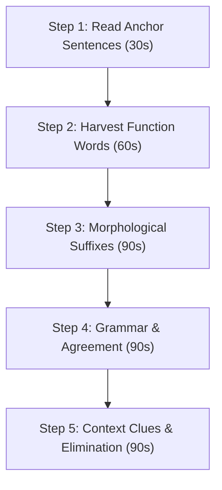

# C-Test Master Guide & High-Yield Vocabulary List
**Target Exam**: Münster SPZ C-Test & German University Language Placement (*Einstufungstest*)  
**Prep Window**: 30-Minute Rapid Mastery  
**Target Score**: B2 / C1 Placement (60–90+ / 100)

---

## 1. The C-Test Mathematical Engine: The Rule of Halves

A C-Test is not a random vocabulary recall test; it is a **rule-constrained reconstruction puzzle**. Knowing the mathematical constraints eliminates 80% of wrong guesses instantly.

> [!IMPORTANT]
> **The Golden Formula**:
> For any damaged word of length $L$:
> - **Given letters**: $g = \lfloor L / 2 \rfloor$
> - **Missing letters**: $m = \lceil L / 2 \rceil = L - g$
> - **Rule**: The missing part is **always equal to or exactly 1 letter longer** than the given prefix!
> $$m \in \{g, g+1\}$$

### The Length Decoder Table
Commit this table to memory before starting the exam:

| Given Letters ($g$) | Total Word Length ($L$) | Missing Letters ($m$) | Impossible Candidates | Instant Examples |
| :---: | :---: | :---: | :--- | :--- |
| **1 letter** | **2 or 3 letters** | **1 or 2 letters** | *Any word with 4+ letters* (e.g. `über`, `unter`, `weil`) | `z[u]`, `i[n]`, `e[s]`, `u[nd]`, `d[as]`, `T[ee]` |
| **2 letters** | **4 or 5 letters** | **2 or 3 letters** | *Short words (3)* or *Long words (6+)* | `Br[ot]`, `Ei[er]`, `ni[mmt]`, `Sa[che]`, `Me[nsa]` |
| **3 letters** | **6 or 7 letters** | **3 or 4 letters** | *Words shorter than 6 or longer than 7* | `Kaf[fee]`, `Gem[üse]`, `sei[nen]`, `Riv[alen]` |
| **4 letters** | **8 or 9 letters** | **4 or 5 letters** | *Words shorter than 8 or longer than 9* | `Leck[eres]`, `Vorm[ittag]`, `Proj[ekte]` |
| **5 letters** | **10 or 11 letters** | **5 or 6 letters** | *Words shorter than 10 or longer than 11* | `Karto[ffeln]`, `Entwi[cklung]` |

---

## 2. 5-Step Rapid Solving Algorithm (Under Exam Conditions)

With **25 minutes for 4 texts** (approx. 6 minutes per text):



1. **Step 1: Anchor Read (30 seconds)**: Read the first and last sentences completely (they have no gaps). Identify the theme: is it university life, food, medical research, or telecommunications?
2. **Step 2: Harvest Function Words (60 seconds)**: Jump straight to 1-letter and 2-letter prefixes. Fill in articles (`d[as]`, `ei[ne]`), prepositions (`z[u]`, `i[n]`), conjunctions (`u[nd]`, `au[ch]`), and pronouns (`s[ie]`, `e[s]`). This secures ~40% of the score immediately.
3. **Step 3: Morphological Suffixes (90 seconds)**: Look for academic nouns ending in `-ung`, `-heit`, `-keit`, `-schaft`, `-tion`, and adjectives ending in `-lich`, `-ig`, `-isch`.
4. **Step 4: Check Grammatical Agreement (90 seconds)**:
   - **Verbs**: Match ending with subject (`er/sie/es` $\to$ `-t`, plural $\to$ `-en`, modal $\to$ stem).
   - **Adjectives**: Match ending with preceding article and case (`in d[er] nähere[n] Umge[bung]`).
5. **Step 5: Fill All Gaps (90 seconds)**: Never leave an empty box. Use the letter count constraint to guess the most natural collocated German word.

---

## 3. High-Yield "Free Points" Function Words Table

> [!TIP]
> Function words make up **35% to 50%** of all gaps across Münster C-Tests. Memorize these exact prefixes:

### Articles & Determiners
* `d[er]`, `d[ie]`, `d[as]`, `d[en]`, `d[em]`, `d[es]`
* `ei[n]`, `ei[ne]`, `ei[nem]`, `ei[nen]`, `ei[ner]`, `ei[nes]`
* `di[es]`, `di[ese]`, `di[eser]`, `di[esem]`, `di[esen]`, `di[eses]`
* `je[de]`, `je[der]`, `je[des]`, `je[dem]`, `je[den]`
* `al[le]`, `al[les]`, `al[lem]`, `al[len]`, `al[ler]`
* `vi[el]`, `vi[ele]`, `vi[elen]`, `vi[eler]`
* `ei[nige]`, `me[hrere]`, `an[dere]`, `be[ide]`

### Prepositions (Grouped by Prefix Length)
* **1 Letter Given**:
  * `z[u]` (+ Dativ)
  * `i[n]` (+ Dativ / Akkusativ)
  * `a[n]` (+ Dativ / Akkusativ)
  * `b[ei]` (+ Dativ)
  * `m[it]` (+ Dativ)
  * `u[m]` (+ Akkusativ)
  * `a[b]` (+ Dativ)
* **2 Letters Given**:
  * `au[f]` (+ Dativ / Akkusativ)
  * `vo[n]` (+ Dativ)
  * `au[s]` (+ Dativ)
  * `fü[r]` (+ Akkusativ)
  * `na[ch]` (+ Dativ)
  * `üb[er]` (+ Dativ / Akkusativ)
  * `un[ter]` (+ Dativ / Akkusativ)
  * `vo[r]` (+ Dativ / Akkusativ)
  * `se[it]` (+ Dativ)
* **3–4 Letters Given**:
  * `dur[ch]` (+ Akkusativ)
  * `geg[en]` (+ Akkusativ)
  * `hin[ter]` (+ Dativ / Akkusativ)
  * `neb[en]` (+ Dativ / Akkusativ)
  * `weg[en]` (+ Genitiv / Dativ)
  * `wäh[rend]` (+ Genitiv)
  * `zwis[chen]` (+ Dativ / Akkusativ)

### Conjunctions & Subordinate Connectors
* **Coordinating (Position 0)**:
  * `u[nd]`
  * `a[ber]`
  * `o[der]`
  * `d[enn]`
  * `so[ndern]`
* **Subordinating (Verb at End)**:
  * `d[ass]`
  * `w[eil]`
  * `w[enn]`
  * `o[b]`
  * `obw[ohl]`
  * `wäh[rend]`
  * `nach[dem]`
  * `bev[or]`
  * `sod[ass]`
* **Two-Part Connectors**:
  * `sow[ohl] ... a[ls auch]`
  * `entw[eder] ... o[der]`
  * `wed[er] ... n[och]`
  * `nic[ht] nur ... son[dern] au[ch]`
  * `zwa[r] ... ab[er]`

### Pronouns & Particles
* **Personal & Reflexive**: `i[ch]`, `e[r]`, `e[s]`, `s[ie]`, `w[ir]`, `i[hr]`, `s[ich]`, `m[an]`, `m[ir]`, `d[ir]`, `i[hm]`, `i[hn]`, `u[ns]`
* **Possessive**: `me[in]`, `de[in]`, `se[in]`, `ih[r]`, `un[ser]`, `eu[er]`
* **Adverbs & Adverbial Particles**:
  * `au[ch]`, `no[ch]`, `ni[cht]`, `se[hr]`, `o[ft]`, `nu[r]`, `sc[hon]`
  * `he[ute]`, `je[tzt]`, `im[mer]`, `ba[ld]`, `wi[eder]`, `fa[st]`
  * `desh[alb]`, `dah[er]`, `jed[och]`, `allerd[ings]`

---

## 4. High-Yield Academic Vocabulary (Organized by Suffix & Roots)

Münster C-Test texts are excerpted from university articles, newspapers (*Die Zeit*, *FAZ*), and scientific reviews.

### Universal Noun Suffixes
| Suffix | Gender | Common C-Test Completions |
| :--- | :--- | :--- |
| **`-ung`** | *die* | `Bedeut[ung]`, `Entwickl[ung]`, `Erfah[rung]`, `Forsch[ung]`, `Ausbild[ung]`, `Veranstat[ung]`, `Leist[ung]` |
| **`-heit`** | *die* | `Sicher[heit]`, `Frei[heit]`, `Gelegen[heit]`, `Wahr[heit]`, `Mehr[heit]`, `Gesund[heit]` |
| **`-keit`** | *die* | `Möglich[keit]`, `Schwierig[keit]`, `Fähig[keit]`, `Tätig[keit]`, `Wirksam[keit]` |
| **`-schaft`** | *die* | `Wissen[schaft]`, `Gesell[schaft]`, `Wirt[schaft]`, `Bereit[schaft]` |
| **`-tion`** | *die* | `Informa[tion]`, `Situa[tion]`, `Organisa[tion]`, `Kommunika[tion]`, `Produkt[ion]` |
| **`-tät`** | *die* | `Universi[tät]`, `Aktuali[tät]`, `Quali[tät]`, `Realit[ät]` |
| **`-tum`** | *das* | `Wachs[tum]`, `Eigen[tum]`, `Bürger[tum]` |
| **`-nis`** | *das/die* | `Ergeb[nis]`, `Kennt[nis]`, `Verständ[nis]`, `Erleb[nis]` |

### Universal Adjective Suffixes
| Suffix | Meaning | Common C-Test Completions |
| :--- | :--- | :--- |
| **`-lich`** | Characteristic | `mög[lich]`, `täg[lich]`, `ursprüng[lich]`, `öffent[lich]`, `persön[lich]`, `wesent[lich]` |
| **`-ig`** | State/Quality | `wich[tig]`, `rich[tig]`, `häu[fig]`, `gerin[gig]`, `eindeut[ig]`, `stän[dig]` |
| **`-isch`** | Origin/Domain | `techni[sch]`, `politi[sch]`, `medizini[sch]`, `akade[misch]`, `prakti[sch]` |
| **`-bar`** | Passive ability (-able) | `sicht[bar]`, `lös[bar]`, `erreich[bar]`, `anwend[bar]`, `nutz[bar]` |
| **`-voll`** | Full of | `sinn[voll]`, `wert[voll]`, `erfolg[voll]`, `anspruchs[voll]` |

### High-Frequency Verbs in Academic Texts
* `unterst[ützen]` (to support)
* `beschr[eiben]` (to describe)
* `veran[stalten]` (to organize/host)
* `entsch[eiden]` (to decide)
* `entwi[ckeln]` (to develop)
* `verbes[sern]` (to improve)
* `beeinfl[ussen]` (to influence)
* `unters[uchen]` (to examine/investigate)
* `funktio[nieren]` (to function)
* `beschäf[tigen]` (to occupy/deal with)
* `beschr[änken]` (to limit/restrict)
* `darst[ellen]` (to represent/portray)

---

## 5. Fixed Collocations & Idiomatic Idioms (*Nomen-Verb-Verbindungen*)

C-Test gaps frequently split fixed combinations. If you recognize the idiom, the answer is instantaneous:

* **`eine Ro[lle] spi[elen]`** = to play a role / be important
* **`zur Verfü[gung] ste[hen] / stel[len]`** = to be available / make available
* **`im Mittel[punkt] ste[hen]`** = to be at the center of attention
* **`in Fra[ge] kom[men]`** = to come into consideration
* **`eine Entsche[idung] tref[fen]`** = to make a decision
* **`unter Bew[eis] ste[llen]`** = to prove
* **`Rücksicht nehm[en] auf`** = to be considerate of
* **`in Kauf nehm[en]`** = to accept (a downside)
* **`Ergeb[nisse] erzie[len]`** = to achieve results
* **`v[on] Ze[it] z[u] Ze[it]`** = from time to time
* **`i[n] d[er] Re[gel]`** = as a rule / normally
* **`n[ach] w[ie] v[or]`** = still / as before
* **`z[um] ei[nen] ... z[um] and[eren]`** = on one hand ... on the other hand
* **`Ta[g] d[er] off[enen] Tü[r]`** = Open Day

---

## 6. Preposition + Case Traps

Always inspect the case required by the preposition before completing articles or adjective endings:

```
Akkusativ Only: bis, durch, für, gegen, ohne, um
Dativ Only:     aus, bei, mit, nach, seit, von, zu, gegenüber
Genitiv:        während, wegen, trotz, innerhalb, außerhalb
Wechsel:        an, auf, hinter, in, neben, über, unter, vor, zwischen
                (Wo? = Dativ | Wohin? = Akkusativ)
```

**Common Examples in C-Tests**:
- *`mit groß[em] Erfo[lg]`* (mit + Dativ Maskulin = `-em`)
- *`in d[er] heuti[gen] Ze[it]`* (in + Dativ Feminin = `der heutigen Zeit`)
- *`auf d[ie] Fra[ge]`* (auf + Akkusativ Feminin = `die Frage`)
- *`im Rah[men] ein[es] Proje[kts]`* (Genitiv = `eines Projekts`)

---

## 7. Interactive Rapid-Fire Practice Drills

Test yourself now with these 2 real-format simulation texts (12 gaps each). Cover the solutions below before answering!

### Drill Text 1: University Life (*Das Studium*)
> Ein Studium an einer deutschen Universität verlangt viel Selbstständigkeit. Studierende müs___ ihren Stu___ meist sel___ organisieren u___ den Ta___ nach eig___ Vorstellungen gesta___. Viele Stu___ arbeiten neb___ dem Stu___, um ih___ Lebensunterhalt z___ sichern.

### Drill Text 2: Digital Health (*Digitale Medizin*)
> Die Digitalisierung eröffnet in der modernen Medizintechnik neue Horizonte. Computergestützte Verf___ helfen Är___ bei d___ präzisen Diag___ von Erkran___. Künstliche Intel___ analysiert gro___ Datenmengen u___ erkennt klei___ Abweichungen, d___ dem mensch___ Auge verbli___ bleiben.

---

### Drill Solutions & Length Verification

#### Text 1 Solutions:
1. `müs[sen]` (3 letters given $\to$ 6 letters: *müssen*)
2. `Stu[dienplan]` or `Stu[dentenalltag]` $\to$ `Stu[dium]` (3 given $\to$ 7 letters: *Studium*)
3. `sel[bst]` (3 given $\to$ 6 letters: *selbst*)
4. `u[nd]` (1 given $\to$ 3 letters: *und*)
5. `Ta[g]` (2 given $\to$ 3 letters: *Tag*)
6. `eig[enen]` (3 given $\to$ 7 letters: *eigenen*)
7. `gesta[lten]` (5 given $\to$ 9 letters: *gestalten*)
8. `Stu[denten]` (3 given $\to$ 8 letters: *Studenten*)
9. `neb[en]` (3 given $\to$ 5 letters: *neben*)
10. `Stu[dium]` (3 given $\to$ 7 letters: *Studium*)
11. `ih[ren]` (2 given $\to$ 5 letters: *ihren*)
12. `z[u]` (1 given $\to$ 2 letters: *zu*)

#### Text 2 Solutions:
1. `Verf[ahren]` (4 given $\to$ 8 letters: *Verfahren*)
2. `Är[zten]` (2 given $\to$ 6 letters: *Ärzten*)
3. `d[er]` (1 given $\to$ 3 letters: *der*)
4. `Diag[nose]` (4 given $\to$ 8 letters: *Diagnose*)
5. `Erkran[kungen]` (6 given $\to$ 11 letters: *Erkrankungen*)
6. `Intel[ligenz]` (5 given $\to$ 10 letters: *Intelligenz*)
7. `gro[ße]` (3 given $\to$ 5 letters: *große*)
8. `u[nd]` (1 given $\to$ 3 letters: *und*)
9. `klei[nste]` (4 given $\to$ 8 letters: *kleinste*)
10. `d[ie]` (1 given $\to$ 3 letters: *die*)
11. `mensch[lichen]` (6 given $\to$ 12 letters: *menschlichen*)
12. `verbli[eben]` (6 given $\to$ 10 letters: *verborgen* or *verblieben*)

---

## 8. 3-Minute Quick Review Checklist

Before clicking **"Test starten"**:
* [ ] **First & Last sentences read**: Context identified.
* [ ] **1-letter words checked**: Only 2 or 3 letters (`zu`, `in`, `und`, `das`, `die`, `der`, `es`).
* [ ] **2-letter words checked**: Only 4 or 5 letters (`eine`, `nach`, `aber`, `wird`, `kann`, `sind`).
* [ ] **Verb agreement verified**: Subject identified; verb ending matches singular/plural.
* [ ] **Zero empty boxes**: Filled in best guesses everywhere before the 25-minute timer expires!

---

## 9. Case Recognition Engine (Nominativ · Akkusativ · Dativ · Genitiv)

In a C-Test, grammatical endings for articles, pronouns, and adjectives are 100% predictable if you identify the case. Follow this **3-step priority pipeline**:

### Step 1: Preposition Before the Gap? (100% Deterministic)
If a preposition precedes the gap, it overrides the verb and dictates the case completely:
* **Akkusativ Only**: `bis`, `durch`, `für`, `gegen`, `ohne`, `um`
  * *Transformation*: Masculine changes to `den / einen / meinen`; Neuter (`das / ein`) and Feminine (`die / eine`) remain unchanged.
* **Dativ Only**: `aus`, `bei`, `mit`, `nach`, `seit`, `von`, `zu`, `gegenüber`
  * *Transformation*: Masculine & Neuter both become `dem / einem`; Feminine becomes `der / einer`; Plural becomes `den + Noun-(e)n`.
* **Genitiv Only**: `während`, `wegen`, `trotz`, `innerhalb`, `außerhalb`
  * *Transformation*: Masculine & Neuter both become `des / eines + Noun-(e)s`; Feminine & Plural become `der / einer`.
* **Two-Way Prepositions (Wechselpräpositionen)**: `an`, `auf`, `hinter`, `in`, `neben`, `über`, `unter`, `vor`, `zwischen`
  * **Wo? (Static location/state)** $\to$ **DATIV** (*in d[er] Mensa, an d[em] Institut*).
  * **Wohin? (Motion/direction)** $\to$ **AKKUSATIV** (*ins [in das] Ausland, auf d[en] Markt*).

### Step 2: Specific Verb Trigger?
* **Dative Verbs**: `helfen`, `gehören`, `schaden`, `danken`, `folgen`, `entsprechen`, `vertrauen` $\to$ Object is **always Dativ** (*Er hilft d[em] Studenten*).
* **Copular Verbs**: `sein`, `werden`, `bleiben` $\to$ Predicate noun/adjective is **always Nominativ** (*Er ist ein erfahren[er] Arzt*).

### Step 3: Syntactic Role (Subject vs Object)
* **Subject (Who is acting?)** $\to$ **Nominativ**
* **Direct Object (What is being acted on?)** $\to$ **Akkusativ** (Used by 90% of German verbs: *haben, finden, sehen, nutzen, bieten, entwickeln*).

---

## 10. The Adjective & Noun Endings Decision Matrix

### Adjective Ending Secrets
1. **After Definite Articles (`der, die, das, den, dem, des`)**:
   * There are **only two endings in existence**: **`-e`** or **`-en`**!
   * **`-e`** occurs in only 5 boxes: Nominative Singular (*der gut[e], die neu[e], das schön[e]*) and Accusative Feminine/Neuter (*die neu[e], das schön[e]*).
   * **`-en` occurs everywhere else**: All Plurals, all Datives, all Genitives, and Masculine Accusative.
2. **After Indefinite Articles (`ein, kein, mein, sein, ihr`)**:
   * If the article already shows the case ending (*einem, einen, einer, eines*), the adjective takes **`-en`**.
   * If the article shows NO ending (*ein, kein* in Nom. Maskulin or Nom./Akk. Neuter), the adjective must signal the gender:
     * *ein groß[er] Erfolg* (signals `der`)
     * *ein neu[es] System* (signals `das`)
3. **No Article (Zero Article)**:
   * The adjective copies the ending of the definite article directly:
     * *mit groß[em] Interesse* (copies `dem` $\to$ `-em`)
     * *nach lang[er] Diskussion* (copies `der` $\to$ `-er`)
     * *frisch[es] Brot* (copies `das` $\to$ `-es`)

> [!TIP]
> **Stat-Hack**: When in doubt on an adjective ending, guess **`-en`**. Over 65% of German adjective slots in academic texts end in `-en`.

### Noun Ending Traps
* **Dativ Plural Noun Endings**: Plural nouns in Dativ **must add `-n`** (*mit den Kolle[gen]*, *bei den Kin[dern]*).
* **N-Deklination (Weak Masculine Nouns)**: Add `-(e)n` in all cases except Nominativ Singular (*den Studen[ten]*, *des Exper[ten]*, *dem Patien[ten]*, *den Men[schen]*).
* **Genitiv Singular (Masculine / Neuter)**: Adds `-(e)s` (*des Jah[res]*, *des Proje[kts]*, *des Stu[diums]*).
