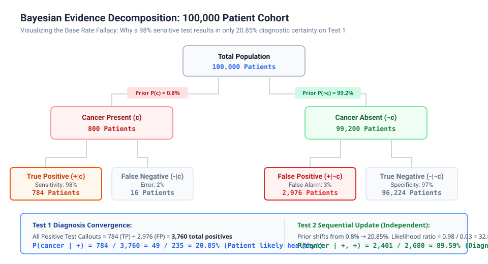
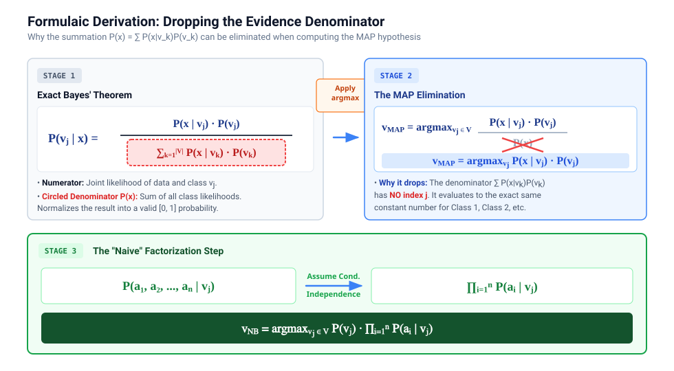
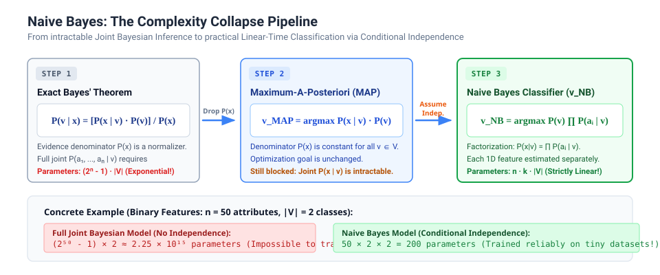
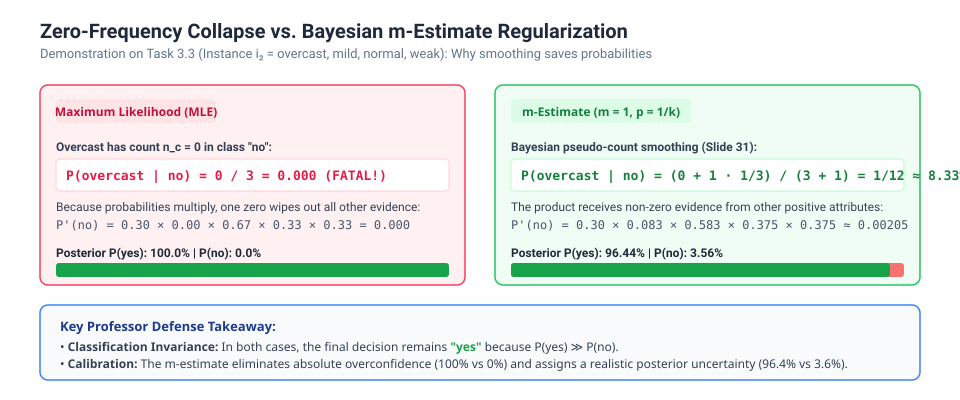
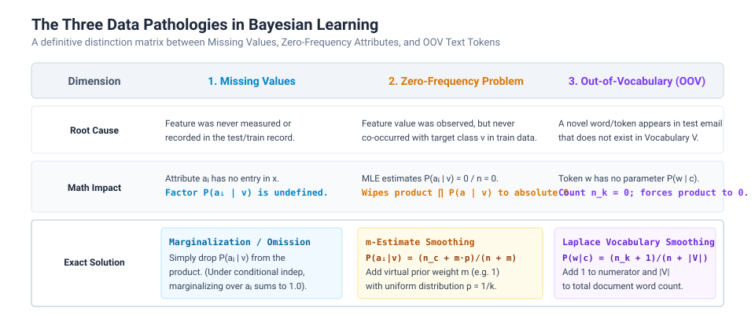

# Machine Learning (WS 2026/2027) — Bayesian Learning & Sheet 3 Defense Guide

**Course:** Machine Learning | **Chair:** Prof. Dr.-Ing. Andreas Nürnberger, M.Sc. Ernst Stötzner-Luu  
**Student:** Nutan Kumar Anantha Sai | **Matrikelnummer:** 261304  
**Program:** M.Sc. Medical Systems Engineering — OVGU Magdeburg  
**Focus:** Assignment Sheet 3 Oral Defense & Tutorial Preparation  

---

## Executive Summary & Tutorial Objective

In today's tutorial, you will be asked to present or defend one of the tasks from **Assignment Sheet 3**. Prof. Nürnberger and the tutors will not simply look at final numbers—they test **conceptual understanding**, **underlying assumptions**, and **mathematical mechanics**.

This guide is designed for rapid 60-minute mastery:
1. **Core Bayesian Mechanics**: Why rare diseases fool human intuition (Base-Rate Fallacy).
2. **Naive Bayes Architecture**: How Maximum-A-Posteriori (MAP) collapses from exponential to linear complexity.
3. **Task-by-Task Defense Manual**: The exact 30-second spoken opening and step-by-step whiteboard derivations for Tasks 3.1, 3.2, 3.3, and 3.4.
4. **Professor Grilling Simulator**: The 8 most brutal follow-up questions with bulletproof 1-to-2 sentence answers.

---

## Part 1: Core Bayesian Mechanics & Intuition

### 1.1 The Four Pillars of Bayes' Theorem

Bayes' Theorem provides the principled mathematical framework for updating beliefs in light of new evidence:

$$P(h \mid D) = \frac{P(D \mid h) \cdot P(h)}{P(D)}$$

* **Prior $P(h)$**: Background probability of hypothesis $h$ before seeing data $D$.
* **Likelihood $P(D \mid h)$**: Probability of observing data $D$ if hypothesis $h$ is true.
* **Evidence / Marginal Likelihood $P(D)$**: Total probability of observing $D$ across all possible mutually exclusive hypotheses:
  $$P(D) = \sum_{k} P(D \mid h_k) P(h_k)$$
* **Posterior $P(h \mid D)$**: Updated belief in hypothesis $h$ after observing evidence $D$.

---

### 1.2 The Base-Rate Fallacy (Deconstructing Task 3.1)

When a medical test has **98% sensitivity** (true positive rate) and **97% specificity** (true negative rate, giving a 3% false positive rate), most people intuitively assume that a positive test means a 98% chance of having the disease.

In reality, if the disease is rare ($P(\text{cancer}) = 0.008$), the posterior probability after one test is **only 20.85%**.



#### The 100,000 Patient Cohort Intuition
Imagine screening $100,000$ random people:
* **800 people have cancer** ($0.8\%$): The test identifies $98\% \times 800 = \mathbf{784}$ true positives (and misses 16 false negatives).
* **99,200 people are healthy** ($99.2\%$): The test falsely flags $3\% \times 99,200 = \mathbf{2,976}$ false positives.
* **Total Positive Tests**: $784 + 2,976 = \mathbf{3,760}$.
* **Diagnostic Probability**: Out of all 3,760 people told they tested positive, only 784 actually have cancer:
  $$\frac{784}{3,760} = \frac{49}{235} \approx \mathbf{20.85\%}$$

> [!IMPORTANT]
> **Key Insight**: The false positive rate ($3\%$) is small, but it operates on a massive healthy population ($99.2\%$), creating roughly $4\times$ more false alarms than true detections!

---

### 1.3 Sequential Bayesian Updating (The Power of Test 2)

Bayesian inference is cumulative. When the patient takes a **second, independent test** that is also positive:
* You **do not** discard the first test.
* The posterior of Test 1 becomes the **new prior** for Test 2:
  $$P_{\text{prior}_2}(c) = \frac{49}{235} \approx 0.2085, \quad P_{\text{prior}_2}(\neg c) = \frac{186}{235} \approx 0.7915$$
* The likelihood ratio is $\frac{P(+ \mid c)}{P(+ \mid \neg c)} = \frac{0.98}{0.03} \approx 32.67$.
* This overwhelming ratio easily overcomes the remaining doubt:
  $$P(c \mid +, +) = \frac{0.98 \times \frac{49}{235}}{\left(0.98 \times \frac{49}{235}\right) + \left(0.03 \times \frac{186}{235}\right)} = \frac{48.02}{53.60} = \frac{2401}{2680} \approx \mathbf{89.59\%}$$

The diagnosis shifts decisively from $h_{\text{MAP}} = \neg c$ to $h_{\text{MAP}} = c$.

---

## Part 2: The Architecture of Naive Bayes

### 2.1 The Derivation Pipeline: Bayes $\to$ MAP $\to$ Naive Bayes





#### Step 1: The True Joint Posterior
For an instance $x = (a_1, a_2, \dots, a_n)$ and candidate classes $v_j \in V$:
$$P(v_j \mid a_1, \dots, a_n) = \frac{P(a_1, \dots, a_n \mid v_j) \cdot P(v_j)}{P(a_1, \dots, a_n)}$$

#### Step 2: Maximum-A-Posteriori (MAP)
We only need to pick the class with the highest probability. Since the denominator $P(a_1, \dots, a_n) = \sum_k P(x \mid v_k) P(v_k)$ does not depend on $v_j$, it is an identical constant across all candidates and can be safely dropped:
$$v_{\text{MAP}} = \arg\max_{v_j \in V} P(a_1, \dots, a_n \mid v_j) \cdot P(v_j)$$

#### Step 3: The "Naive" Conditional Independence Factorization
Estimating the full joint probability $P(a_1, \dots, a_n \mid v_j)$ requires an astronomical amount of data. Naive Bayes assumes each attribute $a_i$ is **conditionally independent** of every other attribute given the class $v_j$:
$$P(a_1, a_2, \dots, a_n \mid v_j) = \prod_{i=1}^n P(a_i \mid v_j)$$

Substituting this yields the celebrated **Naive Bayes Decision Rule**:
$$\mathbf{v_{\text{NB}} = \arg\max_{v_j \in V} P(v_j) \prod_{i=1}^n P(a_i \mid v_j)}$$

---

### 2.2 Why the "Naive" Assumption is Essential

* **Complexity Collapse**:
  * For $n$ binary features and $|V|$ classes:
    * Full Joint Model: Requires estimating $(2^n - 1) \times |V|$ parameters. For $n=50$, $2^{50} \approx 10^{15}$ parameters (uncomputable).
    * Naive Bayes Model: Requires estimating only $n \times 2 \times |V|$ parameters. For $n=50$, that is just $50 \times 2 \times 2 = \mathbf{200}$ parameters!
* **Why it works despite violation**:
  In real life, attributes are almost never independent (e.g., medical symptoms or co-occurring words). Yet Naive Bayes achieves state-of-the-art accuracy. Why?  
  Because **classification is a 0-1 loss decision**: you only care which class has the higher score ($\arg\max$). As long as the correct class has a higher product, the classifier makes the correct decision, even if the absolute probabilities are poorly calibrated.

---

## Part 3: Task-by-Task Defense Manual

---

### Task 3.1: Cancer Diagnosis

#### 30-Second Spoken Pitch
> *"In Task 3.1, we evaluate Bayesian diagnostic updating on a rare cancer with base rate $0.8\%$. After the first test, despite $98\%$ sensitivity and $97\%$ specificity, the posterior probability is only $20.85\%$, meaning the patient is still roughly $80\%$ likely to be healthy due to the base-rate fallacy. However, when a second independent test also returns positive, we use the first posterior as our new prior. The evidence compounds, pushing the posterior to $89.59\%$ and flipping our MAP diagnosis to cancer."*

#### Whiteboard Step-by-Step Script
1. Write given parameters:
   $$P(c) = 0.008, \quad P(\neg c) = 0.992$$
   $$P(+ \mid c) = 0.98, \quad P(+ \mid \neg c) = 0.03$$
2. First Test Calculation:
   $$P(c \mid +) = \frac{0.98 \times 0.008}{(0.98 \times 0.008) + (0.03 \times 0.992)} = \frac{0.00784}{0.00784 + 0.02976} = \frac{0.00784}{0.03760} = \mathbf{20.85\%}$$
3. Second Test Calculation (Sequential):
   $$P(c \mid +, +) = \frac{0.98 \times \frac{49}{235}}{\left(0.98 \times \frac{49}{235}\right) + \left(0.03 \times \frac{186}{235}\right)} = \frac{48.02}{53.60} = \mathbf{89.59\%}$$

---

### Task 3.2: Foundations of Naive Bayes

#### 30-Second Spoken Pitch
> *"In Task 3.2, we derive Naive Bayes as a linear-time approximation of the MAP hypothesis. By dropping the constant evidence denominator and assuming conditional independence of features given the class, parameter estimation drops from exponential to linear. We handle missing values at test time by marginalizing out the missing dimension—simply dropping it from the product. To solve zero frequencies, where unseen features would multiply the entire probability to zero, we apply Bayesian pseudo-count regularization via the $m$-estimate or Laplace smoothing."*

#### Key Conceptual Points to Hit:
* **MAP Connection**: $v_{\text{NB}} = \arg\max P(v_j) \prod P(a_i \mid v_j)$ directly tracks $v_{\text{MAP}}$ with an intractable joint replaced by marginal products.
* **Probability Estimation**:
  * Discrete: Maximum Likelihood Estimate $P(a_i \mid v_j) = \frac{n_c}{n}$.
  * Continuous: Gaussian density $P(a_i \mid v_j) = \frac{1}{\sqrt{2\pi\sigma^2}} \exp\left(-\frac{(a_i - \mu)^2}{2\sigma^2}\right)$.
* **Missing Value vs. Zero Frequency Trap**: Be ready to state immediately that these are two different problems (see Part 4).

---

### Task 3.3: PlayTennis Classification (MLE vs. $m$-Estimate)

#### 30-Second Spoken Pitch
> *"In Task 3.3, we classify two instances from a 10-day PlayTennis dataset. For instance $i_1$, MLE yields $73.84\%$ for 'no' and $26.16\%$ for 'yes'. For instance $i_2$, `overcast` never appears with 'no' ($n_c = 0$), causing MLE to catastrophically crash $P(\text{no} \mid i_2)$ to $0.0\%$, creating an unrealistic $100\%$ confidence for 'yes'. Applying the $m$-estimate with $m=1$ and uniform priors resolves this zero-frequency collapse, assigning 'no' a realistic $3.56\%$ posterior while leaving the final classification invariant."*



#### Numerical Summary Table (Memorize These Values)

| Instance | Query Features | Metric | MLE Result | $m$-Estimate ($m=1$) | Impact / Observation |
| :--- | :--- | :---: | :---: | :---: | :--- |
| **$i_1$** | `sunny, cool, high, strong` | $P(\text{yes})$<br>$P(\text{no})$ | $26.16\%$<br>$73.84\%$ | $34.89\%$<br>$65.11\%$ | Probabilities pull toward prior; less extreme. |
| | | **Decision** | **`no`** | **`no`** | Class decision remains invariant. |
| **$i_2$** | `overcast, mild, normal, weak` | $P(\text{yes})$<br>$P(\text{no})$ | **$100.0\%$**<br>**$0.0\%$** | **$96.44\%$**<br>**$3.56\%$** | **Cures Zero-Frequency Trap** (`overcast|no` $\to 1/12$). |
| | | **Decision** | **`yes`** | **`yes`** | Class decision remains invariant. |

#### Whiteboard Calculation Walkthrough for $i_2$:
1. **Priors**: $P(\text{yes}) = 7/10 = 0.7, \quad P(\text{no}) = 3/10 = 0.3$.
2. **The MLE Collapse**:
   $$P(\text{overcast} \mid \text{no}) = \frac{0}{3} = 0 \implies P'(\text{no}) = 0.3 \times 0 \times \dots = 0 \implies P(\text{yes}) = 100\%$$
3. **The $m$-Estimate Fix** ($n_c=0, m=1, p=1/3, n=3$):
   $$P(\text{overcast} \mid \text{no}) = \frac{n_c + m \cdot p}{n + m} = \frac{0 + 1 \cdot \frac{1}{3}}{3 + 1} = \frac{\frac{1}{3}}{4} = \mathbf{\frac{1}{12}} \approx 8.33\%$$
   $$P'(\text{no}) = 0.3 \times \frac{1}{12} \times \frac{7}{12} \times \frac{3}{8} \times \frac{3}{8} = 0.002051$$
   $$P'(\text{yes}) = 0.7 \times \frac{5}{12} \times \frac{5}{12} \times \frac{13}{16} \times \frac{9}{16} = 0.055542$$
   $$P(\text{yes} \mid i_2) = \frac{0.055542}{0.055542 + 0.002051} = \mathbf{96.44\%}, \quad P(\text{no} \mid i_2) = \mathbf{3.56\%}$$

---

### Task 3.4: Spam Filtering Realities

#### 30-Second Spoken Pitch
> *"In Task 3.4, we adapt Naive Bayes to email spam filtering. Word probabilities are modeled using a Multinomial Bag-of-Words with Laplace smoothing ($+1$ to counts, $+|V|$ to the denominator) to prevent zero-probabilities on unseen words. Email size can be modeled via a class-conditional Gaussian distribution or discretized size bins. In production, Naive Bayes suffers from extreme probability overconfidence due to correlated words, arithmetic underflow requiring log-space addition, and susceptibility to 'Good Word Attacks'."*

#### Key Mechanics to Mention:
1. **Word Likelihood (Slide 35)**:
   $$P(w_k \mid c) = \frac{n_{k, c} + 1}{n_c + |V|}$$
2. **Email Size**:
   Continuous: $P(\text{size}=S \mid c) = \frac{1}{\sqrt{2\pi\sigma_c^2}} \exp\left(-\frac{(S - \mu_c)^2}{2\sigma_c^2}\right)$ (or fit to $\ln S$).
3. **Log-Space Computation**:
   $$\ln P(c \mid d) \propto \ln P(c) + \sum_{k=1}^M \ln P(w_k \mid c)$$

---

## Part 4: The Professor Grilling Simulator (Top 8 Defense Questions)



### Q1: "Why did you drop the denominator $P(x)$ in Naive Bayes? Can you always drop it?"
> **Your Answer:**  
> *"We drop $P(x)$ only when we are performing classification ($\arg\max$). Because $P(x) = \sum_k P(x \mid v_k)P(v_k)$ is independent of the class label $v$, it scales all class scores by the exact same constant, so it cannot change the rank order. However, if we need the true posterior probabilities (e.g. for confidence estimation or risk assessment), we cannot drop it; we must normalize by dividing by the sum of all unnormalized scores."*

---

### Q2: "In Task 3.1, why is the cancer probability after test 1 only 20.85% when the test is 98% accurate? What is this called?"
> **Your Answer:**  
> *"This is the **Base-Rate Fallacy**. Because the disease is so rare ($0.8\%$), the vast majority ($99.2\%$) of the population is healthy. Even with a small $3\%$ false positive rate, the false positives generated from the massive healthy pool ($2,976$ people per $100,000$) far outnumber the true positives generated from the small diseased pool ($784$ people per $100,000$). Hence, any individual positive test is still much more likely to be a false alarm."*

---

### Q3: "What critical assumption did we make when calculating the second test in Task 3.1?"
> **Your Answer:**  
> *"We assumed that the two test outcomes are **conditionally independent given the patient's true health status**:  
> $$P(T_1 = +, T_2 = + \mid \text{cancer}) = P(T_1 = + \mid \text{cancer}) \cdot P(T_2 = + \mid \text{cancer})$$  
> If the two tests are not independent—for instance, if both tests fail due to the same cross-reacting protein or patient biology—this assumption breaks down, and the true posterior will be significantly lower than $89.59\%$."*

---

### Q4: "Conditional independence is almost always violated in practice (e.g., words in emails). Why does Naive Bayes still perform so well?"
> **Your Answer:**  
> *"Naive Bayes works well because 0-1 loss classification only depends on the **sign of the decision boundary** ($\arg\max$), not the accuracy of the posterior probabilities. Even if the probability values are severely distorted (often pushed unrealistically close to 0 or 1), the ranking of the classes remains remarkably robust as long as the correct class receives the highest score."*

---

### Q5: "What is the difference between a missing value and the zero-frequency problem? How does Naive Bayes handle each?"
> **Your Answer:**  
> *"They are completely distinct pathologies:  
> • **Missing Values**: An attribute was never observed in a test sample. We handle it by **marginalizing out** that attribute under conditional independence, which simply means omitting $P(a_i \mid v)$ from the product.  
> • **Zero-Frequency Problem**: An attribute was observed, but never occurred with class $v$ during training ($n_c = 0$). Under MLE, this sets $P(a_i \mid v) = 0$, wiping out the entire product. We fix this using **smoothing** (such as the $m$-estimate or Laplace smoothing) to inject a non-zero pseudo-count."*

---

### Q6: "In the $m$-estimate formula $P(a_i \mid v) = \frac{n_c + m \cdot p}{n + m}$, what does $m$ physically represent?"
> **Your Answer:**  
> *"The parameter $m$ represents an **equivalent sample size**—it is the weight or number of 'virtual examples' we assign to our prior belief $p$. If $m$ is large, we strongly distrust small datasets and force probabilities toward the prior $p$. If $m=0$, it reduces strictly to the standard empirical Maximum Likelihood Estimate."*

---

### Q7: "Why do production implementations of Naive Bayes always compute probabilities in log-space?"
> **Your Answer:**  
> *"Because multiplying dozens or hundreds of small probabilities between $0$ and $1$ causes **floating-point underflow**, rounding the product to $0.0$ in computer memory. Taking the natural logarithm converts the product of probabilities into a numerically stable sum of log-probabilities:  
> $$\ln P(v) + \sum \ln P(a_i \mid v)$$  
> Furthermore, addition is computationally faster than multiplication."*

---

### Q8: "What is a 'Good Word Attack' in spam filtering, and why is Naive Bayes vulnerable to it?"
> **Your Answer:**  
> *"A Good Word Attack occurs when a spammer appends large blocks of legitimate text (e.g., news articles or classic literature) to a spam email. Because Naive Bayes assumes all words are independent and multiplies their probabilities, the sheer volume of benign 'ham' words easily overwhelms the few spam trigger words in the sum of log-likelihoods, tricking the classifier into predicting ham."*

---

## Part 5: Whiteboard Quick-Draw Reference

If Prof. Nürnberger calls you to the blackboard, write these down immediately:

```
1. Bayes Theorem:
   P(h | D) = [ P(D | h) * P(h) ] / P(D)

2. MAP Rule:
   v_MAP = argmax_v [ P(a1, ..., an | v) * P(v) ]

3. Naive Bayes Rule:
   v_NB = argmax_v [ P(v) * ∏ P(ai | v) ]

4. m-Estimate Formula:
   P(ai | v) = [ n_c + m * p ] / [ n + m ]
   (for uniform prior: p = 1/k)

5. Laplace Smoothing for Text:
   P(wk | c) = [ n_kc + 1 ] / [ n_c + |V| ]
```
