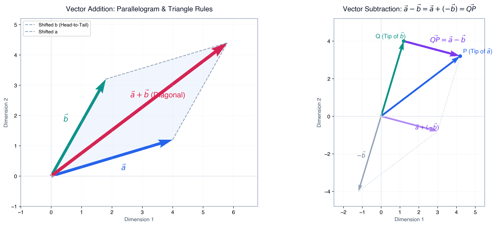
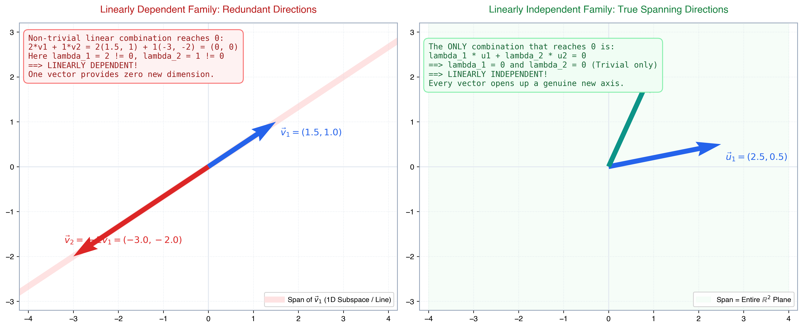
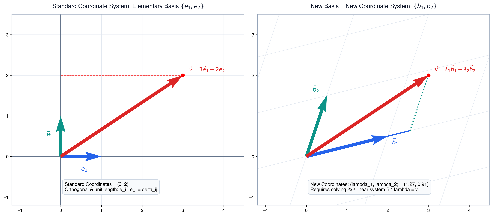
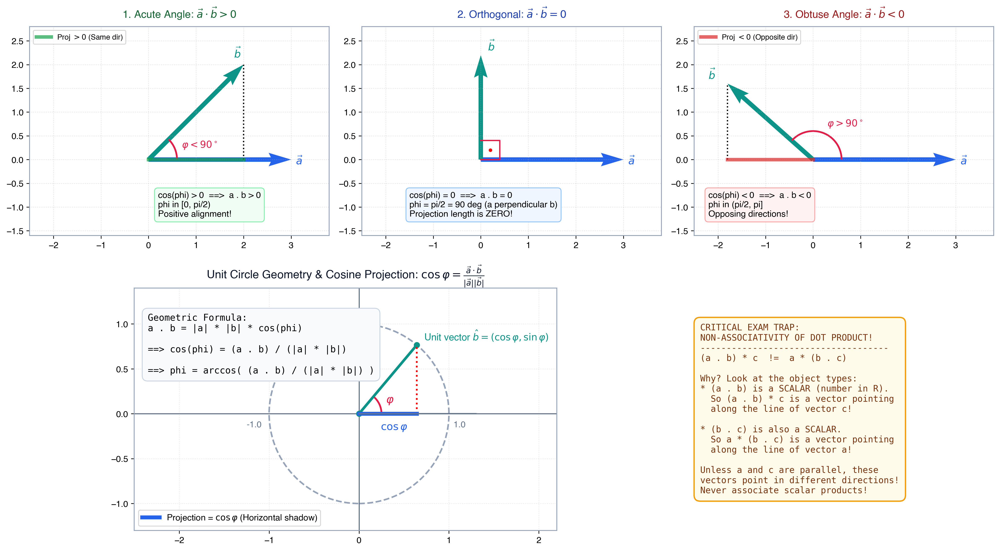
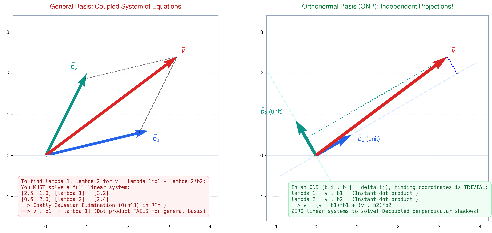
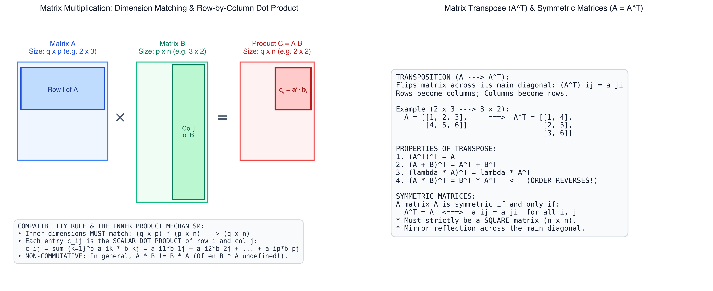
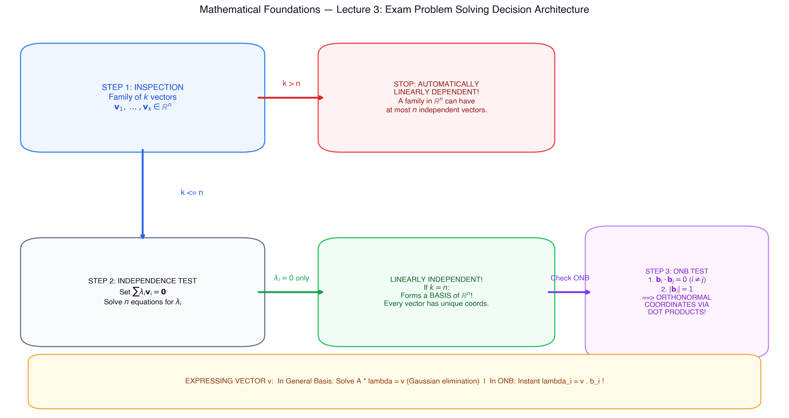
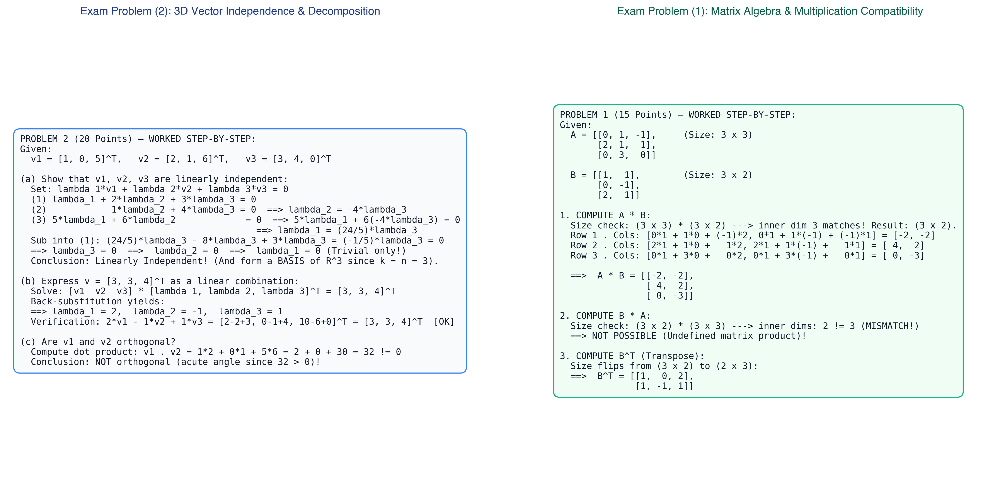

# Mathematical Foundations — Lecture 3 Master Study Explainer
> **OVGU Magdeburg — M.Sc. Medical Systems Engineering (WiSe 2026/27)**  
> **Institute:** Institut für Algebra und Geometrie (IAG) | **Module:** Mathematical Foundations (6 CP, K90 Exam)  
> **Primary Sources:** Handout Notes (`MF-Lecture 3-I.pdf`, `MF-Lecture 3-II.pdf`, `MF-Lecture 3-III.pdf`, `MF-Lecture 3-IV.pdf`), Extra Slides (`MF3angle.pdf`, `MF3problem.pdf`), and Course Handout Sections 1.3 & 2 (`Lecture_notes_for_Mathematical_Foundations_8_Oct_2026.pdf`).

---

## Executive Summary & Core Mental Models

Lecture 3 establishes the linear algebraic engine that underpins all digital medical imaging, computer vision, and physical simulation:
1. **Vectors in $\mathbb{R}^n$**: Geometric displacements defined by length and direction. Addition follows the **parallelogram rule**; subtraction $\mathbf{a} - \mathbf{b} = \vec{QP}$ is the displacement vector pointing from point $Q$ (at $\mathbf{b}$) to point $P$ (at $\mathbf{a}$).
2. **Linear Independence**: Tests whether any vector in a set is redundant. A family of $k$ vectors in $\mathbb{R}^n$ can **never** be linearly independent if $k > n$.
3. **Basis & Coordinates**: *"New Basis = New Coordinate System; Scalars in Linear Combination = New Coordinates."* Expressing a vector in a general basis requires solving an $n \times n$ linear system.
4. **Dot Product & Geometry**: $\mathbf{a} \cdot \mathbf{b}$ yields a single **scalar number**, measuring directional alignment. The sign of $\mathbf{a} \cdot \mathbf{b}$ categorizes the enclosed angle $\varphi$ into **acute** ($> 0$), **orthogonal** ($= 0$, $\varphi = 90^\circ$), or **obtuse** ($< 0$).
5. **The ONB Miracle**: In an Orthonormal Basis (ONB), solving expensive linear systems is completely eliminated. The coordinates of any vector $\mathbf{v}$ are simply its independent perpendicular projections: $\lambda_i = \mathbf{v} \cdot \mathbf{b}_i$.
6. **Matrix Algebra**: Matrices represent structured tables of numbers and linear transformations. Matrix multiplication $(AB)_{ij} = \mathbf{a}^i \cdot \mathbf{b}_j$ requires inner dimension compatibility: $(q \times p) \times (p \times n) \to (q \times n)$ and is non-commutative ($AB \ne BA$).

---

## 1. The $n$-Dimensional Euclidean Space $\mathbb{R}^n$ & Vector Algebra

### 1.1 Vector Spaces and Elementary Operations
In medical imaging and engineering, data rarely exists as single scalar numbers. A volumetric CT scan, an ECG signal array, or a patient feature profile is an element of an $n$-dimensional Euclidean space:
$$\mathbb{R}^n = \left\{ \mathbf{a} = (a_1, a_2, \dots, a_n) \mid a_i \in \mathbb{R} \right\}$$

A vector is fundamentally defined by two physical properties:
- **Direction** (where it points in $n$-dimensional space).
- **Length / Magnitude** (how far it extends).

```
Vector Properties:
  Length:    |a| = sqrt(a_1^2 + a_2^2 + ... + a_n^2)
  Direction: Unit vector â = a / |a|
```

### 1.2 Vector Addition & The Parallelogram Rule
For two vectors $\mathbf{a} = (a_1, \dots, a_n)$ and $\mathbf{b} = (b_1, \dots, b_n)$, addition is performed component-wise:
$$\mathbf{a} + \mathbf{b} = (a_1 + b_1, a_2 + b_2, \dots, a_n + b_n)$$

* **Geometric Intuition (Parallelogram Rule):** If you place the tails of $\mathbf{a}$ and $\mathbf{b}$ at the origin, their sum $\mathbf{a} + \mathbf{b}$ forms the main diagonal of the parallelogram defined by the two vectors.
* **Geometric Intuition (Tip-to-Tail / Triangle Rule):** Starting at the origin, follow vector $\mathbf{a}$ to its tip, then follow vector $\mathbf{b}$ from that tip. The net displacement from start to finish is $\mathbf{a} + \mathbf{b}$.

### 1.3 Vector Subtraction: Displacement from $Q$ to $P$
Subtraction is defined as adding the opposite vector:
$$\mathbf{a} - \mathbf{b} = \mathbf{a} + (-\mathbf{b}) = (a_1 - b_1, a_2 - b_2, \dots, a_n - b_n)$$

> [!IMPORTANT]
> **Geometric Meaning of Subtraction ($\vec{a} - \vec{b} = \vec{QP}$):**  
> If point $P$ is represented by position vector $\mathbf{a}$ and point $Q$ is represented by position vector $\mathbf{b}$, then the difference vector $\mathbf{a} - \mathbf{b}$ is the **directed displacement vector pointing from $Q$ directly to $P$** ($\vec{QP}$).  
> In medical instrumentation, if $Q$ is the sensor origin and $P$ is a target tumor, $\vec{QP} = \mathbf{a} - \mathbf{b}$ is the relative target trajectory.

### 1.4 Scalar Multiplication & Linear Combinations
Multiplying a vector $\mathbf{a}$ by a real number $\lambda \in \mathbb{R}$ scales its magnitude and governs its direction:
$$\lambda \mathbf{a} = (\lambda a_1, \lambda a_2, \dots, \lambda a_n)$$
- If $\lambda > 1$: Vector is stretched along the same direction.
- If $0 < \lambda < 1$: Vector is shrunk along the same direction.
- If $\lambda < 0$: Vector reverses direction by $180^\circ$ and scales by $|\lambda|$.

A **linear combination** of $k$ vectors $\mathbf{v}_1, \dots, \mathbf{v}_k \in \mathbb{R}^n$ with scalars $\lambda_1, \dots, \lambda_k \in \mathbb{R}$ is the weighted superposition:
$$\sum_{i=1}^k \lambda_i \mathbf{v}_i = \lambda_1 \mathbf{v}_1 + \lambda_2 \mathbf{v}_2 + \dots + \lambda_k \mathbf{v}_k$$



---

## 2. Linear Independence vs. Linear Dependence (The Redundancy Test)

### 2.1 Formal Definition
A set of $k$ vectors $\mathbf{v}_1, \dots, \mathbf{v}_k \in \mathbb{R}^n$ is said to be **linearly dependent** if there exist scalars $\lambda_1, \dots, \lambda_k$, **not all zero**, such that:
$$\sum_{i=1}^k \lambda_i \mathbf{v}_i = \lambda_1 \mathbf{v}_1 + \lambda_2 \mathbf{v}_2 + \dots + \lambda_k \mathbf{v}_k = \mathbf{0}$$

Conversely, the vectors are **linearly independent** if the **only** combination that produces the zero vector is the trivial solution:
$$\lambda_1 \mathbf{v}_1 + \dots + \lambda_k \mathbf{v}_k = \mathbf{0} \quad \implies \quad \lambda_1 = \lambda_2 = \dots = \lambda_k = 0$$

### 2.2 Deep Intuition: The Information Redundancy Check
What does linear dependence actually mean physically?
- **Linear Dependence = Redundancy:** At least one vector in the set can be expressed as a linear combination of the remaining vectors. It adds **zero new dimensions** to the spanned subspace.
- **Linear Independence = True Dimensional Exploration:** Every vector in the set opens up a brand new, independent degree of freedom.

```
Geometric Intuition in 2D and 3D:
  2 Vectors in R^2:
    - Collinear (parallel / on same line) ===> LINEARLY DEPENDENT
    - Pointing in distinct directions      ===> LINEARLY INDEPENDENT (Span all of R^2)

  3 Vectors in R^3:
    - Coplanar (all 3 lie in a single flat plane) ===> LINEARLY DEPENDENT
    - Not all lying in the same plane            ===> LINEARLY INDEPENDENT (Span all of R^3)
```

> [!WARNING]
> **The Fundamental Dimension Bound ($k \le n$):**  
> In $\mathbb{R}^n$, a linearly independent family can **NEVER have more than $n$ elements**:
> $$k \le n$$
> If an exam question asks whether $4$ vectors in $\mathbb{R}^3$ are linearly independent, you write immediately:  
> *"No, because $k = 4 > 3 = n$; any family with more than $n$ vectors in $\mathbb{R}^n$ is automatically linearly dependent."* No calculations needed!

### 2.3 Lecture Examples Worked Step-by-Step

#### Example 1: Collinear Vectors in $\mathbb{R}^2$ (Linearly Dependent)
Let $\mathbf{v}_1 = \begin{pmatrix} 1 \\ 1 \end{pmatrix}$ and $\mathbf{v}_2 = \begin{pmatrix} -2 \\ -2 \end{pmatrix}$.  
Notice that $\mathbf{v}_2 = -2\mathbf{v}_1$. We test:
$$\lambda_1 \begin{pmatrix} 1 \\ 1 \end{pmatrix} + \lambda_2 \begin{pmatrix} -2 \\ -2 \end{pmatrix} = \begin{pmatrix} 0 \\ 0 \end{pmatrix}$$
Choose $\lambda_1 = 2$ and $\lambda_2 = 1$:
$$2 \begin{pmatrix} 1 \\ 1 \end{pmatrix} + 1 \begin{pmatrix} -2 \\ -2 \end{pmatrix} = \begin{pmatrix} 2 - 2 \\ 2 - 2 \end{pmatrix} = \begin{pmatrix} 0 \\ 0 \end{pmatrix}$$
Because non-zero scalars ($\lambda_1 = 2 \ne 0, \lambda_2 = 1 \ne 0$) produce $\mathbf{0}$, $\mathbf{v}_1$ and $\mathbf{v}_2$ are **linearly dependent**.

#### Example 2: Non-Collinear Vectors in $\mathbb{R}^2$ (Linearly Independent)
Let $\mathbf{v}_1 = \begin{pmatrix} 2 \\ 0 \end{pmatrix}$ and $\mathbf{v}_2 = \begin{pmatrix} 1 \\ 1 \end{pmatrix}$.  
Test:
$$\lambda_1 \begin{pmatrix} 2 \\ 0 \end{pmatrix} + \lambda_2 \begin{pmatrix} 1 \\ 1 \end{pmatrix} = \begin{pmatrix} 0 \\ 0 \end{pmatrix} \iff \begin{pmatrix} 2\lambda_1 + \lambda_2 \\ \lambda_2 \end{pmatrix} = \begin{pmatrix} 0 \\ 0 \end{pmatrix}$$
- Second equation: $\lambda_2 = 0$.
- First equation: $2\lambda_1 + 0 = 0 \implies \lambda_1 = 0$.  
Only the trivial solution $\lambda_1 = \lambda_2 = 0$ exists $\implies \mathbf{v}_1, \mathbf{v}_2$ are **linearly independent**!



---

## 3. The Concept of Basis: "New Basis = New Coordinate System"

### 3.1 Definition of a Basis
A set of vectors $\{\mathbf{b}_1, \mathbf{b}_2, \dots, \mathbf{b}_n\}$ forms a **basis** of $\mathbb{R}^n$ if:
1. The family consists of exactly $n$ vectors ($k = n$).
2. The vectors are **linearly independent**.

### 3.2 The Fundamental Theorem of Bases
If $\{\mathbf{b}_1, \dots, \mathbf{b}_n\}$ is a basis of $\mathbb{R}^n$, then **every vector $\mathbf{v} \in \mathbb{R}^n$ has a UNIQUE representation** as a linear combination:
$$\mathbf{v} = \sum_{i=1}^n \lambda_i \mathbf{b}_i = \lambda_1 \mathbf{b}_1 + \lambda_2 \mathbf{b}_2 + \dots + \lambda_n \mathbf{b}_n$$

> [!NOTE]
> **The Two Golden Mantras of Lecture 3:**
> $$\mathbf{\text{NEW BASIS = NEW COORDINATE SYSTEM!}}$$
> $$\mathbf{\text{SCALARS IN LINEAR COMBINATION = NEW COORDINATES!}}$$
> When you choose a new basis, you are not altering the physical vector $\mathbf{v}$ in space. You are simply laying down a **new, possibly tilted grid**, and measuring the vector's address relative to those new axes.

### 3.3 The Standard / Elementary Basis
The most familiar basis of $\mathbb{R}^n$ is the standard elementary basis:
$$\mathbf{e}_1 = \begin{pmatrix} 1 \\ 0 \\ \vdots \\ 0 \end{pmatrix}, \quad \mathbf{e}_2 = \begin{pmatrix} 0 \\ 1 \\ \vdots \\ 0 \end{pmatrix}, \quad \dots, \quad \mathbf{e}_n = \begin{pmatrix} 0 \\ 0 \\ \vdots \\ 1 \end{pmatrix}$$
For any vector $\mathbf{a} = (a_1, a_2, \dots, a_n)^T$:
$$\mathbf{a} = a_1 \mathbf{e}_1 + a_2 \mathbf{e}_2 + \dots + a_n \mathbf{e}_n$$
The components $a_i$ are the coordinates in the standard orthogonal Cartesian system.

### 3.4 General Basis: The Cost of Coupled Equations
What happens when the basis $\{\mathbf{b}_1, \dots, \mathbf{b}_n\}$ is not orthogonal?  
To find the coordinates $\boldsymbol{\lambda} = (\lambda_1, \dots, \lambda_n)^T$ of a vector $\mathbf{v}$, you must construct the matrix $B = [\mathbf{b}_1 \; \mathbf{b}_2 \; \dots \; \mathbf{b}_n]$ and solve the coupled linear system:
$$B \boldsymbol{\lambda} = \mathbf{v} \iff \begin{pmatrix} b_{11} & b_{12} & \dots & b_{1n} \\ b_{21} & b_{22} & \dots & b_{2n} \\ \vdots & \vdots & \ddots & \vdots \\ b_{n1} & b_{n2} & \dots & b_{nn} \end{pmatrix} \begin{pmatrix} \lambda_1 \\ \lambda_2 \\ \vdots \\ \lambda_n \end{pmatrix} = \begin{pmatrix} v_1 \\ v_2 \\ \vdots \\ v_n \end{pmatrix}$$
This requires Gaussian elimination ($O(n^3)$ operations).



---

## 4. The Scalar Product (Dot / Inner Product) & Geometry

### 4.1 Definition
For two vectors $\mathbf{a} = (a_1, \dots, a_n)^T$ and $\mathbf{b} = (b_1, \dots, b_n)^T$ in $\mathbb{R}^n$, their **scalar product** (also called inner product or dot product) is:
$$\mathbf{a} \cdot \mathbf{b} := \sum_{i=1}^n a_i b_i = a_1 b_1 + a_2 b_2 + \dots + a_n b_n \quad \in \mathbb{R}$$

> [!CAUTION]
> **$\vec{a} \cdot \vec{b}$ IS A SINGLE REAL NUMBER, NOT A VECTOR!**  
> Example:
> $$(2, 3, -7) \cdot (4, 0, 6) = (2)(4) + (3)(0) + (-7)(6) = 8 + 0 - 42 = -34 \in \mathbb{R}$$

### 4.2 Algebraic Properties
For all vectors $\mathbf{a}, \mathbf{b}, \mathbf{c} \in \mathbb{R}^n$ and scalars $\lambda \in \mathbb{R}$:
1. **Commutativity:** $\mathbf{a} \cdot \mathbf{b} = \mathbf{b} \cdot \mathbf{a}$.
2. **Distributivity:** $(\mathbf{a} + \mathbf{b}) \cdot \mathbf{c} = \mathbf{a} \cdot \mathbf{c} + \mathbf{b} \cdot \mathbf{c}$.
3. **Homogeneity:** $(\lambda \mathbf{a}) \cdot \mathbf{b} = \lambda (\mathbf{a} \cdot \mathbf{b})$.
4. **Positive Definiteness:**  
   $$\mathbf{a} \cdot \mathbf{a} = \sum_{i=1}^n a_i^2 \ge 0$$
   Furthermore, $\mathbf{a} \cdot \mathbf{a} = 0 \iff \mathbf{a} = \mathbf{0}$ (the zero vector).

### 4.3 Norm (Length), Normalization, and Distance
- **Length (Euclidean Norm):** From the Pythagorean theorem extended to $n$ dimensions:
  $$|\mathbf{a}| = \sqrt{\mathbf{a} \cdot \mathbf{a}} = \sqrt{a_1^2 + a_2^2 + \dots + a_n^2}$$
  Notice that $|\mathbf{a}|^2 = \mathbf{a} \cdot \mathbf{a}$.
- **Normalization (Unit Vector):** Any non-zero vector can be scaled to have unit length ($1$):
  $$\hat{\mathbf{a}} = \frac{\mathbf{a}}{|\mathbf{a}|} \implies |\hat{\mathbf{a}}| = \left| \frac{\mathbf{a}}{|\mathbf{a}|} \right| = \frac{|\mathbf{a}|}{|\mathbf{a}|} = 1$$
- **Euclidean Distance:** The straight-line distance between two points $\mathbf{b}$ and $\mathbf{c}$ in $\mathbb{R}^n$ is the length of their displacement vector:
  $$\text{dist}(\mathbf{b}, \mathbf{c}) = |\mathbf{b} - \mathbf{c}| = \sqrt{(b_1 - c_1)^2 + (b_2 - c_2)^2 + \dots + (b_n - c_n)^2}$$
- **Foundational Inequalities:**
  - *Cauchy-Schwarz Inequality:* $|\mathbf{a} \cdot \mathbf{b}| \le |\mathbf{a}| |\mathbf{b}|$.
  - *Triangle Inequality:* $|\mathbf{a} \pm \mathbf{b}| \le |\mathbf{a}| + |\mathbf{b}|$.

### 4.4 The Critical Exam Trap: Non-Associativity of Dot Product
> [!WARNING]
> **$(\vec{a} \cdot \vec{b}) \vec{c} \neq \vec{a} (\vec{b} \cdot \vec{c})$**  
> Students often make the fatal mistake of treating the dot product like regular numbers:
> - $(\mathbf{a} \cdot \mathbf{b})$ is a **scalar number**. Thus, $(\mathbf{a} \cdot \mathbf{b})\mathbf{c}$ is a vector **pointing in the direction of $\mathbf{c}$**.
> - $(\mathbf{b} \cdot \mathbf{c})$ is also a **scalar number**. Thus, $\mathbf{a}(\mathbf{b} \cdot \mathbf{c})$ is a vector **pointing in the direction of $\mathbf{a}$**.
>
> Unless $\mathbf{a}$ and $\mathbf{c}$ happen to be collinear, these two vectors point in entirely different directions in space! The dot product has **no associative law**.

---

## 5. Enclosed Angles & The 3 Geometric Regimes

### 5.1 The Geometric Formula for Angles
The geometric connection between the algebraic dot product and physical geometry is:
$$\mathbf{a} \cdot \mathbf{b} = |\mathbf{a}| |\mathbf{b}| \cos \varphi$$
Rearranging gives the exact formula for the enclosed angle $\varphi \in [0, \pi]$:
$$\cos \varphi = \frac{\mathbf{a} \cdot \mathbf{b}}{|\mathbf{a}| |\mathbf{b}|} \quad \implies \quad \varphi = \arccos\left( \frac{\mathbf{a} \cdot \mathbf{b}}{|\mathbf{a}| |\mathbf{b}|} \right)$$

### 5.2 The 3 Dot Product Regimes
Because $|\mathbf{a}| > 0$ and $|\mathbf{b}| > 0$ for non-zero vectors, the **sign of $\mathbf{a} \cdot \mathbf{b}$ dictates the sign of $\cos \varphi$**:

| Dot Product Sign | $\cos \varphi$ Sign | Angle Interval $\varphi$ | Geometric Classification | Physical Alignment |
| :--- | :--- | :--- | :--- | :--- |
| $\mathbf{a} \cdot \mathbf{b} > 0$ | $\cos \varphi > 0$ | $\varphi \in [0, \pi/2)$ | **Acute Angle** | Vectors point generally forward in the same direction. At $\varphi = 0$, parallel ($\cos 0 = 1$). |
| $\mathbf{a} \cdot \mathbf{b} = 0$ | $\cos \varphi = 0$ | $\varphi = \pi/2 = 90^\circ$ | **Orthogonal ($\mathbf{a} \perp \mathbf{b}$)** | Vectors are mutually perpendicular. The shadow / projection of $\mathbf{b}$ onto $\mathbf{a}$ is **zero**! |
| $\mathbf{a} \cdot \mathbf{b} < 0$ | $\cos \varphi < 0$ | $\varphi \in (\pi/2, \pi]$ | **Obtuse Angle** | Vectors point generally backward in opposing directions. At $\varphi = \pi$, antiparallel ($\cos \pi = -1$). |

### 5.3 Concrete Calculation from Lecture Slides (`MF3angle.pdf`)
**Problem:** Let $\mathbf{a} = \begin{pmatrix} 1 \\ 0 \\ 3 \end{pmatrix}$ and $\mathbf{b} = \begin{pmatrix} 0 \\ 2 \\ 10 \end{pmatrix}$. What is the angle $\varphi$ included by $\mathbf{a}$ and $\mathbf{b}$?
1. **Compute Dot Product:**
   $$\mathbf{a} \cdot \mathbf{b} = (1)(0) + (0)(2) + (3)(10) = 30 > 0 \implies \text{Acute angle!}$$
2. **Compute Norms:**
   $$|\mathbf{a}| = \sqrt{1^2 + 0^2 + 3^2} = \sqrt{1 + 9} = \sqrt{10}$$
   $$|\mathbf{b}| = \sqrt{0^2 + 2^2 + 10^2} = \sqrt{4 + 100} = \sqrt{104}$$
3. **Compute Cosine and Angle:**
   $$\cos \varphi = \frac{\mathbf{a} \cdot \mathbf{b}}{|\mathbf{a}| |\mathbf{b}|} = \frac{30}{\sqrt{10}\sqrt{104}} = \frac{30}{\sqrt{1040}} \approx \frac{30}{32.249} \approx 0.930$$
   $$\varphi = \arccos\left(\frac{30}{\sqrt{1040}}\right) \approx 0.375 \text{ rad} \approx 21.5^\circ$$



---

## 6. Orthonormal Bases (ONB) & The Decoupled Projection Miracle

### 6.1 Definitions: Orthogonal Family vs. Orthonormal Basis
- **Orthogonal Family:** A set of non-zero vectors $\{\mathbf{b}_1, \dots, \mathbf{b}_k\}$ is an orthogonal family if every pair of distinct vectors is perpendicular:
  $$\mathbf{b}_i \cdot \mathbf{b}_j = 0 \quad \text{for all } i \ne j$$
  > [!TIP]
  > **Theorem:** Any orthogonal family of non-zero vectors is **automatically linearly independent**! You never need to solve a linear system to prove independence if you can show $\mathbf{b}_i \cdot \mathbf{b}_j = 0$ ($i \ne j$).
- **Orthonormal Basis (ONB):** An orthogonal basis of $\mathbb{R}^n$ where every vector is additionally normalized to unit length ($|\mathbf{b}_i| = 1$):
  $$\mathbf{b}_i \cdot \mathbf{b}_j = \delta_{ij} = \begin{cases} 1 & \text{if } i = j \\ 0 & \text{if } i \ne j \end{cases}$$
  where $\delta_{ij}$ is the Kronecker delta.

### 6.2 "Why Do We Need to Learn About ONBs?"
Prof. Rose emphasized this central question on Slide `MF-Lecture 3-III.pdf`:
> *"WHY DO WE NEED TO LEARN ABOUT ONBs? BECAUSE ONBs ARE AS GOOD AS THE STANDARD BASIS, AND OFTEN COMPUTING WITH DIFFERENT BASES IS MUCH SIMPLER."*

In a general basis, finding coordinates $\lambda_i$ for $\mathbf{v} = \sum \lambda_i \mathbf{b}_i$ requires solving a coupled $n \times n$ system $B \boldsymbol{\lambda} = \mathbf{v}$.  
In an **Orthonormal Basis**, the coordinates decouple completely. Taking the dot product of $\mathbf{v}$ with any basis vector $\mathbf{b}_k$:
$$\mathbf{v} \cdot \mathbf{b}_k = \left( \sum_{i=1}^n \lambda_i \mathbf{b}_i \right) \cdot \mathbf{b}_k = \sum_{i=1}^n \lambda_i (\mathbf{b}_i \cdot \mathbf{b}_k) = \lambda_k (\mathbf{b}_k \cdot \mathbf{b}_k) = \lambda_k \cdot 1 = \lambda_k$$

$$\mathbf{v} = \sum_{i=1}^n (\mathbf{v} \cdot \mathbf{b}_i) \mathbf{b}_i = (\mathbf{v} \cdot \mathbf{b}_1)\mathbf{b}_1 + (\mathbf{v} \cdot \mathbf{b}_2)\mathbf{b}_2 + \dots + (\mathbf{v} \cdot \mathbf{b}_n)\mathbf{b}_n$$

> [!IMPORTANT]
> **THE ONB MIRACLE:**  
> The $i$-th coordinate of $\mathbf{v}$ in an ONB is **SIMPLY THE DOT PRODUCT $\mathbf{v} \cdot \mathbf{b}_i$**!  
> No matrix inversions, no Gaussian elimination, no systems of equations. It is just $n$ independent, parallel scalar products!

> [!CAUTION]
> **WARNING FROM PROFESSOR:**  
> This formula **ONLY holds if the basis is an ONB**! If the vectors are orthogonal but not unit length, or if they are not mutually perpendicular, this formula is **completely wrong**.



### 6.3 Worked 4D Example from Lecture Slides (`MF-Lecture 3-III.pdf`)
Consider the Hadamard-type vectors in $\mathbb{R}^4$:
$$\mathbf{b}_1 = \frac{1}{2} \begin{pmatrix} -1 \\ 1 \\ 1 \\ 1 \end{pmatrix}, \quad \mathbf{b}_2 = \frac{1}{2} \begin{pmatrix} 1 \\ -1 \\ 1 \\ 1 \end{pmatrix}, \quad \mathbf{b}_3 = \frac{1}{2} \begin{pmatrix} 1 \\ 1 \\ -1 \\ 1 \end{pmatrix}, \quad \mathbf{b}_4 = \frac{1}{2} \begin{pmatrix} 1 \\ 1 \\ 1 \\ -1 \end{pmatrix}$$

#### Step 1: Verify it is an ONB
- **Norm Check ($|\mathbf{b}_1| = 1$):**
  $$|\mathbf{b}_1|^2 = \mathbf{b}_1 \cdot \mathbf{b}_1 = \frac{1}{4} \left( (-1)^2 + 1^2 + 1^2 + 1^2 \right) = \frac{1}{4}(1 + 1 + 1 + 1) = \frac{4}{4} = 1 \quad \checkmark$$
- **Orthogonality Check ($\mathbf{b}_1 \cdot \mathbf{b}_2 = 0$):**
  $$\mathbf{b}_1 \cdot \mathbf{b}_2 = \frac{1}{4} \left( (-1)(1) + (1)(-1) + (1)(1) + (1)(1) \right) = \frac{1}{4}(-1 - 1 + 1 + 1) = 0 \quad \checkmark$$
By symmetry, all $\mathbf{b}_i \cdot \mathbf{b}_j = \delta_{ij}$. Thus, $\{\mathbf{b}_1, \dots, \mathbf{b}_4\}$ is a certified ONB of $\mathbb{R}^4$.

#### Step 2: Express $\mathbf{v} = (2, 5, -3, 4)^T$ as a Linear Combination
Instead of solving a tedious $4 \times 4$ linear system, we compute four trivial dot products:
$$\lambda_1 = \mathbf{v} \cdot \mathbf{b}_1 = \frac{1}{2} \left( 2(-1) + 5(1) + (-3)(1) + 4(1) \right) = \frac{1}{2}(-2 + 5 - 3 + 4) = \frac{1}{2}(4) = 2$$
$$\lambda_2 = \mathbf{v} \cdot \mathbf{b}_2 = \frac{1}{2} \left( 2(1) + 5(-1) + (-3)(1) + 4(1) \right) = \frac{1}{2}(2 - 5 - 3 + 4) = \frac{1}{2}(-2) = -1$$
$$\lambda_3 = \mathbf{v} \cdot \mathbf{b}_3 = \frac{1}{2} \left( 2(1) + 5(1) + (-3)(-1) + 4(1) \right) = \frac{1}{2}(2 + 5 + 3 + 4) = \frac{1}{2}(14) = 7$$
$$\lambda_4 = \mathbf{v} \cdot \mathbf{b}_4 = \frac{1}{2} \left( 2(1) + 5(1) + (-3)(1) + 4(-1) \right) = \frac{1}{2}(2 + 5 - 3 - 4) = \frac{1}{2}(0) = 0$$

$$\mathbf{v} = 2 \mathbf{b}_1 - 1 \mathbf{b}_2 + 7 \mathbf{b}_3 + 0 \mathbf{b}_4$$
Notice how rapidly the coordinate representation was found!

---

## 7. Matrices & Matrix Algebra

### 7.1 Definitions & Dimensions
A **real $p \times n$ matrix** is a rectangular array of $p \cdot n$ real numbers arranged in $p$ rows and $n$ columns:
$$A = \begin{pmatrix} a_{11} & a_{12} & \dots & a_{1n} \\ a_{21} & a_{22} & \dots & a_{2n} \\ \vdots & \vdots & \ddots & \vdots \\ a_{p1} & a_{p2} & \dots & a_{pn} \end{pmatrix} = (a_{ij})_{\substack{i=1,\dots,p \\ j=1,\dots,n}}$$
- $i \in \{1, \dots, p\}$ indexes the **row** (horizontal).
- $j \in \{1, \dots, n\}$ indexes the **column** (vertical).
- If $p = n$, the matrix is **square**.

### 7.2 Row Vectors vs. Column Vectors
- **Row Vector:** A $1 \times n$ matrix: $\mathbf{a}^i = (a_{i1}, a_{i2}, \dots, a_{in})$.
- **Column Vector:** A $p \times 1$ matrix: $\mathbf{a}_j = \begin{pmatrix} a_{1j} \\ \vdots \\ a_{pj} \end{pmatrix}$.
- In mathematics and medical engineering, elements of $\mathbb{R}^n$ are by default treated as **column vectors** ($n \times 1$).

### 7.3 Transposition ($A \mapsto A^T$)
Transposition swaps the rows and columns of a matrix across its main diagonal:
$$(A^T)_{ij} = a_{ji}$$
If $A$ has size $p \times n$, its transpose $A^T$ has size $n \times p$.

```
Transposition Example:
  A = [ 1  2  3 ]   (2 x 3)   ===>   A^T = [ 1  4 ]   (3 x 2)
      [ 4  5  6 ]                          [ 2  5 ]
                                           [ 3  6 ]
```

**Algebraic Properties of Transpose:**
1. $(A^T)^T = A$
2. $(A + B)^T = A^T + B^T$
3. $(\lambda A)^T = \lambda A^T$
4. **$(AB)^T = B^T A^T$**  *(Critical: multiplication order reverses!)*

### 7.4 Symmetric Matrices
A square matrix $A$ ($n \times n$) is **symmetric** if it equals its own transpose:
$$A^T = A \iff a_{ij} = a_{ji} \quad \text{for all } i, j$$
Elements are mirrored symmetrically across the main diagonal.

### 7.5 Matrix Multiplication & Compatibility
The matrix product $AB$ is defined **if and only if the inner dimensions match**:
$$\mathbf{A}_{(q \times p)} \times \mathbf{B}_{(p \times n)} \longrightarrow \mathbf{C}_{(q \times n)}$$
$$\text{Number of columns of } A \quad \mathbf{MUST \; EQUAL} \quad \text{Number of rows of } B$$

#### The Row-by-Column Inner Product Mechanism:
Every individual entry $c_{ij}$ in the product matrix $C = AB$ is the **scalar dot product** of the $i$-th row of $A$ and the $j$-th column of $B$:
$$c_{ij} = \mathbf{a}^i \cdot \mathbf{b}_j = \sum_{k=1}^p a_{ik} b_{kj} = a_{i1} b_{1j} + a_{i2} b_{2j} + \dots + a_{ip} b_{pj}$$

> [!WARNING]
> **Matrix Multiplication is NON-COMMUTATIVE:**  
> In general:
> $$AB \neq BA$$
> Often, if $AB$ is defined, $BA$ is not even mathematically possible due to dimension mismatch! Even when both $A$ and $B$ are square ($n \times n$), $AB \ne BA$ in general.



---

## 8. Exam Master Checklist & Decision Pipeline

From slide `MF3problem.pdf`, Prof. Rose specifies the **8 essential competencies** that appear directly on the written exam:

```
THE 8 EXAM COMPETENCIES (LECTURE 3):
  [1] Vector and matrix addition & scalar multiplication
  [2] Checking whether vectors are linearly independent or form a basis
  [3] Writing a vector as a linear combination of a given basis
  [4] Computing scalar products, vector lengths, and enclosed angles
  [5] Checking whether vectors are orthogonal or form an ONB
  [6] Writing a vector as a linear combination of an ONB (via dot products)
  [7] Finding the transpose of a matrix
  [8] Multiplying matrices with dimension checks
```



---

## 9. Fully Worked Step-by-Step Exam Problems (from `MF3problem.pdf`)

### 9.1 Problem 2 (20 Points) — Vectors, Independence, Basis & Orthogonality
**Given three vectors in $\mathbb{R}^3$:**
$$\mathbf{v}_1 = \begin{pmatrix} 1 \\ 0 \\ 5 \end{pmatrix}, \quad \mathbf{v}_2 = \begin{pmatrix} 2 \\ 1 \\ 6 \end{pmatrix}, \quad \mathbf{v}_3 = \begin{pmatrix} 3 \\ 4 \\ 0 \end{pmatrix}$$

#### Part (a): Show that $\mathbf{v}_1, \mathbf{v}_2, \mathbf{v}_3$ are linearly independent (and form a basis of $\mathbb{R}^3$).
Set up the homogeneous linear combination equal to $\mathbf{0}$:
$$\lambda_1 \begin{pmatrix} 1 \\ 0 \\ 5 \end{pmatrix} + \lambda_2 \begin{pmatrix} 2 \\ 1 \\ 6 \end{pmatrix} + \lambda_3 \begin{pmatrix} 3 \\ 4 \\ 0 \end{pmatrix} = \begin{pmatrix} 0 \\ 0 \\ 0 \end{pmatrix}$$
This produces a system of 3 linear equations:
$$\begin{aligned}
(1) \quad & \lambda_1 + 2\lambda_2 + 3\lambda_3 = 0 \\
(2) \quad & 0\lambda_1 + 1\lambda_2 + 4\lambda_3 = 0 \\
(3) \quad & 5\lambda_1 + 6\lambda_2 + 0\lambda_3 = 0
\end{aligned}$$

**Solving systematically:**
1. From equation $(2)$:
   $$\lambda_2 = -4\lambda_3$$
2. Substitute $\lambda_2 = -4\lambda_3$ into equation $(3)$:
   $$5\lambda_1 + 6(-4\lambda_3) = 0 \implies 5\lambda_1 - 24\lambda_3 = 0 \implies \lambda_1 = \frac{24}{5}\lambda_3$$
3. Substitute both $\lambda_1 = \frac{24}{5}\lambda_3$ and $\lambda_2 = -4\lambda_3$ into equation $(1)$:
   $$\frac{24}{5}\lambda_3 + 2(-4\lambda_3) + 3\lambda_3 = 0$$
   $$\frac{24}{5}\lambda_3 - 8\lambda_3 + 3\lambda_3 = \left( \frac{24}{5} - 5 \right)\lambda_3 = \left( \frac{24 - 25}{5} \right)\lambda_3 = -\frac{1}{5}\lambda_3 = 0$$
   $$\implies \lambda_3 = 0$$
4. Back-substitute $\lambda_3 = 0$:
   $$\lambda_2 = -4(0) = 0$$
   $$\lambda_1 = \frac{24}{5}(0) = 0$$

**Conclusion:** The only solution is the trivial solution $\lambda_1 = \lambda_2 = \lambda_3 = 0$. Therefore, $\mathbf{v}_1, \mathbf{v}_2, \mathbf{v}_3$ are **linearly independent**. Furthermore, since we have $k = 3$ linearly independent vectors in an $n = 3$ dimensional space ($\mathbb{R}^3$), they **form a basis of $\mathbb{R}^3$**!

---

#### Part (b): Write $\mathbf{v} = \begin{pmatrix} 3 \\ 3 \\ 4 \end{pmatrix}$ as a linear combination of $\mathbf{v}_1, \mathbf{v}_2, \mathbf{v}_3$.
We seek scalars $\lambda_1, \lambda_2, \lambda_3$ such that:
$$\lambda_1 \begin{pmatrix} 1 \\ 0 \\ 5 \end{pmatrix} + \lambda_2 \begin{pmatrix} 2 \\ 1 \\ 6 \end{pmatrix} + \lambda_3 \begin{pmatrix} 3 \\ 4 \\ 0 \end{pmatrix} = \begin{pmatrix} 3 \\ 3 \\ 4 \end{pmatrix}$$
This yields the inhomogeneous system:
$$\begin{aligned}
(1) \quad & \lambda_1 + 2\lambda_2 + 3\lambda_3 = 3 \\
(2) \quad & \lambda_2 + 4\lambda_3 = 3 \\
(3) \quad & 5\lambda_1 + 6\lambda_2 = 4
\end{aligned}$$

**Solving systematically:**
1. From equation $(2)$:
   $$\lambda_2 = 3 - 4\lambda_3$$
2. Substitute into equation $(3)$:
   $$5\lambda_1 + 6(3 - 4\lambda_3) = 4 \implies 5\lambda_1 + 18 - 24\lambda_3 = 4 \implies 5\lambda_1 = 24\lambda_3 - 14 \implies \lambda_1 = \frac{24\lambda_3 - 14}{5}$$
3. Substitute both into equation $(1)$:
   $$\left( \frac{24\lambda_3 - 14}{5} \right) + 2(3 - 4\lambda_3) + 3\lambda_3 = 3$$
   Multiply the entire equation by 5:
   $$(24\lambda_3 - 14) + 10(3 - 4\lambda_3) + 15\lambda_3 = 15$$
   $$24\lambda_3 - 14 + 30 - 40\lambda_3 + 15\lambda_3 = 15$$
   $$(24 - 40 + 15)\lambda_3 + 16 = 15 \implies -\lambda_3 + 16 = 15 \implies \mathbf{\lambda_3 = 1}$$
4. Calculate $\lambda_2$ and $\lambda_1$:
   $$\mathbf{\lambda_2} = 3 - 4(1) = \mathbf{-1}$$
   $$\mathbf{\lambda_1} = \frac{24(1) - 14}{5} = \frac{10}{5} = \mathbf{2}$$

**Verification Check:**
$$2 \begin{pmatrix} 1 \\ 0 \\ 5 \end{pmatrix} - 1 \begin{pmatrix} 2 \\ 1 \\ 6 \end{pmatrix} + 1 \begin{pmatrix} 3 \\ 4 \\ 0 \end{pmatrix} = \begin{pmatrix} 2 - 2 + 3 \\ 0 - 1 + 4 \\ 10 - 6 + 0 \end{pmatrix} = \begin{pmatrix} 3 \\ 3 \\ 4 \end{pmatrix} = \mathbf{v} \quad \checkmark$$

---

#### Part (c): Are $\mathbf{v}_1$ and $\mathbf{v}_2$ orthogonal?
Compute their scalar product:
$$\mathbf{v}_1 \cdot \mathbf{v}_2 = \begin{pmatrix} 1 \\ 0 \\ 5 \end{pmatrix} \cdot \begin{pmatrix} 2 \\ 1 \\ 6 \end{pmatrix} = (1)(2) + (0)(1) + (5)(6) = 2 + 0 + 30 = 32$$
Because $\mathbf{v}_1 \cdot \mathbf{v}_2 = 32 \ne 0$, they are **NOT orthogonal**!  
(Since $32 > 0$, the angle between them is strictly acute).

---

### 9.2 Problem 1 (15 Points) — Matrix Operations & Multiplication Compatibility
**Given matrices:**
$$A = \begin{pmatrix} 0 & 1 & -1 \\ 2 & 1 & 1 \\ 0 & 3 & 0 \end{pmatrix} \quad (3 \times 3), \qquad B = \begin{pmatrix} 1 & 1 \\ 0 & -1 \\ 2 & 1 \end{pmatrix} \quad (3 \times 2)$$

#### 1. Compute $A \cdot B$:
- **Size Compatibility:** $A$ is $(3 \times \mathbf{3})$, $B$ is $(\mathbf{3} \times 2)$. The inner dimensions match ($3 = 3$). The product is defined and has size **$3 \times 2$**.
- **Row 1 of $A$ dotted with columns of $B$:**
  - $c_{11} = (0)(1) + (1)(0) + (-1)(2) = 0 + 0 - 2 = -2$
  - $c_{12} = (0)(1) + (1)(-1) + (-1)(1) = 0 - 1 - 1 = -2$
- **Row 2 of $A$ dotted with columns of $B$:**
  - $c_{21} = (2)(1) + (1)(0) + (1)(2) = 2 + 0 + 2 = 4$
  - $c_{22} = (2)(1) + (1)(-1) + (1)(1) = 2 - 1 + 1 = 2$
- **Row 3 of $A$ dotted with columns of $B$:**
  - $c_{31} = (0)(1) + (3)(0) + (0)(2) = 0 + 0 + 0 = 0$
  - $c_{32} = (0)(1) + (3)(-1) + (0)(1) = 0 - 3 + 0 = -3$

$$A \cdot B = \begin{pmatrix} -2 & -2 \\ 4 & 2 \\ 0 & -3 \end{pmatrix}$$

#### 2. Compute $B \cdot A$:
- **Size Compatibility:** $B$ is $(3 \times \mathbf{2})$, $A$ is $(\mathbf{3} \times 3)$.
- The inner dimensions do NOT match ($2 \ne 3$).
- **Conclusion:** $B \cdot A$ is **NOT POSSIBLE (UNDEFINED)**!

#### 3. Compute $B^T$ (Transpose of $B$):
- $B$ has size $3 \times 2$, so $B^T$ has size $2 \times 3$.
- Rows become columns:
  $$B^T = \begin{pmatrix} 1 & 0 & 2 \\ 1 & -1 & 1 \end{pmatrix}$$



---

## 10. Bridge to Medical Systems Engineering & Computed Tomography (CT)

For Ananth's Master's coursework (particularly in `Computed Tomography I - Methods on CT`), Lecture 3 provides the exact mathematical foundation:

```
[ Computed Tomography Bridge ]
Continuous Object: Cross-sectional slice f(x,y)
Discretization:    Voxel Grid of N = M x M voxels ===> Vector x in R^N

X-ray Projections: M detector rays
Ray Line Integral: p_i = sum_{j=1}^N a_ij x_j = a^i . x
System Matrix A:   Size M x N (Maps voxel vector x to detector projection vector p)
                   A x = p

Kaczmarz / ART Algorithm (Iterative CT Reconstruction):
                   Each projection measurement is a hyperplane: a^i . x = p_i
                   Successive ORTHOGONAL PROJECTIONS in R^N:
                   x^(k+1) = x^(k) + ( (p_i - a^i . x^(k)) / |a^i|^2 ) a^i
```

1. **Voxel Volumes as High-Dimensional Vectors:** In CT reconstruction, a $512 \times 512$ axial slice is flattened into a single vector $\mathbf{x} \in \mathbb{R}^{262,144}$.
2. **Ray Sums as Dot Products:** Every X-ray beam passing through the patient forms an equation $p_i = \mathbf{a}^i \cdot \mathbf{x}$, where $\mathbf{a}^i$ encodes the ray's chord length through each voxel.
3. **Algebraic Reconstruction Technique (ART):** As taught by Prof. Rose in CT-1, Kaczmarz's algorithm solves $A\mathbf{x} = \mathbf{p}$ through **iterative orthogonal projections** onto the hyperplanes defined by the row vectors $\mathbf{a}^i$.
4. **ONBs in Transform Imaging:** Fourier transform reconstruction (Filtered Backprojection, FBP) relies on projecting projections onto an orthonormal sinusoidal basis, where coordinate extraction is decoupled and instantaneous.

---

## 11. Quick Summary Cheat Sheet

| Mathematical Concept | Formula / Rule | Key Intuition / Exam Takeaway |
| :--- | :--- | :--- |
| **Vector Subtraction** | $\mathbf{a} - \mathbf{b} = \vec{QP}$ | Displacement vector pointing from $Q$ (at $\mathbf{b}$) to $P$ (at $\mathbf{a}$). |
| **Linear Independence** | $\sum \lambda_i \mathbf{v}_i = \mathbf{0} \implies \lambda_i = 0$ only | No vector is redundant; each spans a genuine new dimension. |
| **Dimension Limit** | $k \le n$ for independent set | Any family with $k > n$ vectors in $\mathbb{R}^n$ is **automatically dependent**. |
| **Basis & Coordinates** | $\mathbf{v} = \sum_{i=1}^n \lambda_i \mathbf{b}_i$ (unique) | *"New basis = new grid; scalars = new address."* |
| **Dot Product** | $\mathbf{a} \cdot \mathbf{b} = \sum a_i b_i = |\mathbf{a}||\mathbf{b}|\cos\varphi$ | Yields a **scalar number**. Not associative: $(\mathbf{a}\cdot\mathbf{b})\mathbf{c} \ne \mathbf{a}(\mathbf{b}\cdot\mathbf{c})$. |
| **Angle Regimes** | $\mathbf{a}\cdot\mathbf{b} > 0$ (Acute), $= 0$ (Ortho), $< 0$ (Obtuse) | Sign directly indicates geometric alignment. |
| **ONB Projection** | $\mathbf{v} = \sum_{i=1}^n (\mathbf{v} \cdot \mathbf{b}_i) \mathbf{b}_i$ | **Zero linear systems to solve!** New coordinates are direct dot products. |
| **Matrix Multiply** | $(AB)_{ij} = \mathbf{a}^i \cdot \mathbf{b}_j$ | Requires $(q \times p) \times (p \times n) \to (q \times n)$. Non-commutative ($AB \ne BA$). |
